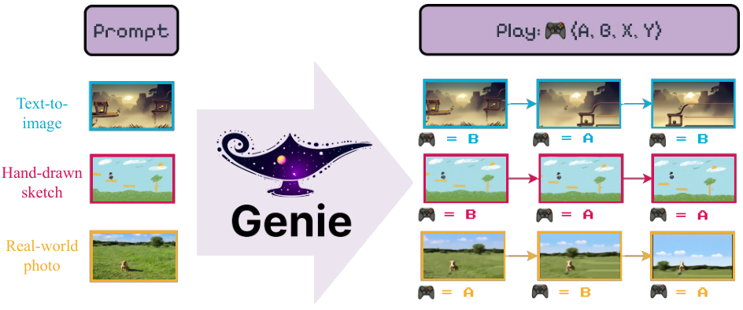

# Genie · 不同提示生成可交互世界

[顶会精选图文目录](../../../collections/top-conference-figures.md) · [总目录](../../../CATALOG.md)

**ICML 2024 · Oral · 原论文 Figure 1**

## 为什么收这张图

左侧三种输入沿统一箭头进入模型，右侧按动作展示连续变化；一张图同时回答输入是什么、输出是什么、为什么可交互。

任务概念与交互能力 teaser。

## 可以借鉴

- 输入类型用不同颜色贯穿对应输出行
- 操作标记紧邻连续帧
- 大箭头承载模型身份并组织阅读方向

## 文件与编辑范围

[主文件](source.svg) · [单图 PDF](figure.pdf) · [来源与校验记录](metadata.json)

原 PDF 的几何路径与线条保留，SVG 文字转为轮廓；照片、三维渲染与原有位图部件仍为嵌入图片。

SVG 是原论文图形的提取转换件，未取得作者原生 AI 工程。不同 PDF 阅读器或 Illustrator 对字体、透明度的导入可能有差异。

## 原始出处

- 论文：[Genie: Generative Interactive Environments](https://arxiv.org/abs/2402.15391)
- 作者：Bruce, Jake, Dennis, Michael, Edwards, Ashley, Parker-Holder, Jack, Shi, Yuge, Hughes, Edward, Lai, Matthew, Mavalankar, Aditi, Steigerwald, Richie, Apps, Chris, Aytar, Yusuf, Bechtle, Sarah, Behbahani, Feryal, Chan, Stephanie, Heess, Nicolas, Gonzalez, Lucy, Osindero, Simon, Ozair, Sherjil, Reed, Scott, Zhang, Jingwei, Zolna, Konrad, Clune, Jeff, de Freitas, Nando, Singh, Satinder, Rocktäschel, Tim
- [作者项目或代码](https://sites.google.com/view/genie2024/home)
- [会议与展示身份依据](https://icml.cc/virtual/2024/oral/35508)
- PDF 第 1 页，Figure 1；截取坐标见 metadata.json。

## 权利与修改记录

arXiv 标注的是授予 arXiv 的非独占分发许可，不是第三方图形重用许可。本条用于个人私有参考，改编或公开再用需核对原权利。

原文许可声明：https://arxiv.org/licenses/nonexclusive-distrib/1.0/

只提取、裁剪与转换原图；没有重新绘制。
