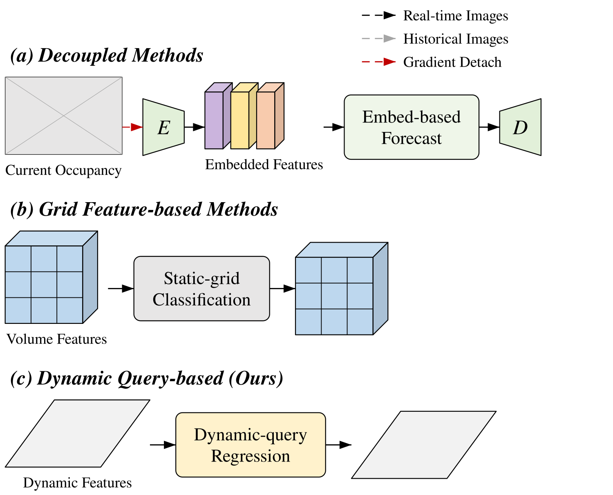

# 方法范式对比 / Method comparison

三行并列展示 Decoupled、Grid feature-based 与 Dynamic query-based 三种范式。适合把两类既有方法与本文方法的核心差异放在同一张首图中。

## 可编辑文件

- **主文件：[source.svg](source.svg)**
- [结构化元数据](metadata.json)

配套原始文件与许可：

- [`originals/teaser-comparison.yaml`](originals/teaser-comparison.yaml)
- [`LICENSE.source.txt`](LICENSE.source.txt)

## 借鉴什么

先替换三个行标题，再改每行的输入、表示与输出；保持三行对齐，用同一种颜色突出本文新增的结构。图中术语是模板内容，应按你的方法重写。

## 打开与编辑

在 Illustrator 中使用“文件 → 打开”选择 `source.svg`，按需要取消编组并另存自己的工作副本。SVG 可另外用 Inkscape 打开；AI 预览来自其 PDF 兼容层。

- 由作者 YAML 模板及公开渲染程序导出，保留文字和图形对象。
- 字体表现依赖本地字体；尚未在桌面 Illustrator 中打开验证。

## 来源

- https://github.com/ChizkiyahuOhayon/CVPR-Figure
- https://github.com/ChizkiyahuOhayon/CVPR-Figure/blob/main/templates/teaser-comparison.yaml

原始文件名：`templates/teaser-comparison.yaml`。

## 许可与使用范围

**MIT License**。许可证针对来源项目；复制或再分发其内容时保留原版权和许可声明。

## 整理时做了什么

- 由作者原始 YAML 模板使用其渲染程序导出 SVG；未修改模板内容。
- 本条目仅复制、重命名已有 SVG 和预览。

收录日期：2026-10-25。主文件与所有随附二进制文件的 SHA256 记录在 `metadata.json`。

