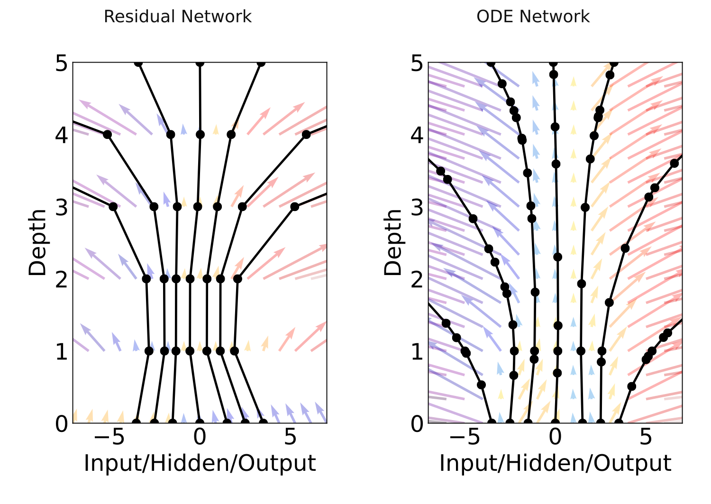

# Neural ODE Figure 1：离散层与连续动力学

真实论文 Figure 1 的两个面板：离散残差变换与连续 ODE 向量场对比。适合借鉴用轨迹、采样位置与连续场解释方法差异的方式。

## 可编辑文件

- **主文件：[source.svg](source.svg)**
- [结构化元数据](metadata.json)

配套原始文件与许可：

- [`originals/resnet_0_viz.pdf`](originals/resnet_0_viz.pdf)
- [`originals/odenet_0_viz.pdf`](originals/odenet_0_viz.pdf)

## 借鉴什么

保留左右共同的坐标和视觉尺度，让差异集中在轨迹或更新规则。可借鉴这种离散—连续对照来讲数值积分、动力学或优化过程；图内具体数学对象应按自己的方法重新绘制。

## 打开与编辑

在 Illustrator 中使用“文件 → 打开”选择 `source.svg`，按需要取消编组并另存自己的工作副本。SVG 可另外用 Inkscape 打开；AI 预览来自其 PDF 兼容层。

- 曲线、箭头与标记为矢量。
- 转换后的部分文字可能按 PDF 文本块拆分，字体依赖本地环境。
- 尚未在桌面 Illustrator 中打开验证。

## 来源

- https://arxiv.org/abs/1806.07366
- https://arxiv.org/src/1806.07366

原始文件名：`imgs/resnet_0_viz.pdf`, `imgs/odenet_0_viz.pdf`。

## 许可与使用范围

**arXiv non-exclusive distribution license**。arXiv 的非独占分发许可不是通用自由复用许可证。本条目作为私人研究与版式参考保存，不能据此推定可以自由再分发或直接复用论文图片。

## 整理时做了什么

- 从作者 arXiv 源包提取两份原始 PDF，保留未修改副本。
- 将两个 PDF 面板转换为 SVG，给内部 XML ID 加前缀避免冲突。
- 并排组合两个面板，补上原论文中的 Residual Network 和 ODE Network 标题；图内内容不变。

收录日期：2026-10-25。主文件与所有随附二进制文件的 SHA256 记录在 `metadata.json`。

