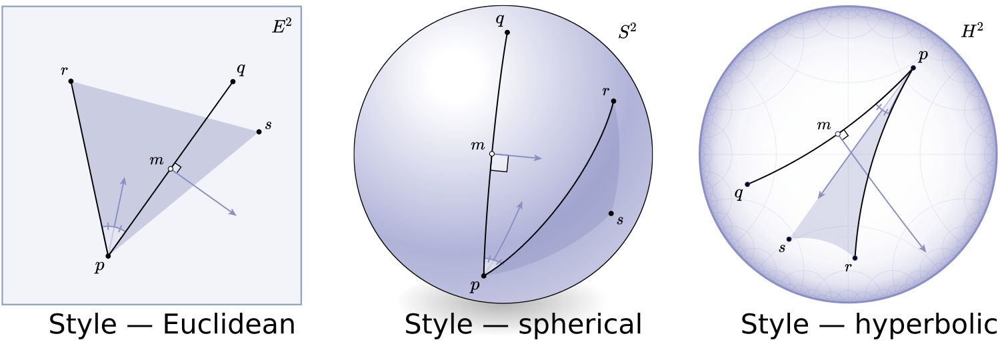

# Penrose Figure 1：三种几何的概念对照

Penrose 论文 Figure 1 右侧的三联可视化，展示欧氏、球面和双曲几何。原 Figure 1 左侧还包含语句／代码，所以本条目不是整张 Figure 1。

## 可编辑文件

- **主文件：[source.svg](source.svg)**
- [结构化元数据](metadata.json)

配套原始文件与许可：

- [`LICENSE.source.txt`](LICENSE.source.txt)

## 借鉴什么

借鉴“相同对象、不同假设”的三栏对照：保持对应实体和配色不变，让几何环境承担解释差异的任务。适合数学结构、约束或不同物理假设的概念首图。

## 打开与编辑

在 Illustrator 中使用“文件 → 打开”选择 `source.svg`，按需要取消编组并另存自己的工作副本。SVG 可另外用 Inkscape 打开；AI 预览来自其 PDF 兼容层。

- 多数形状与公式是可编辑路径；部分公式或字形已转轮廓，不再是文字对象。
- 少量底部标题仍是文字，依赖本地字体。
- 一个小型阴影 PNG 已内嵌；源 SVG 已无该外链依赖。
- 尚未在桌面 Illustrator 中打开验证。

## 来源

- https://penrose.cs.cmu.edu/siggraph20
- https://github.com/penrose/penrose
- https://raw.githubusercontent.com/penrose/penrose/main/packages/docs-site/public/media/figures/teaser.svg
- https://raw.githubusercontent.com/penrose/penrose/main/packages/docs-site/public/media/figures/B936EAED9CFC42F4.png

原始文件名：`packages/docs-site/public/media/figures/teaser.svg`, `packages/docs-site/public/media/figures/B936EAED9CFC42F4.png`。

## 许可与使用范围

**MIT License (source repository)**。来源仓库声明 MIT，已保留其许可证原文；保留项目与论文出处。

## 整理时做了什么

- 使用官方仓库的原始 SVG。
- 将同目录的 B936EAED9CFC42F4.png 内嵌为 data URI，解除外部阴影素材依赖；其余图内内容不变。
- 本条目仅复制、重命名已处理的 SVG 和预览。

收录日期：2026-10-25。主文件与所有随附二进制文件的 SHA256 记录在 `metadata.json`。

