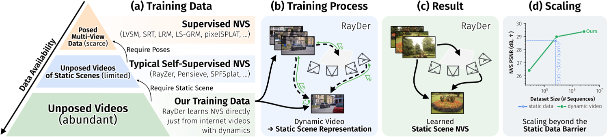

# RayDer：数据瓶颈与新训练范式

数据金字塔、训练过程、结果与规模变化并列，先说明问题和核心差异。

[作者原始 SVG](source.svg) · [来源与检查记录](metadata.json) · [原项目](https://compvis.github.io/rayder/)

## 来源与可编辑范围

来源：`CompVis/rayder` / `docs/static/images/paper-svg/teaser-concept.svg`，固定版本 `2ce3a3fbe499`。原 SVG 未重绘、未修改字节。

SVG 对象：347 个 path，0 个 text，12 个 image。有 SVG 容器不代表每个区域都是可编辑矢量；内嵌照片和渲染图保持位图，公式可能为轮廓。

保存仓库原许可证；用途限于其原有条款。

已检查预览；桌面 Illustrator 的字体与链接兼容性尚未逐项实测。
