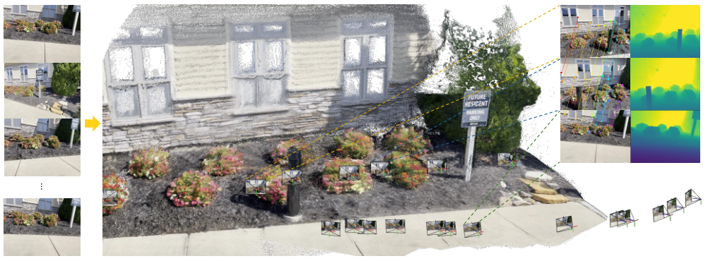

# VGGT · 多视图输入与统一三维感知能力

<!-- CATEGORY NAV -->
[Teaser](../README.md) · [Architecture](../../architectures/README.md) · [Element](../../../elements/README.md) · [总目录](../../../CATALOG.md)
<!-- END CATEGORY NAV -->

**CVPR 2025 · Oral · 原论文 Figure 1**

## 为什么收这张图

用一个大型三维场景作为视觉中心，两侧安排输入与多种输出，让读者先理解方法能做什么。

能力展示型 teaser；不是网络内部结构图。

## 可以借鉴

- 中心主视觉与两侧辅助信息的层级
- 少量输入图像串联统一三维场景
- 能力展示型 teaser 的留白与占比

## 文件与编辑范围

[主文件](source.svg) · [单图 PDF](figure.pdf) · [来源与校验记录](metadata.json)

原 PDF 的几何路径与线条保留，SVG 文字转为轮廓；照片、三维渲染与原有位图部件仍为嵌入图片。

SVG 是原论文图形的提取转换件，未取得作者原生 AI 工程。不同 PDF 阅读器或 Illustrator 对字体、透明度的导入可能有差异。

## 原始出处

- 论文：[VGGT: Visual Geometry Grounded Transformer](https://arxiv.org/abs/2503.11651)
- 作者：Wang, Jianyuan, Chen, Minghao, Karaev, Nikita, Vedaldi, Andrea, Rupprecht, Christian, Novotny, David
- [作者项目或代码](https://vgg-t.github.io/)
- [会议与展示身份依据](https://cvpr.thecvf.com/Conferences/2025/News/Awards_Press)
- PDF 第 1 页，Figure 1；截取坐标见 metadata.json。

## 权利与修改记录

arXiv 标注的是授予 arXiv 的非独占分发许可，不是第三方图形重用许可。本条用于个人私有参考，改编或公开再用需核对原权利。

原文许可声明：https://arxiv.org/licenses/nonexclusive-distrib/1.0/

只提取、裁剪与转换原图；没有重新绘制。

<!-- BEGIN FIGURE LINKS -->
## 关联范例与元素

同论文的其他图：[VGGT · 交替注意力主干与多任务输出头](../../architectures/vggt-architecture/README.md)

**可搭配的现有元素：** [相机](../../../elements/svg/tabler-camera.svg) · [图像](../../../elements/svg/tabler-photo.svg) · [三维坐标物体](../../../elements/svg/tabler-cube-3d-sphere.svg)

这些元素按表达功能关联，并非从本论文原图拆出；来源和许可仍以各元素记录为准。

[范例与元素对照表](../../../elements/with-examples.md) · [元素分类目录](../../../elements/README.md)
<!-- END FIGURE LINKS -->
