# 大图 · 多面板正文图

[仓库首页](../README.md) · [总目录](../CATALOG.md) · [Teaser](../teaser/README.md) · [Architecture](../architecture/README.md) · [Element](../element/README.md)

58 幅完整论文图，按面板之间的关系浏览。点击缩略图可查看高清图版、逐面板解读和出处。

其中 40 幅 PDF 保留可编辑的矢量路径，18 幅保留为位图参考。

[装置、过程与测量（7）](#apparatus) · [同一对象的多种证据（5）](#evidence) · [从整体到局部（6）](#scales) · [多工况与方法对照（6）](#comparisons) · [引线与局部展开（5）](#cross-panel-links) · [共用数据与坐标（10）](#linked-data) · [从模型选择读到输出（15）](#model-to-output) · [同一输入的干预对照（2）](#paired-interventions) · [按事件对齐与汇总（2）](#event-alignment)

## 装置、过程与测量

| | |
|---|---|
| <a href="ibl-behaviour-task-and-neural-recordings/README.md">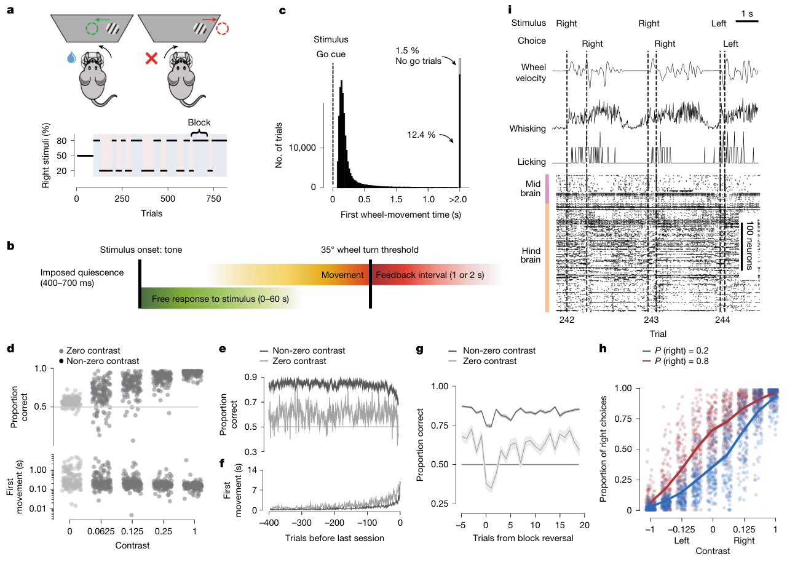</a> **[从转轮选择任务到同一试次的神经记录](ibl-behaviour-task-and-neural-recordings/README.md)** Nature 2025 · Fig. 1 · a–i · 矢量与位图混合 上半部左侧是任务装置和事件时间轴，中央是反应时，右侧的纵向长面板沿三次试验对齐行为与神经元放电。底部四组小图概括会话进程、区块切换和选择偏差。 | <a href="microfluidic-transistor-particle-dispenser/README.md">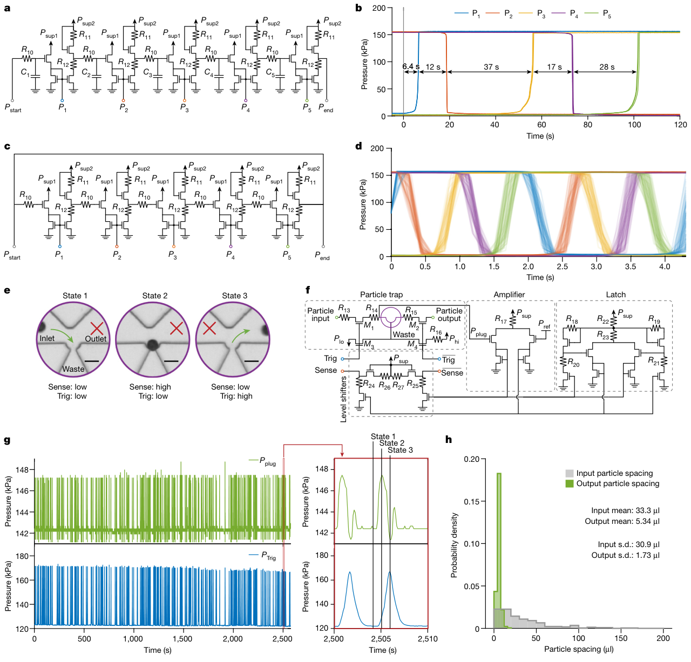</a> **[微流控晶体管如何定时、分送单颗粒](microfluidic-transistor-particle-dispenser/README.md)** Nature 2023 · Fig. 3 · a–h · 矢量与位图混合 上方两行各用左电路图、右压力曲线。第三行把颗粒阱的三个状态放在左侧，右侧展开整个分配器。末行从一次分配的时序走到粒子间距统计。 |
| <a href="electromagnetic-soft-robots-locomotion/README.md">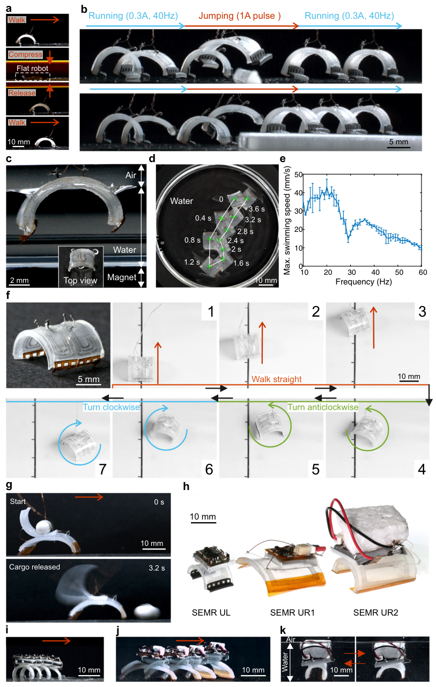</a> **[电磁软机器人的运动序列与实测速度](electromagnetic-soft-robots-locomotion/README.md)** Nature Communications 2022 · Fig. 4 · a–k · 矢量与位图混合 上层以连续摄影展示压平恢复和越障，中间并列水上装置、游动轨迹和频率响应。一条通栏编号轨迹示范转弯，下层以实物和连拍收束到无系绳原型。 | <a href="hydrogel-cap-cooling-dynamics/README.md">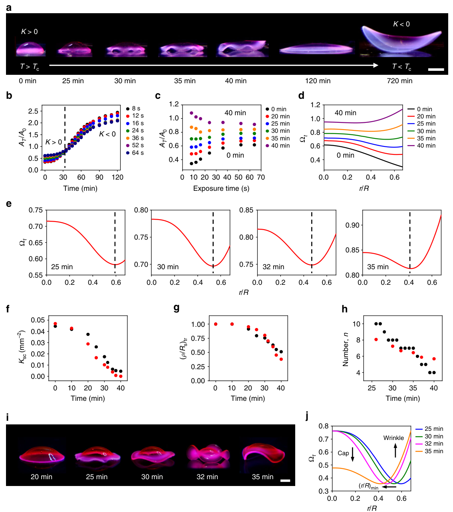</a> **[一只水凝胶球冠的冷却变形全过程](hydrogel-cap-cooling-dynamics/README.md)** Nature Communications 2018 · Fig. 5 · a–j · 矢量与位图混合 顶端用一条黑底时间序列横贯全图。中部从三张校准图过渡到分时径向曲线，再排三张理论与实验对照。末行回到实物复现及其设计曲线。 |
| <a href="metaai-tunable-metasurface-prototype/README.md">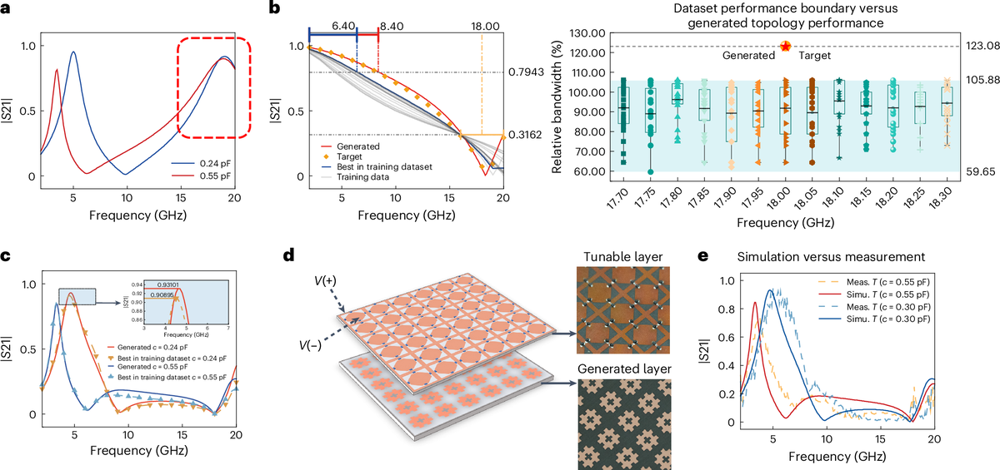</a> **[MetaAI · 可调器件的两层结构、样品与透射测量](metaai-tunable-metasurface-prototype/README.md)** Nature Machine Intelligence 2026 · Fig. 4 · a–e · 位图参考 d 的两根引线把分层装配图连到可调层和生成层的样品照片。沿着组装后的器件读到 e，两种电容设置下都叠放了模拟与实测透射曲线。 | <a href="origami-exoskeleton-module-to-arm/README.md">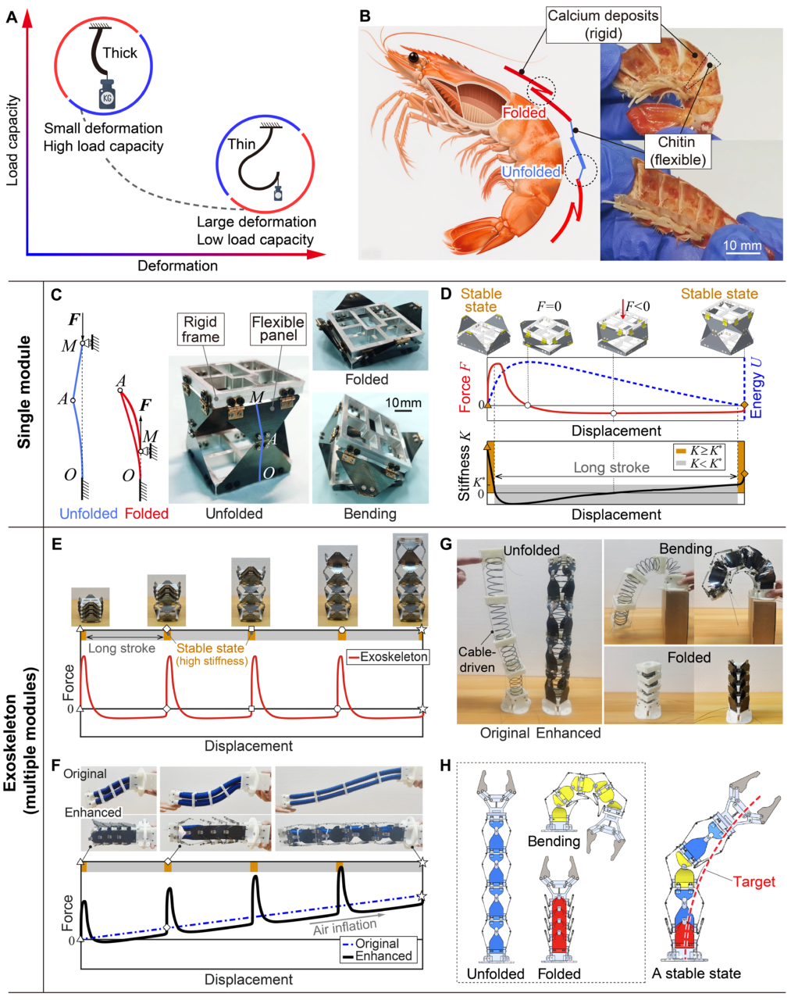</a> **[从虾壳分节到承力折纸机械臂](origami-exoskeleton-module-to-arm/README.md)** Science Advances 2025 · Fig. 1 · A–H · 位图参考 首行并列变形与承重的矛盾、虾体硬柔分节。下方以“单模块”和“多模块外骨骼”分区：构型照片贴近力学曲线，右下角用机械臂姿态收束。 |
| <a href="waffle-solar-distiller-thermal-sequence/README.md">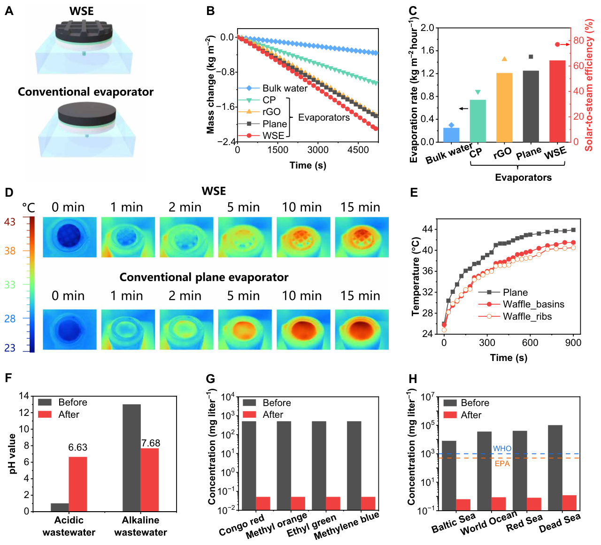</a> **[同一束光下比较两种海水蒸发器](waffle-solar-distiller-thermal-sequence/README.md)** Science Advances 2024 · Fig. 3 · A–H · 矢量与位图混合 首行并列结构示意、质量变化和效率。中央用两行同刻热像对比华夫形与平面蒸发器，右侧给温升曲线。底部以三种水质读数收尾。 |  |

## 同一对象的多种证据

| | |
|---|---|
|  **[从无刺激步行连拍到康复评估](brain-spine-rehabilitation-without-stimulation/README.md)** Nature 2023 · Fig. 4 · a–h · 矢量与位图混合 顶部三组连拍把同一位参与者的临床阶段并置。横跨整行的时间轴标明干预。中间把屈髋照片、肌电和身体分布图配成组，底部横排四类结局评估。 |  **[从视觉皮层活动解码电影帧](cebra-natural-movie-decoding/README.md)** Nature 2023 · Fig. 5 · a–h · 矢量与位图混合 上排 a–c 从解码流程、成对电影帧过渡到准确率曲线。下排 d–h 依次放场景识别、帧号对照、误差以及脑区与层别比较。 |
|  **[把同一网格细胞放回物理空间和环面](grid-cell-toroidal-coordinates/README.md)** Nature 2022 · Fig. 2 · a–g · 矢量与位图混合 左上用环面及其二维展开解释坐标，中上用多行细胞热图对照环境，右列放信息量与模型拟合。左下和中下以连线图、累积分布检验位置稳定性。 | <a href="metaai-multilayer-transmission-absorption/README.md">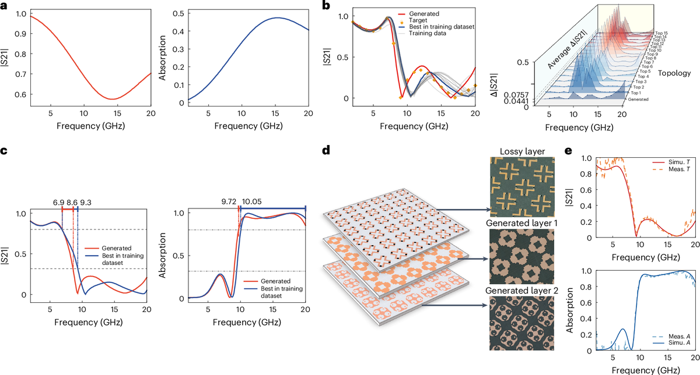</a> **[MetaAI · 三层样品的透射与吸收双重验证](metaai-multilayer-transmission-absorption/README.md)** Nature Machine Intelligence 2026 · Fig. 5 · a–e · 位图参考 d 的三根引线逐一对应损耗层、第一生成层和第二生成层的实物纹样。e 在两个相同频率范围的坐标系中分别核对整件样品的透射与吸收。 |
| <a href="ibl-mouse-prior-cross-lab-replication/README.md">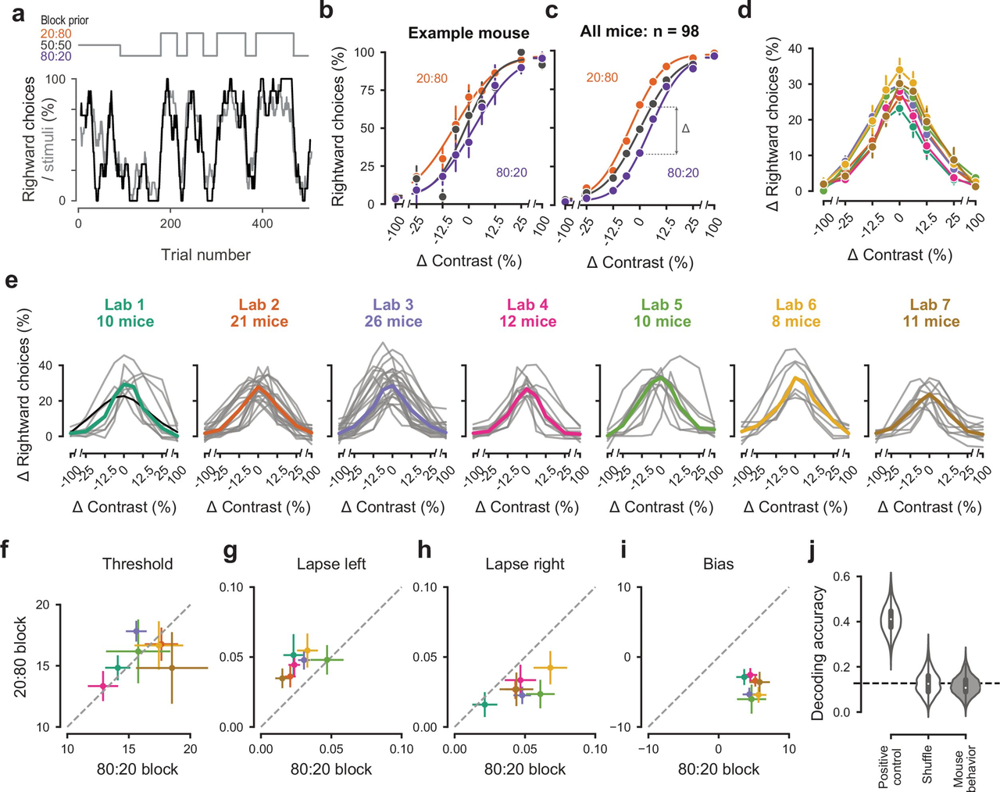</a> **[从一只小鼠的先验偏差到跨实验室复核](ibl-mouse-prior-cross-lab-replication/README.md)** eLife 2021 · Fig. 4 · a–j · 位图参考 第一行从单只小鼠的连续选择过渡到区块间的偏移定义和汇总。中间七个实验室各占一格、共用坐标。最下排比较心理物理参数，并以分类结果检查实验室差异。 |  |

## 从整体到局部

| | |
|---|---|
| <a href="mattergen-chemical-space-crystals/README.md">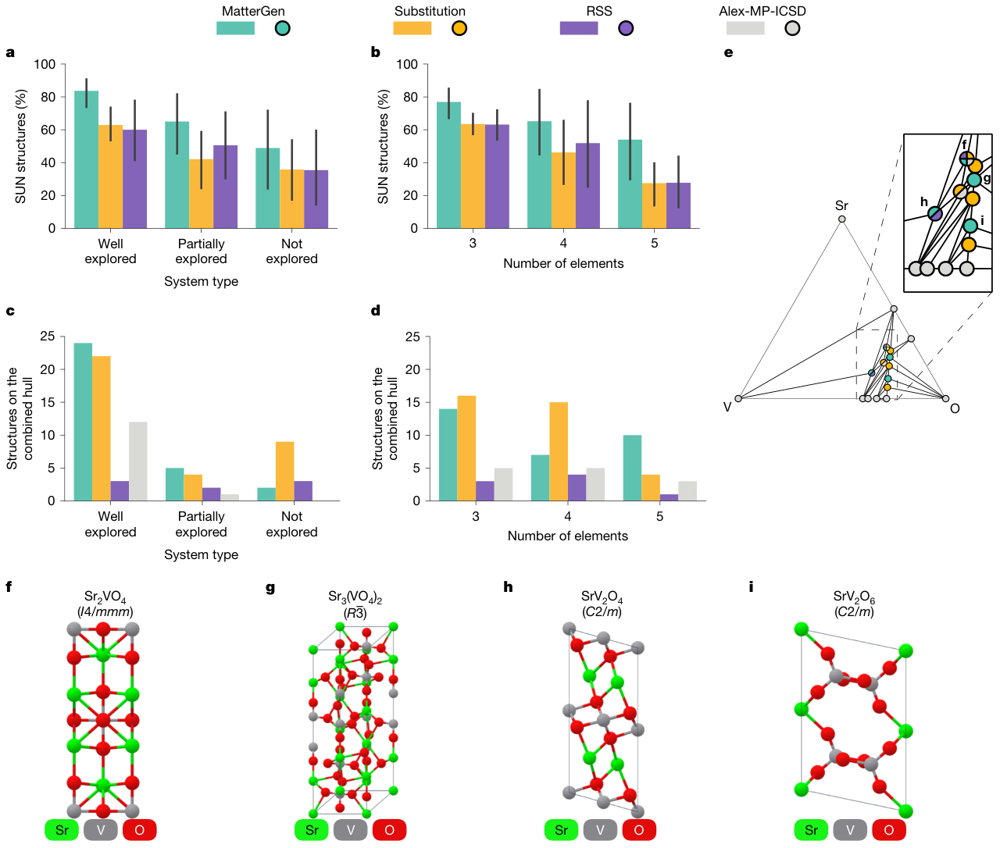</a> **[MatterGen · 从目标化学空间读到四个具体晶体](mattergen-chemical-space-crystals/README.md)** Nature 2025 · Fig. 3 · a–i · 矢量与位图混合 左上为两行两列统计图，右上用跨两行的三元相图与局部放大框呈现个案。底行四个晶体结构并排，图中字母与放大框中的点相互索引。 |  **[从单个锥体细胞追到突触靶点和功能响应](microns-single-cell-structural-functional/README.md)** Nature 2025 · Fig. 6 · a–k · 矢量与位图混合 顶端两行沿同一组织方向重复细胞分布图。中段左侧展开单细胞及靶点，中央汇总连接去向，右侧竖排电镜与双光子图。底部热图回到视觉刺激。 |
| <a href="gnome-discovery-loop-and-validation/README.md">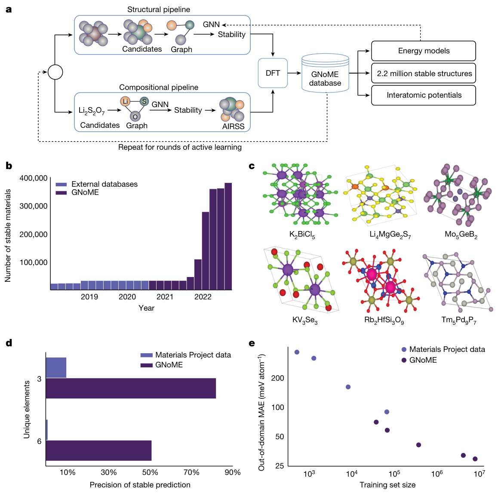</a> **[GNoME · 筛选闭环、发现规模与晶体实例](gnome-discovery-loop-and-validation/README.md)** Nature 2023 · Fig. 1 · a–e · 矢量与位图混合 第一行通栏画两条候选生成支路和筛选反馈。下方两行各分两栏。中行右栏在一个字母内嵌入六个已验证结构，与左边发现数量的时间轴对照。 | <a href="perovskite-depth-composition/README.md">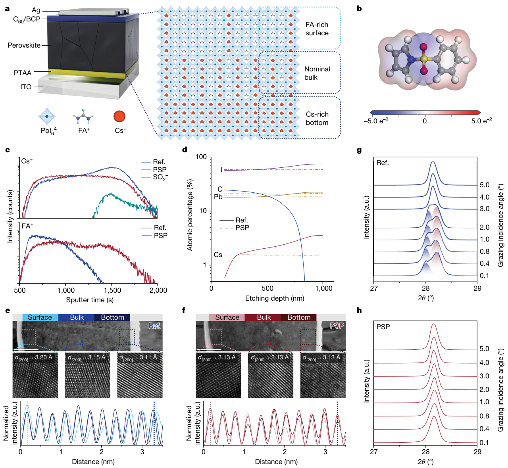</a> **[沿薄膜深度追踪钙钛矿的成分偏析](perovskite-depth-composition/README.md)** Nature 2023 · Fig. 1 · a–h · 矢量与位图混合 上部放器件剖面、晶格示意与处理分子。中左两列排深度剖面，下方并排参考膜与处理膜的三个取样深度。右列上下对齐两组衍射谱。 |
| <a href="north-greenland-ice-shelf-change/README.md">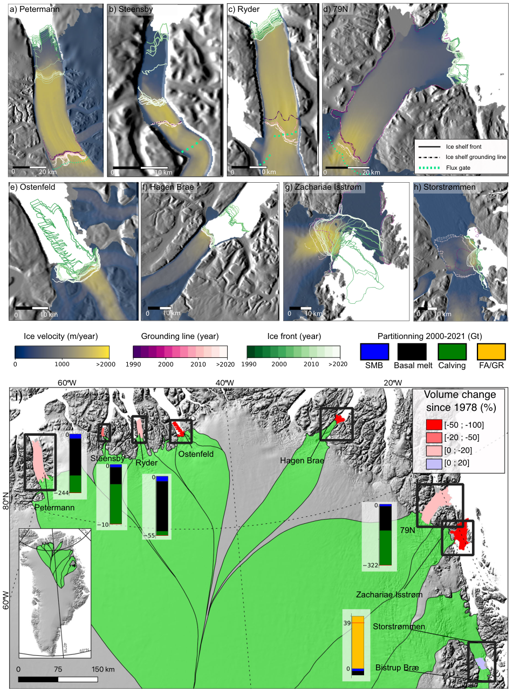</a> **[把八座冰架的退缩放回同一幅区域地图](north-greenland-ice-shelf-change/README.md)** Nature Communications 2023 · Fig. 1 · a–i · 矢量与位图混合 上方两排八个局部地图按冰架分格，共用其下方一整行色标。下方一幅区域图标出其位置、体积变化以及各处的质量收支柱状图。 | <a href="larval-brain-connectome-reconstruction/README.md">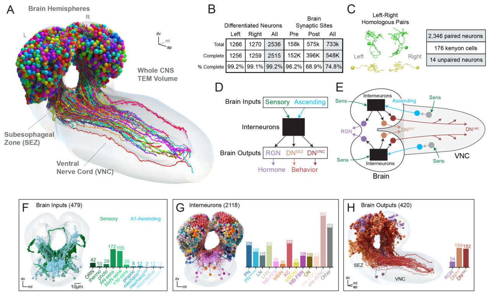</a> **[果蝇幼虫全脑重建与三类神经元](larval-brain-connectome-reconstruction/README.md)** Science 2023 · Fig. 1 · A–H · 位图参考 左上用整幅彩色神经重建定位全脑。右上四格把重建完整度、左右配对与通路关系排成两层。底行三张同构的「神经元形态＋计数柱图」并排，可沿同一视角比较。 |

## 多工况与方法对照

| | |
|---|---|
| <a href="dalle-contrastive-reranking-contact-sheet/README.md">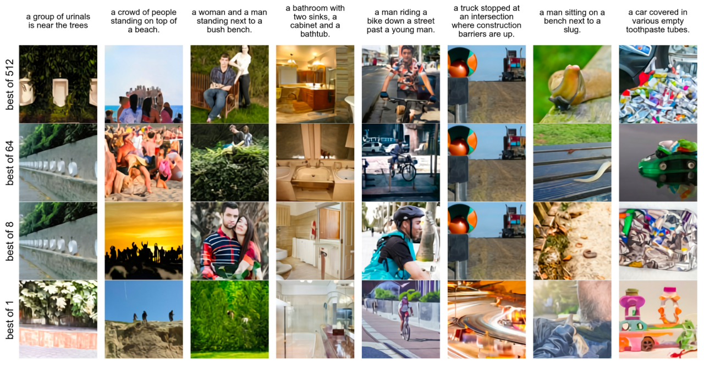</a> **[DALL·E · 八条提示词与四种候选池大小](dalle-contrastive-reranking-contact-sheet/README.md)** ICML 2021 · Fig. 6 · 原图无字母；8 列 × 4 行 · 位图参考 每列上方写一条 MS-COCO 提示词，下方沿同一列排四幅生成图。行名是 best of 512、64、8、1。共 32 个图像单元，论文没有逐格编字母。原文将整幅图嵌为 3364 × 1753 像素位图。 |  **[GNS · 五组消融、同场景预测与跨材料误差](gns-ablation-and-boxbath-rollouts/README.md)** ICML 2020 · Fig. 4 · a–m · 矢量与位图混合 左侧五列消融各用上下两张柱图，共用横轴。右上给同一 BoxBath 场景的两幅模拟快照，右下为不同材料的误差总图。原图包含可编辑的曲线轴标与柱形，两张模拟快照为嵌入图像。 |
|  **[NeuralGCM · 四种预报指标与全球误差地图](neuralgcm-weather-skill-and-maps/README.md)** Nature 2024 · Fig. 2 · a–h · 矢量与位图混合 四行分别对应四种指标。每行左侧用三幅并列折线比较大气变量，右侧用两张同投影地图比较模型，并在行末放对应色标。 |  **[TCV · 四种等离子体构型的控制轨迹](tcv-plasma-control-demonstrations/README.md)** Nature 2022 · Fig. 3 · a–d · 矢量 四组放电实验占据两行两列。每组上方横排等离子体截面的时间快照，下方的测量或目标轨迹共用时间方向，便于在形状和数值之间切换。 |
|  **[用上下两排一一配对干涉图样和光子数统计](plasmon-interference-photon-number/README.md)** Nature Communications 2021 · Fig. 2 · a–h · 位图参考 两行四列以实验条件为列。每个上格放远场空间强度剖面、小幅强度图和偏振／狭缝示意。对应的下格放光子数概率分布和二阶相关值。 |  **[Cellpose 2.0 · 两套数据上的分割质量与标注预算](cellpose-human-loop-annotation-budget/README.md)** Nature Methods 2022 · Fig. 5 · a–j · 矢量与位图混合 上下两组分别对应 TissueNet 和 LiveCell。每组先并排四幅同一图像的分割结果，下一行以一幅人工复标图加三幅定量曲线收束。 |

## 引线与局部展开

| | |
|---|---|
|  **[水凝胶传感器 · 身体测点连到电压曲线](hydrogel-motion-sensor-body-readouts/README.md)** Chinese Journal of Polymer Science 2026 · Fig. 9 · a–g · 矢量与位图混合 中央跑步者身上的四个贴片各有一条引线。循着膝部贴片读到 d，照片给出弯膝动作，曲线给出膝关节反复弯曲时的电压响应。 |  **[KAN · 从网络的一条边展开样条函数](kan-edge-spline-grid-extension/README.md)** ICLR 2025 · Fig. 2.2 · 原图无字母 · 网络与函数局部 · 位图参考 小函数图直接画在边上。选中的一条边用虚线圈出，跨图引线把它接到右侧，展示同一函数在粗、细网格上的样条表示。 |
| <a href="flock-obstacle-time-and-formation/README.md">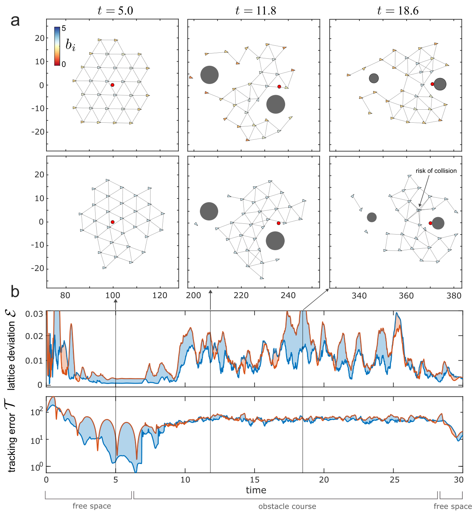</a> **[集群避障 · 从误差发生的时刻追到队形](flock-obstacle-time-and-formation/README.md)** Nature Communications 2025 · Fig. 7 · a、b · 矢量与位图混合 b 的两排时间曲线选出三个时刻，引线接到 a 的三列队形。对照同一时刻的两种队形，可以定位碰撞风险出现在哪里。 | <a href="perturbome-morphospace-exemplars/README.md">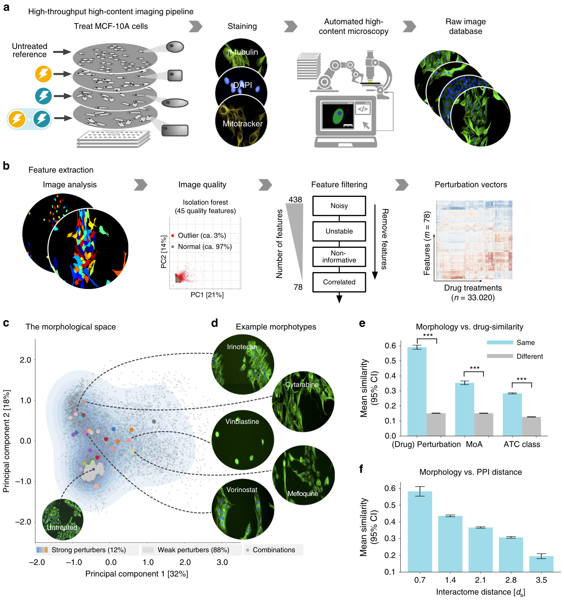</a> **[细胞形态空间 · 从统计点找到显微图像](perturbome-morphospace-exemplars/README.md)** Nature Communications 2019 · Fig. 3 · a–f · 矢量与位图混合 c 将处理条件压缩到二维形态空间，跨面板虚线把代表点连到 d 的细胞图像。点云中的差异由此可以回到具体形态上辨认。 |
| <a href="graphene-respiration-monitor-screen/README.md">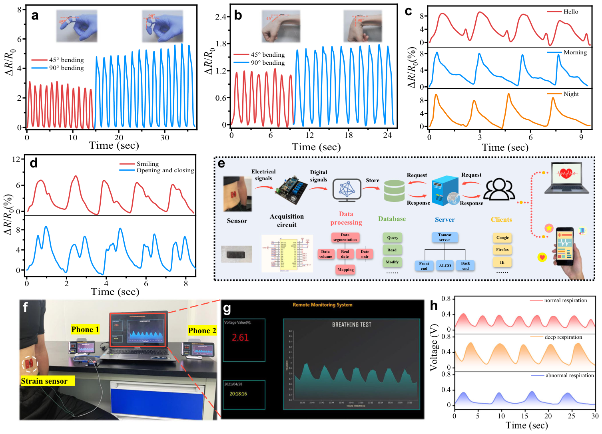</a> **[呼吸监测 · 从实验台的屏幕读到实时波形](graphene-respiration-monitor-screen/README.md)** npj Flexible Electronics 2022 · Fig. 5 · a–h · 矢量与位图混合 f 的笔记本屏幕被红框圈出，两条虚线接到 g 的显示界面。读者能在装置照片中找到信号来源，又能在旁边看清波形。 |  |

## 共用数据与坐标

| | |
|---|---|
|  **[UpSetR · 同一列连起集合组合、计数与属性](upsetr-intersection-and-attributes/README.md)** Bioinformatics 2017 · Fig. 1 · 原图无字母 · 按五个功能区阅读 · 矢量与位图混合 点阵的一列定义一个集合交集。沿列向上读其计数，再沿颜色去找下方对应的属性热图，可以一直追踪同一批变异。 | <a href="microchannel-flow-field-and-profiles/README.md">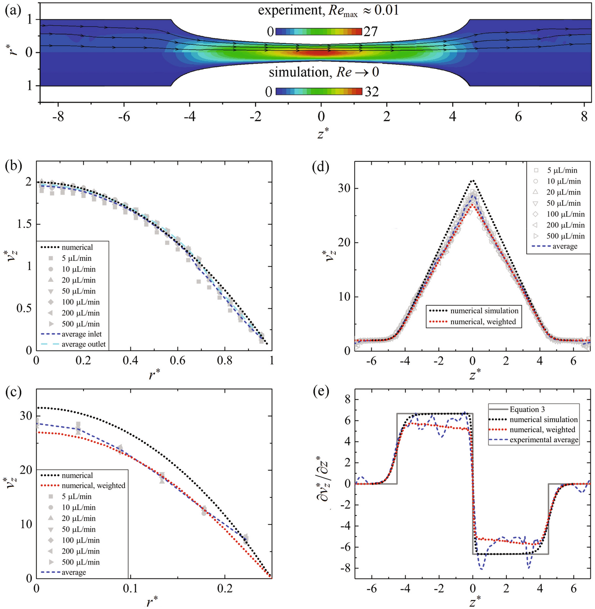</a> **[收缩微通道 · 从二维速度场取剖面和导数](microchannel-flow-field-and-profiles/README.md)** Experiments in Fluids 2020 · Fig. 8 · a–e · 位图参考 a 把实验与仿真放进同一通道轮廓。d 从中心轴取出速度，e 再对轴向位置求导，将二维图中的加速与减速变成可读的曲线。 |
|  **[快速射电暴 · 时频图和两侧投影共用坐标](frb-dynamic-spectrum-projections/README.md)** Nature Astronomy 2024 · Fig. 2 · a–l · 矢量与位图混合 每次暴发占一列。热图上方是沿频率平均的时间波形，彩条选中的时间窗又决定右侧频谱使用哪些数据。 |  **[克隆演化 · 谱系树的末端接到五次采样](aml-clonal-lineage-and-sampling/README.md)** Nature Communications 2020 · Fig. 7 · 原图无字母 · 谱系、采样与推断 · 矢量与位图混合 左侧分支接到下方气泡矩阵的一行，每列对应一次采样。上方同色面积带表示由离散观测推断的克隆比例随时间变化。 |
| <a href="bubble-coalescence-rescaled-time/README.md">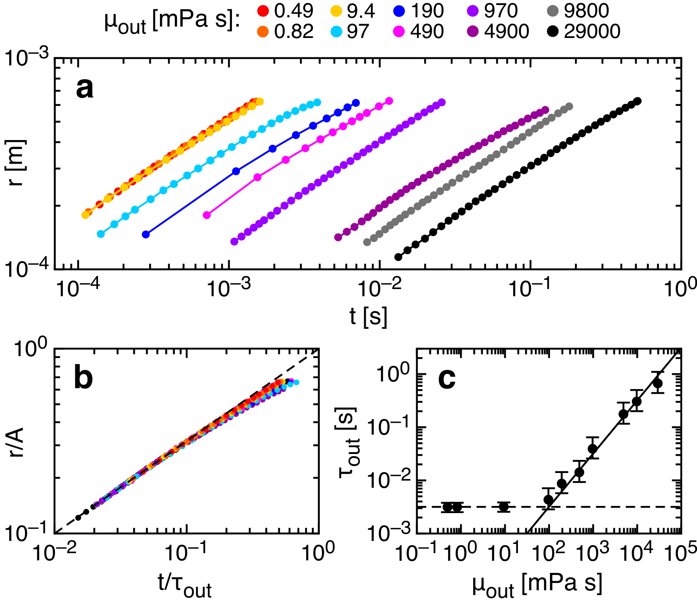</a> **[气泡合并 · 拟合出来的时间尺度成为下一幅图的纵轴](bubble-coalescence-rescaled-time/README.md)** Nature Communications 2014 · Fig. 2 · a–c · 矢量 a 中不同黏度的数据原本分开。b 用各组各自的时间尺度把它们叠到一条曲线上，c 再拿这些拟合出的时间尺度作图。 | <a href="metaai-single-layer-current-and-spectrum/README.md">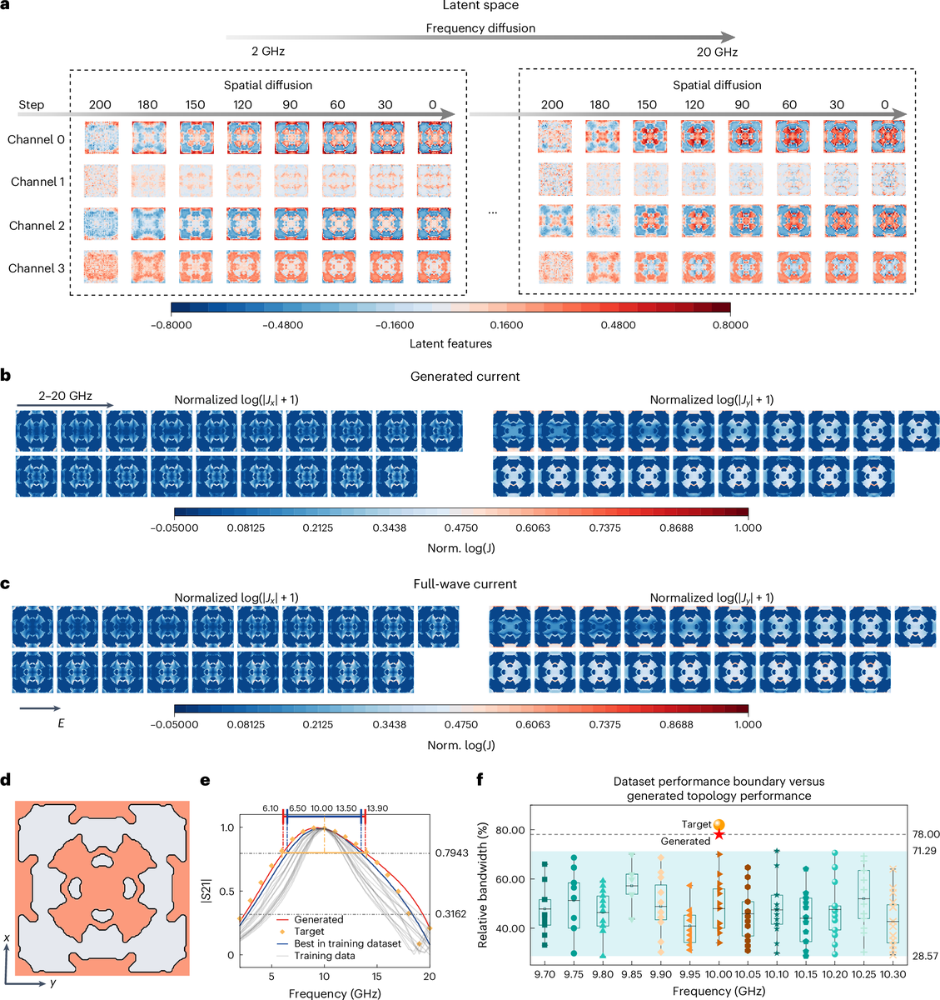</a> **[MetaAI · 从单层拓扑核对生成电流与全波仿真](metaai-single-layer-current-and-spectrum/README.md)** Nature Machine Intelligence 2026 · Fig. 3 · a–f · 位图参考 b、c 以相同频率顺序分别排出生成电流和全波仿真电流。选定一个频点和分量，就能在上下两排直接核对同一结构的空间分布，再到 e 看整个频段的透射响应。 |
| <a href="estimation-plot-aligned-difference/README.md">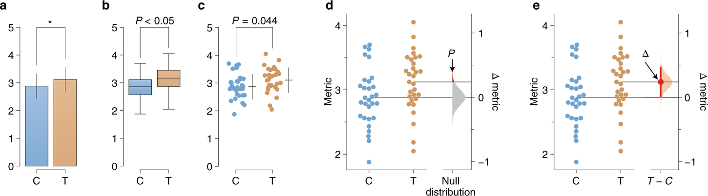</a> **[估计图 · 左侧对照均值就是右侧差值零点](estimation-plot-aligned-difference/README.md)** Nature Methods 2019 · Fig. 1 · a–e · 位图参考 e 把右侧差值轴的零点放在左侧对照组均值的高度，处理组均值对应右侧的差值点。左右两边用同一段垂直距离表达组间差异。 |  **[GW150914 · 实测与模型相减得到下一行残差](gw150914-strain-reconstruction-residuals/README.md)** Physical Review Letters 2016 · Fig. 1 · 原图无字母 · 两列各四行 · 矢量与位图混合 每个探测器占一列，记录、模型、残差与时频图沿同一时间轴展开。第三行的每个点都能回到前两行，核对同一时刻相减的两个值。 |
|  **[欧洲电网 · 沿交换带读到地区总量和份额](european-power-exchange-chords/README.md)** Renewable Energy 2019 · Fig. 18 · 原图无字母 · 三层同心视图 · 位图参考 弦带连接一对电力交换地区，带宽表示电量。顺着端点读到同一地区的弧段，能在同一角位置读取 TWh 刻度和外层百分比。 | <a href="fly-behavior-map-transition-matrix/README.md">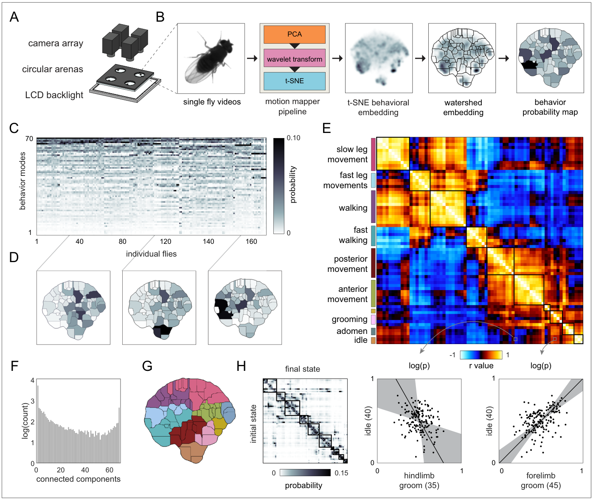</a> **[果蝇行为图谱 · 从个体列追到行为地图与转移矩阵](fly-behavior-map-transition-matrix/README.md)** eLife 2021 · Fig. 2 · A–H · 矢量与位图混合 C 为每只果蝇保留一列，三根引线把选中的列接到 D 中各自的行为概率地图。E、G、H 又把同一套行为分组带到相关矩阵、二维地图和相邻帧转移矩阵中。 |

## 从模型选择读到输出

| | |
|---|---|
| <a href="wgan-perception-distortion-digit-outputs/README.md">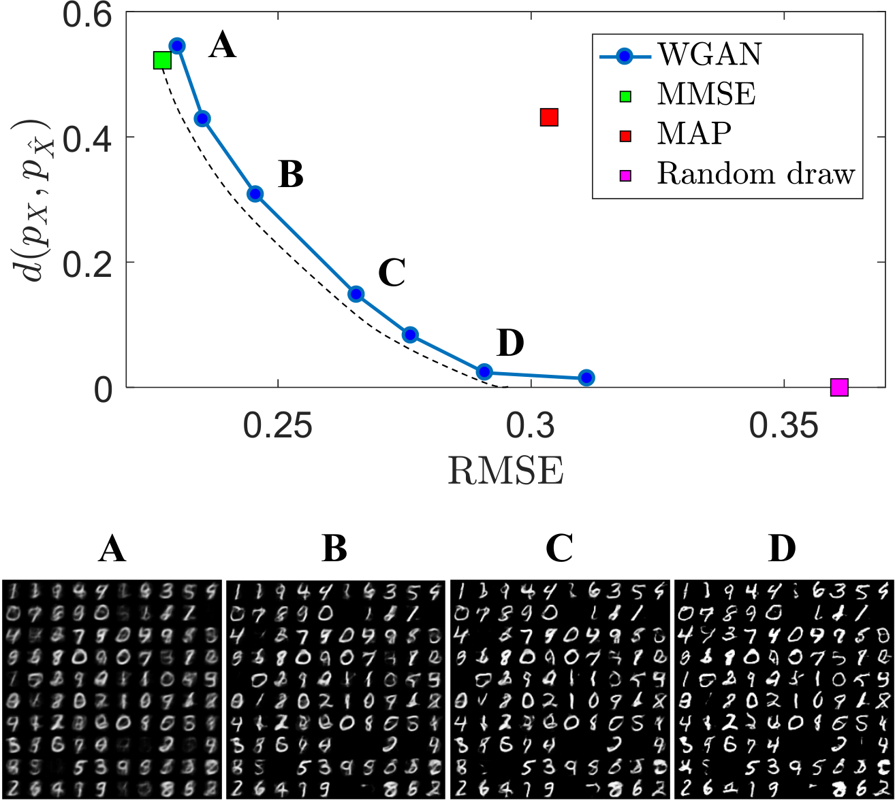</a> **[手写数字去噪 · 从权衡曲线上的 A–D 读到四组输出](wgan-perception-distortion-digit-outputs/README.md)** CVPR 2018 · Fig. 6 · 权衡图与 A–D 四组去噪结果 · 矢量与位图混合 蓝色折线连接以不同损失权重训练的去噪器。A–D 同时标在模型点和下方数字图组上，沿一个字母就能看到该模型输出的笔画。 | <a href="lorenz-pareto-coefficients-and-trajectories/README.md">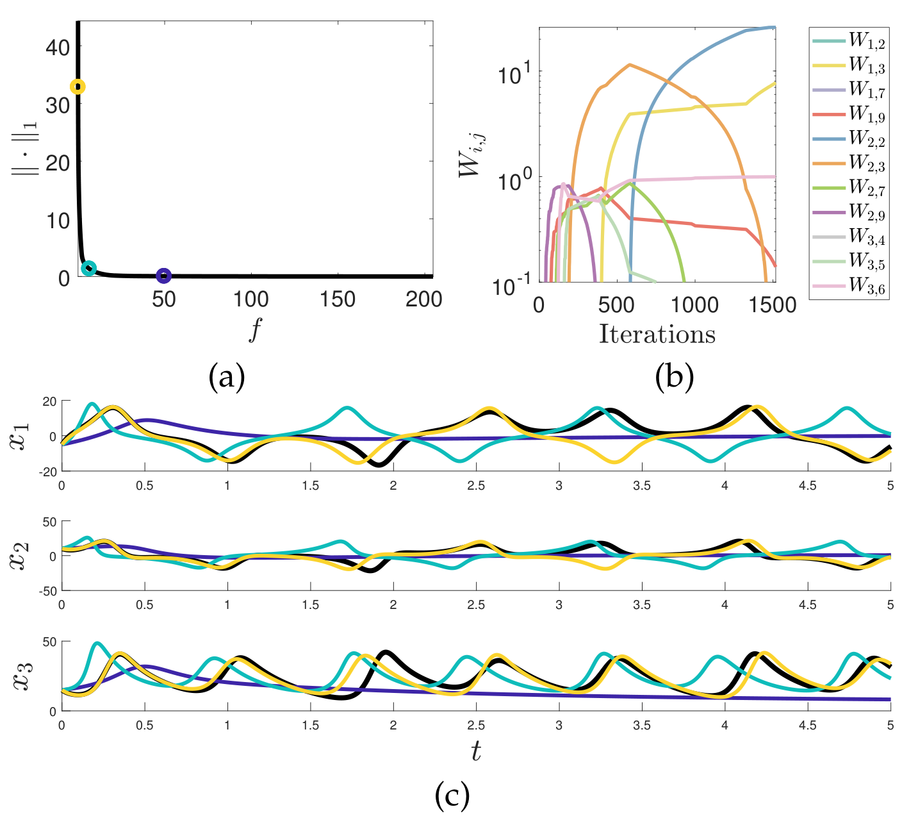</a> **[Lorenz 系统 · 从帕累托选择读到系数与三条状态轨迹](lorenz-pareto-coefficients-and-trajectories/README.md)** IEEE Transactions on Pattern Analysis and Machine Intelligence 2022 · Fig. 6 · a–c · 矢量 a 标出三个候选解，c 用相同颜色画每个解在三个状态分量上的预测；b 补出沿前沿推进时保留下来的系数。黄色点在未见数据上的轨迹比青色拐点更贴近黑色参考。 |
| <a href="ly-symbolic-pareto-polynomial-fits/README.md">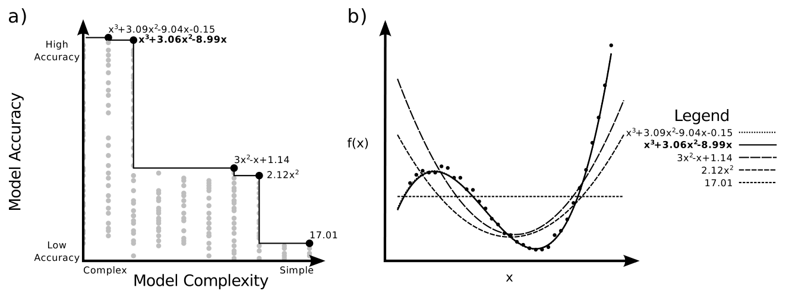</a> **[多项式选模 · 沿同一个公式从前沿读到拟合曲线](ly-symbolic-pareto-polynomial-fits/README.md)** Journal of Machine Learning Research 2012 · Fig. 5 · a、b · 矢量 a 把候选多项式写在帕累托阶梯的各个黑点旁。b 用相同公式作图例，把每个候选的拟合曲线叠在同一组样本上；可直接追踪加粗的三次式，也可以跟踪最简单的常数项。 | <a href="greco-flexoelectric-front-potential-fields/README.md">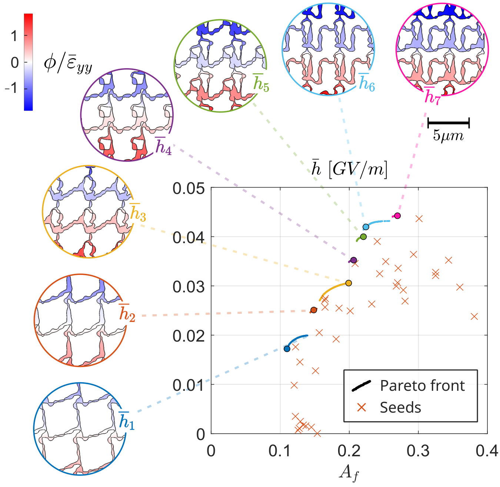</a> **[挠曲电应变传感器 · 七个前沿点各自连到结构和电势场](greco-flexoelectric-front-potential-fields/README.md)** Journal of the Mechanics and Physics of Solids 2024 · Fig. 6 · 右下前沿图与七个带编号的圆形局部图（h̄₁ 至 h̄₇） · 矢量与位图混合 右下绘出材料面积分数与等效压电系数的权衡。每个选中点都有一根同色虚线，沿线可找到该设计的周期微结构和施加应变时的电势分布。 |
| <a href="fox-symbolic-regression-pareto-isotherms/README.md">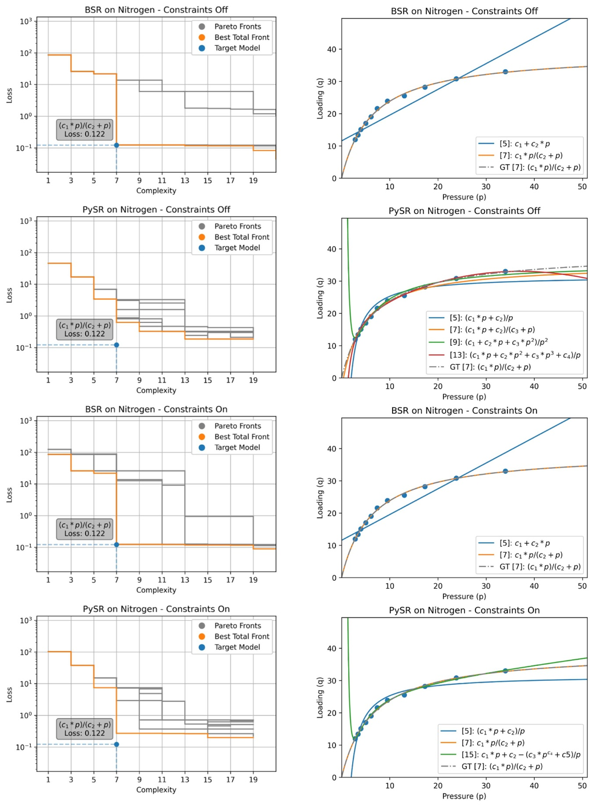</a> **[符号回归 · 从帕累托拐点读到拟合曲线](fox-symbolic-regression-pareto-isotherms/README.md)** Machine Learning: Science and Technology 2024 · Fig. 5 · 四行 × 两列（图内无字母） · 位图参考 左列给出表达式复杂度与损失，右列把前沿上选出的表达式画回同一批氮吸附数据。图例中的复杂度编号把帕累托点、公式和预测曲线对应起来。 | <a href="sym-eft-length50-spectrum-and-error/README.md">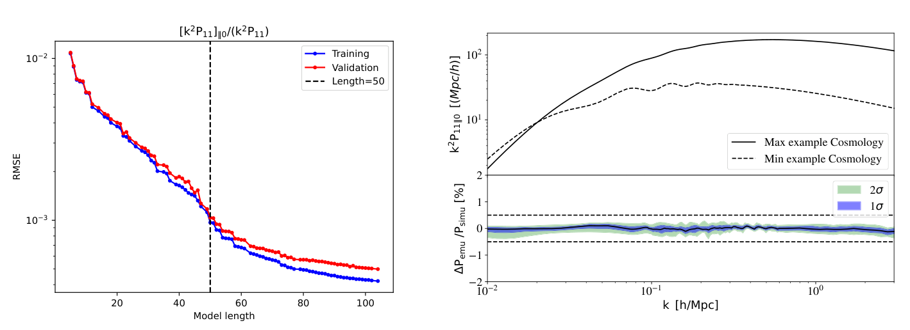</a> **[Sym-EFT · 从长度 50 的候选式检验功率谱分量的模拟误差](sym-eft-length50-spectrum-and-error/README.md)** Monthly Notices of the Royal Astronomical Society 2026 · Fig. 4 · 左侧误差前沿、右上谱分量、右下误差带 · 矢量 左图用一条竖虚线选定长度 50 的符号表达式。右上给出两个宇宙学参数例子下待拟合的功率谱分量，右下用同一波数轴展示该表达式在 300 组参数下的相对误差。 |
| <a href="jenkins-metasurface-masks-robustness/README.md">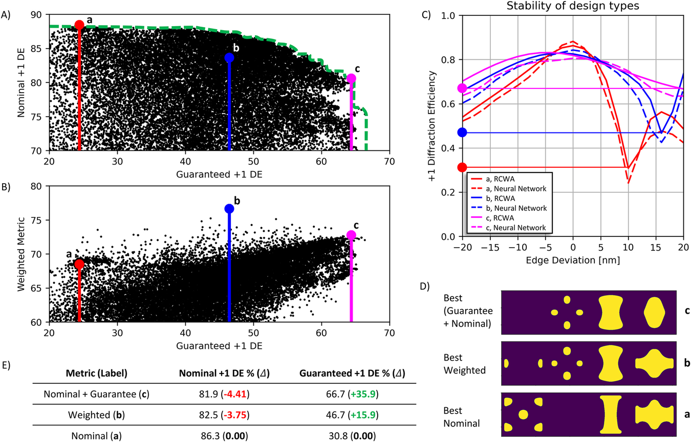</a> **[超表面制造偏差 · 从前沿设计追到掩模与衍射效率曲线](jenkins-metasurface-masks-robustness/README.md)** Nanophotonics 2021 · Fig. 4 · A–E，设计编号为小写 a、b、c · 位图参考 A 标出三种选择，D 展示各自的超胞几何掩模，C 给出边缘偏差从 −20 到 +20 nm 时网络预测与电磁求解器计算的衍射效率，E 汇总标称和保证效率。 | <a href="multi-ion-pareto-committor/README.md">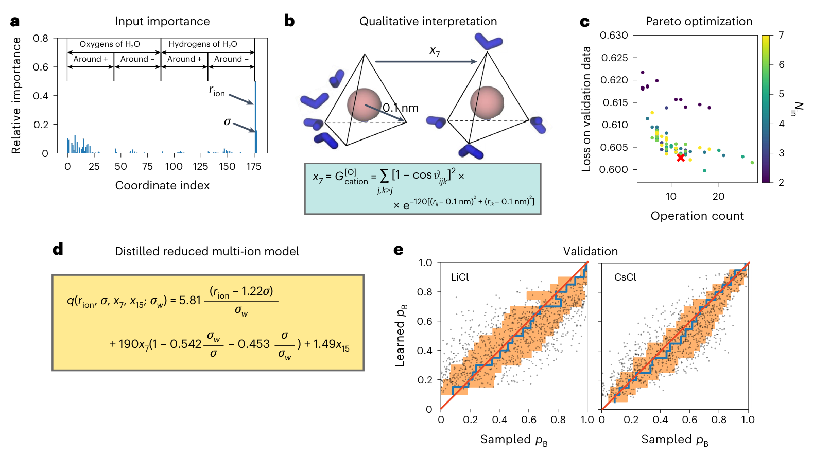</a> **[离子配对 · 从前沿红叉追到解析式与采样验证](multi-ion-pareto-committor/README.md)** Nature Computational Science 2023 · Fig. 2 · a–e · 矢量与位图混合 c 的红叉选定一个模型，d 把它写成显式函数，b 说明函数里的水分子几何量 x₇。e 将该模型对 LiCl、CsCl 的到达概率预测与独立轨迹采样并排核对。 |
| <a href="nanoantennas-pareto-geometry-and-measured-spectra/README.md">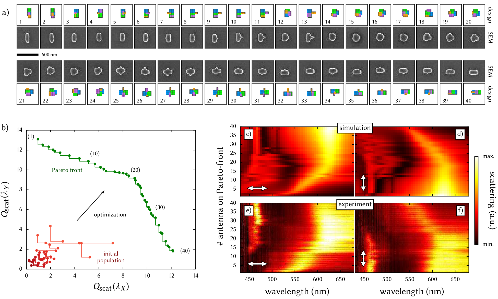</a> **[硅纳米天线 · 从前沿上的编号追到几何、模拟谱与实测谱](nanoantennas-pareto-geometry-and-measured-spectra/README.md)** Nature Nanotechnology 2017 · Fig. 3 · a–f · 矢量与位图混合 同一套 1–40 的天线编号标在 b 的前沿、a 的几何与实物显微图，以及 c–f 四幅散射谱的纵轴上。选一个编号，就能读到该器件在两个偏振方向上的模拟和实测输出。 | <a href="neural-code-rate-acoustic-frequency-thresholds/README.md">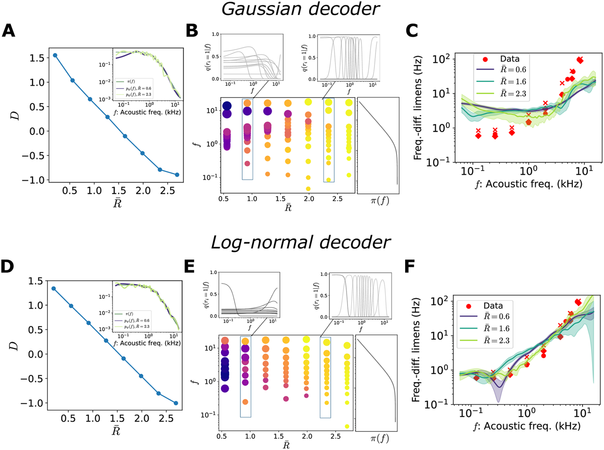</a> **[听觉编码 · 从一个编码率读到调谐函数和频率辨别阈](neural-code-rate-acoustic-frequency-thresholds/README.md)** PLOS Computational Biology 2024 · Fig. 9 · A–F，上排高斯解码器，下排对数正态解码器 · 位图参考 每排从率–失真曲线出发，中列放大所选编码率下的神经元调谐函数，右列把模型预测的频率辨别阈与三位受试者的实测值叠在同一坐标系。 |
| <a href="sindy-lorenz-active-terms/README.md">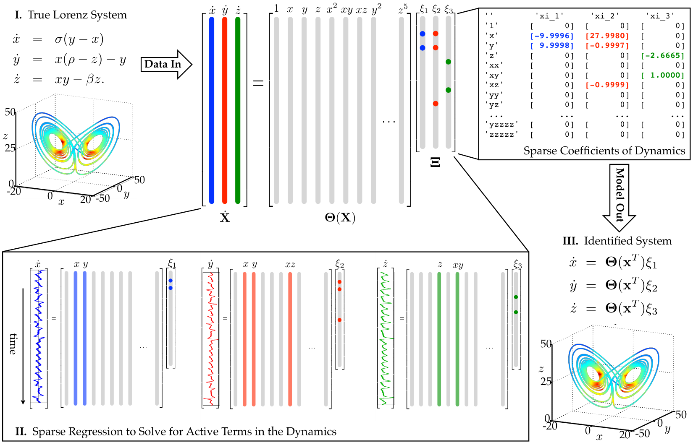</a> **[SINDy · 从稀疏系数读回方程和轨迹](sindy-lorenz-active-terms/README.md)** PNAS 2016 · Fig. 1 · I–III（含系数表和分项展开） · 矢量与位图混合 沿蓝色的 x 导数读下去，候选项只剩 x 和 y。右上表中对应的两个非零系数决定右侧方程，方程再生成右下的轨迹。 | <a href="feml-conductivity-pareto-inset/README.md">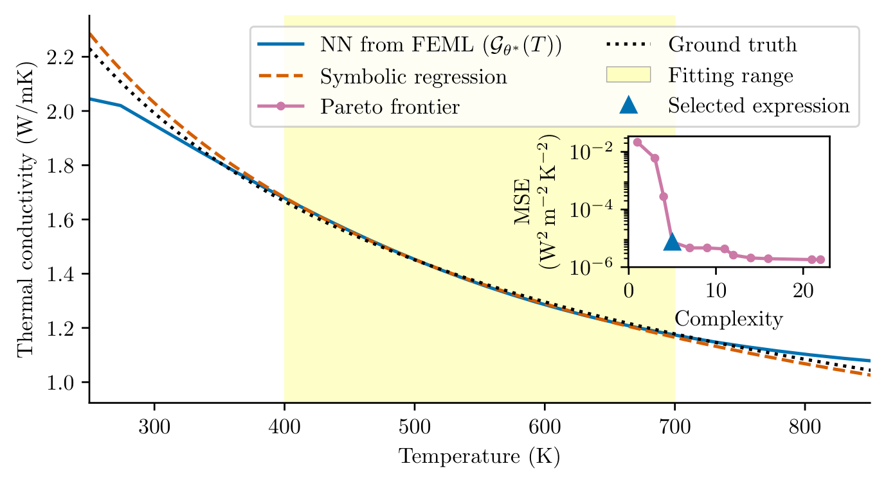</a> **[FEML 热导率 · 从复杂度 5 的拐点读到温度区间外的预测](feml-conductivity-pareto-inset/README.md)** Scientific Reports 2026 · Fig. 18 · 主图与右上插图（无字母编号） · 矢量 插图用蓝色三角锁定复杂度 5 的候选式。主图把它求值成橙色虚线，并与有限元学习得到的蓝线和真值点线一起延伸到拟合温度区间之外。 |
| <a href="metamaterial-pareto-unit-cell-frequency-response/README.md">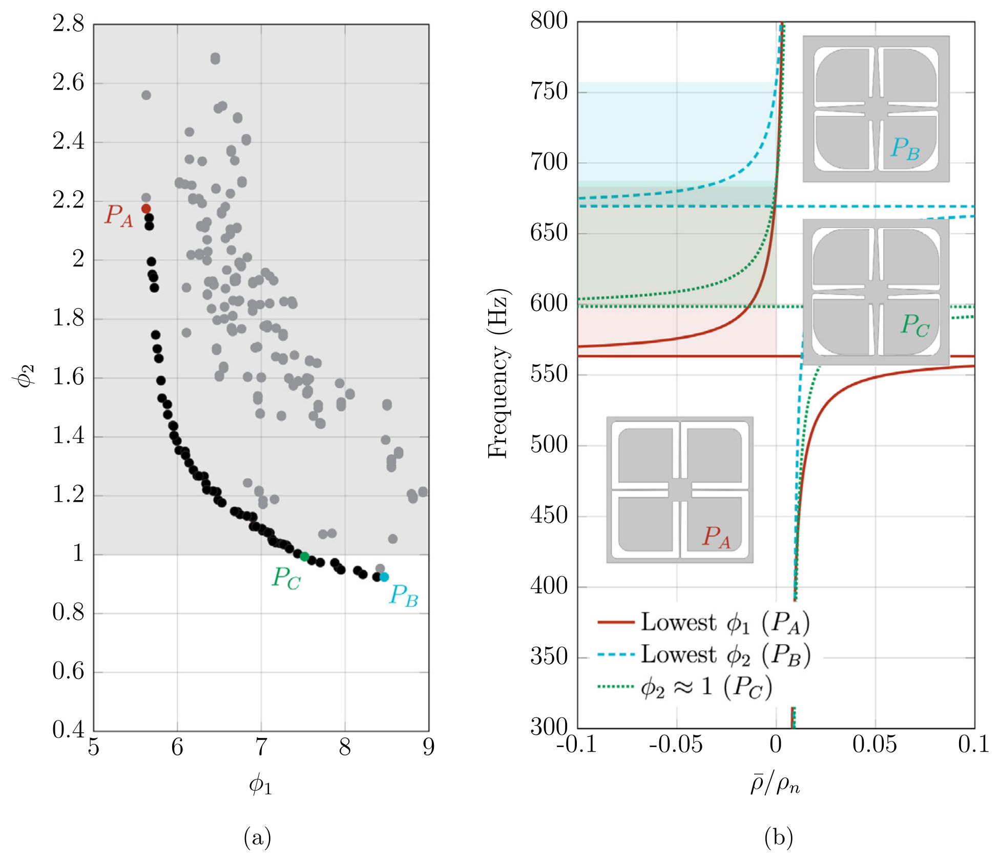</a> **[声学超材料 · 同一编号串起前沿点、单胞几何与带隙](metamaterial-pareto-unit-cell-frequency-response/README.md)** Structures 2025 · Fig. 10 · a、b（b 含三组单胞与频响） · 矢量与位图混合 a 选出前沿上的三个具名设计。b 在同一张频率图中放入对应的单胞几何、有效质量密度曲线和带隙。颜色、编号和线型共同维系三者的对应关系。 | <a href="dirac-decoder-sampling-operating-points/README.md">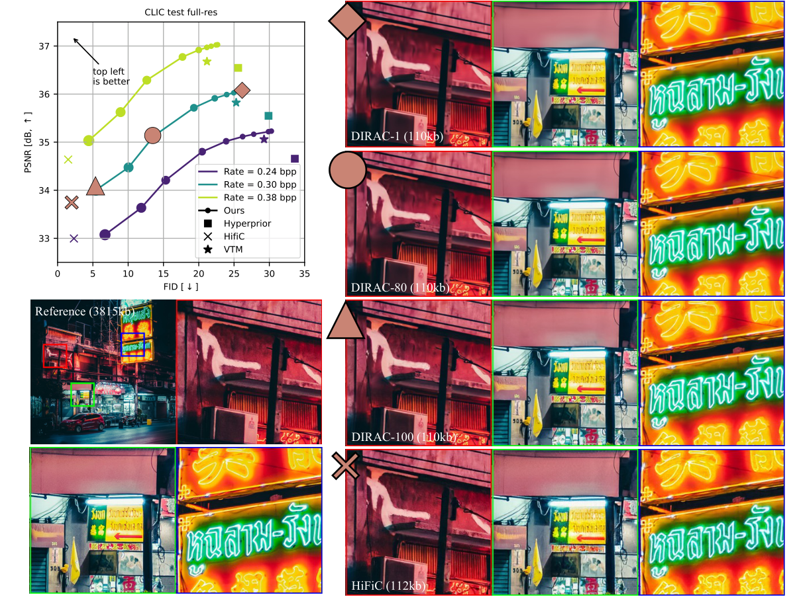</a> **[DIRAC 图像压缩 · 用相同标记找到三个解码步数各自的街景重建](dirac-decoder-sampling-operating-points/README.md)** arXiv preprint (v1) 2023 · Fig. 1 · 左上性能曲线、左下参考图与三个裁区、右侧四行重建（无字母编号，按六组阅读） · 矢量与位图混合 左上青线固定 0.30 bpp。菱形、圆形和三角形在右侧三行重建中再次出现，对应 1、80、100 步解码。每行都看同一幅街景的三个区域。 |
| <a href="pfm-domain-growth-pareto-response-maps/README.md">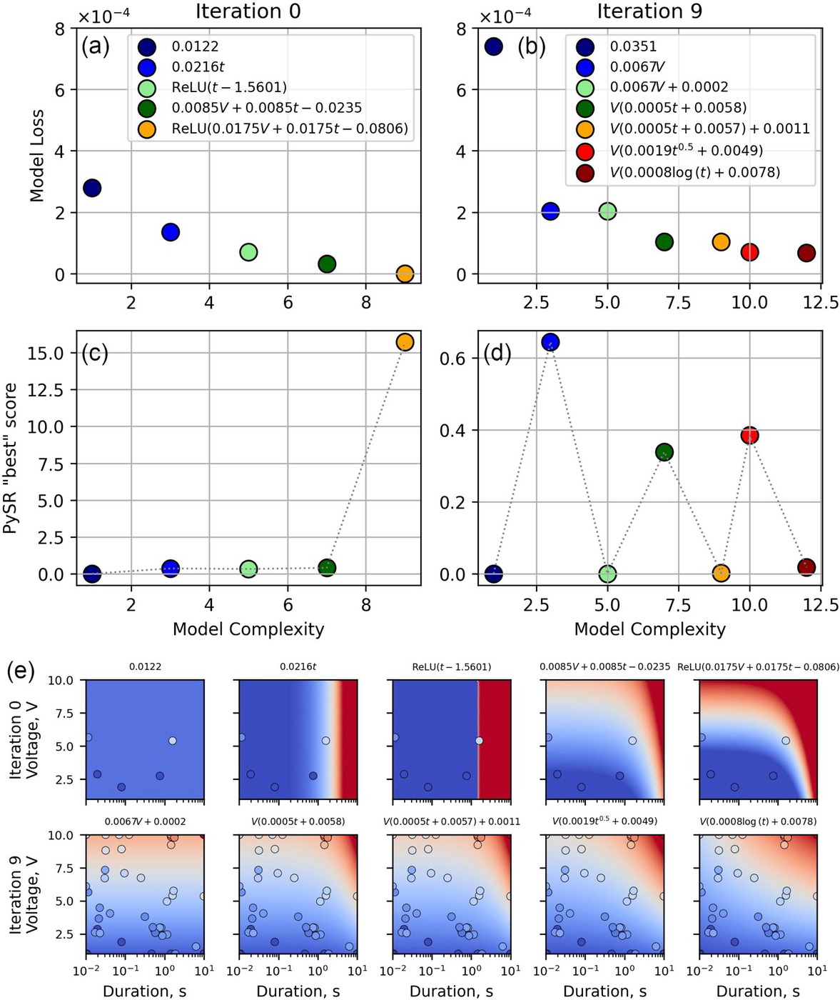</a> **[铁电畴生长 · 从前沿上的公式追到二维半径预测图](pfm-domain-growth-pareto-response-maps/README.md)** arXiv（预印本） 2026 · Fig. 4 · a–e（e 含两行共十幅预测图） · 位图参考 前沿图例直接写出每个彩色点的公式，下一排沿用点色给出选择分数，最下排用公式作小图标题，把候选式对应到电压、脉宽与畴半径的实测和预测。 |  |

## 同一输入的干预对照

| | |
|---|---|
| <a href="rome-causal-tracing-seattle/README.md">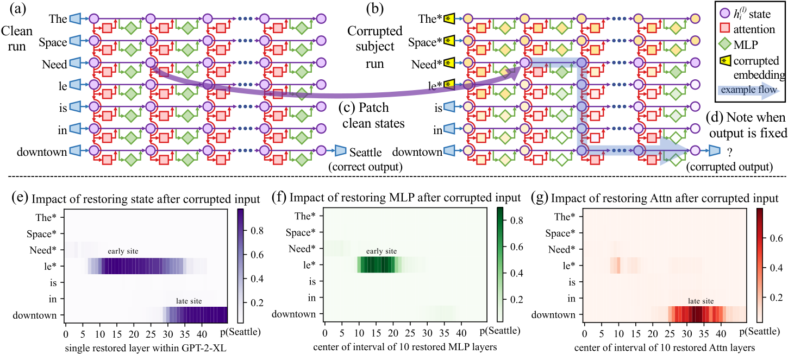</a> **[ROME · 把一次激活恢复实验读成概率热图](rome-causal-tracing-seattle/README.md)** NeurIPS 2022 · Fig. 1 · a–g · 矢量与位图混合 同一句 Space Needle 提示贯穿正常、加噪和局部恢复三种计算。下排每个格子对应在一个指定位置恢复激活后，模型给 Seattle 分配的概率。 | <a href="visuomotor-halt-and-replay/README.md">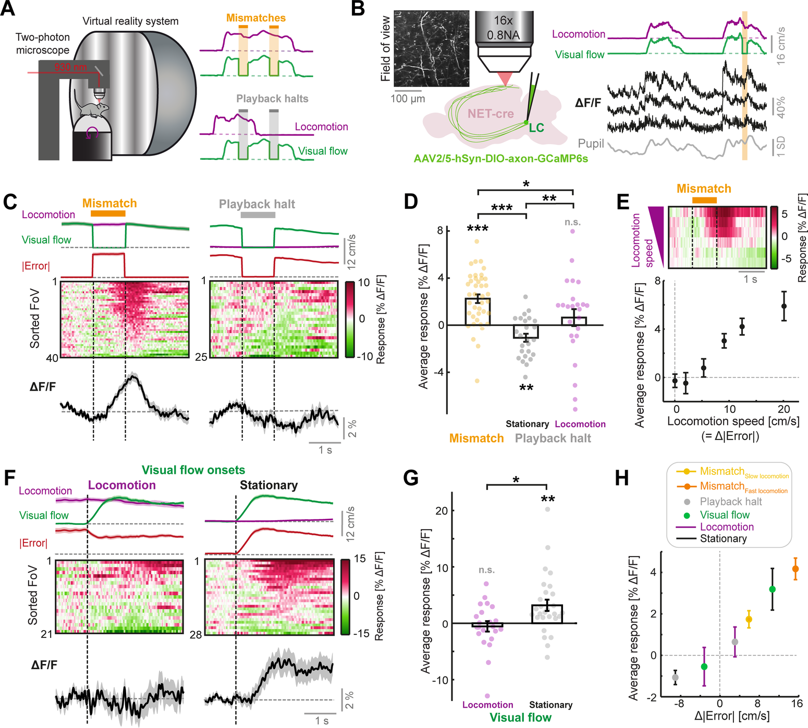</a> **[同一段视觉刺激在闭环和回放中对照](visuomotor-halt-and-replay/README.md)** eLife 2023 · Fig. 1 · A–H · 位图参考 原样回放闭环实验的视流序列，让同一次停顿出现在不同运动条件下。从 A 的刺激设计追到 C 的响应热图，再到 H 按误差大小汇成的比较。 |

## 按事件对齐与汇总

| | |
|---|---|
| <a href="dopamine-cue-lick-realignment/README.md">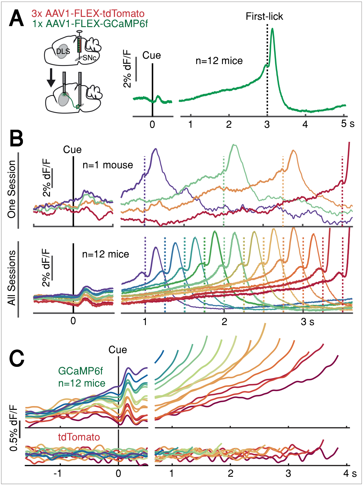</a> **[把同一批试次分别对齐提示与首次动作](dopamine-cue-lick-realignment/README.md)** eLife 2021 · Fig. 2 · A–C · 矢量与位图混合 同一批钙信号在横轴断口两侧分别对齐提示和首次舔舐。首次动作发生的早晚决定 B、C 中曲线的颜色与右侧对齐时刻。 | <a href="zebrafish-turn-triggered-trajectories/README.md">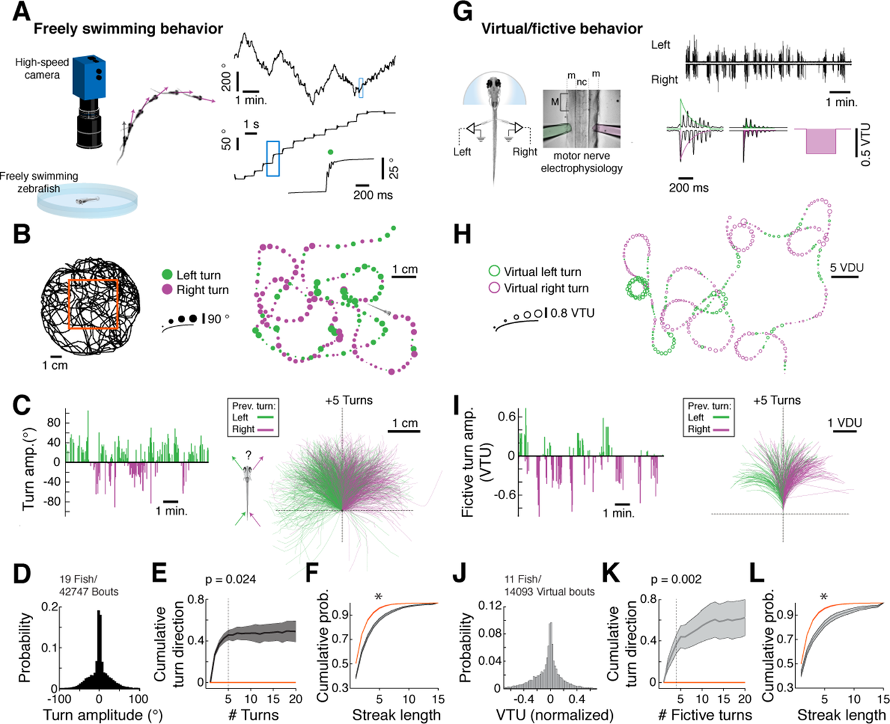</a> **[斑马鱼转向 · 用上一次转弯对齐后五次游动](zebrafish-turn-triggered-trajectories/README.md)** eLife 2016 · Fig. 1 · A–L · 位图参考 B 保留游动的原始路线，C 把一次转弯当作共同起点，旋转并对齐随后五次游动。前一次左转或右转的颜色贯穿时序和扇形轨迹，读者能直接看出历史如何影响接下来的方向。 |

[另见双稳态折纸机器人 Fig. 1 · A–J](../architecture/magnetic-bistable-origami-robot-design-actuation/README.md)。这张已收录在 Architecture 的图把折纸结构、力学曲线、装置和八种运动模式放在同一页。
