# 大图 · 多面板正文图

[仓库首页](../README.md) · [总目录](../CATALOG.md) · [Teaser](../teaser/README.md) · [Architecture](../architecture/README.md) · [Element](../element/README.md)

34 幅完整论文图，按面板之间的关系浏览。点击缩略图可查看高清图版、逐面板解读和出处。

其中 25 幅 PDF 保留可编辑的矢量路径，9 幅保留为位图参考。

[装置、过程与测量（6）](#apparatus) · [同一对象的多种证据（4）](#evidence) · [从整体到局部（6）](#scales) · [多工况与方法对照（6）](#comparisons) · [引线与局部展开（5）](#cross-panel-links) · [共用数据与坐标（7）](#linked-data)

## 装置、过程与测量

| | |
|---|---|
|  **[从转轮选择任务到同一试次的神经记录](ibl-behaviour-task-and-neural-recordings/README.md)** Nature 2025 · Fig. 1 · a–i · 矢量与位图混合 上半部左侧是任务装置和事件时间轴，中央是反应时，右侧的纵向长面板沿三次试验对齐行为与神经元放电。底部四组小图概括会话进程、区块切换和选择偏差。 |  **[微流控晶体管如何定时、分送单颗粒](microfluidic-transistor-particle-dispenser/README.md)** Nature 2023 · Fig. 3 · a–h · 矢量与位图混合 上方两行各用左电路图、右压力曲线。第三行把颗粒阱的三个状态放在左侧，右侧展开整个分配器。末行从一次分配的时序走到粒子间距统计。 |
|  **[电磁软机器人的运动序列与实测速度](electromagnetic-soft-robots-locomotion/README.md)** Nature Communications 2022 · Fig. 4 · a–k · 矢量与位图混合 上层以连续摄影展示压平恢复和越障，中间并列水上装置、游动轨迹和频率响应。一条通栏编号轨迹示范转弯，下层以实物和连拍收束到无系绳原型。 |  **[一只水凝胶球冠的冷却变形全过程](hydrogel-cap-cooling-dynamics/README.md)** Nature Communications 2018 · Fig. 5 · a–j · 矢量与位图混合 顶端用一条黑底时间序列横贯全图。中部从三张校准图过渡到分时径向曲线，再排三张理论与实验对照。末行回到实物复现及其设计曲线。 |
|  **[从虾壳分节到承力折纸机械臂](origami-exoskeleton-module-to-arm/README.md)** Science Advances 2025 · Fig. 1 · A–H · 位图参考 首行并列变形与承重的矛盾、虾体硬柔分节。下方以“单模块”和“多模块外骨骼”分区：构型照片贴近力学曲线，右下角用机械臂姿态收束。 |  **[同一束光下比较两种海水蒸发器](waffle-solar-distiller-thermal-sequence/README.md)** Science Advances 2024 · Fig. 3 · A–H · 矢量与位图混合 首行并列结构示意、质量变化和效率。中央用两行同刻热像对比华夫形与平面蒸发器，右侧给温升曲线。底部以三种水质读数收尾。 |

## 同一对象的多种证据

| | |
|---|---|
| <a href="brain-spine-rehabilitation-without-stimulation/README.md">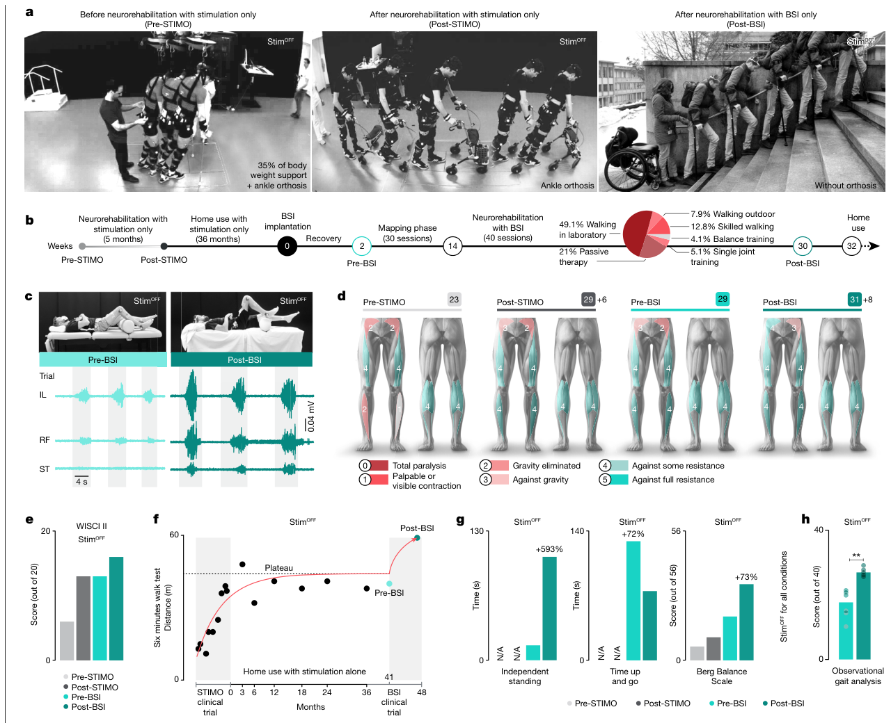</a> **[从无刺激步行连拍到康复评估](brain-spine-rehabilitation-without-stimulation/README.md)** Nature 2023 · Fig. 4 · a–h · 矢量与位图混合 顶部三组连拍把同一位参与者的临床阶段并置。横跨整行的时间轴标明干预。中间把屈髋照片、肌电和身体分布图配成组，底部横排四类结局评估。 | <a href="cebra-natural-movie-decoding/README.md">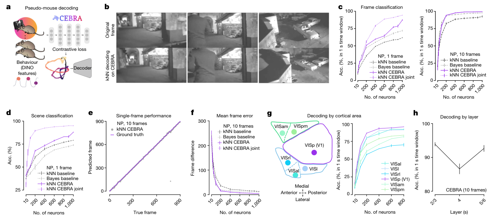</a> **[从视觉皮层活动解码电影帧](cebra-natural-movie-decoding/README.md)** Nature 2023 · Fig. 5 · a–h · 矢量与位图混合 上排 a–c 从解码流程、成对电影帧过渡到准确率曲线。下排 d–h 依次放场景识别、帧号对照、误差以及脑区与层别比较。 |
| <a href="grid-cell-toroidal-coordinates/README.md">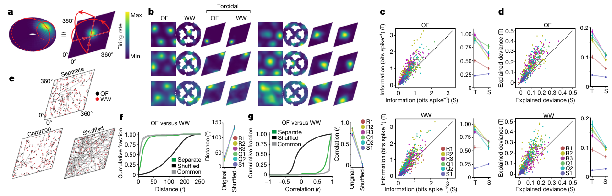</a> **[把同一网格细胞放回物理空间和环面](grid-cell-toroidal-coordinates/README.md)** Nature 2022 · Fig. 2 · a–g · 矢量与位图混合 左上用环面及其二维展开解释坐标，中上用多行细胞热图对照环境，右列放信息量与模型拟合。左下和中下以连线图、累积分布检验位置稳定性。 |  **[从一只小鼠的先验偏差到跨实验室复核](ibl-mouse-prior-cross-lab-replication/README.md)** eLife 2021 · Fig. 4 · a–j · 位图参考 第一行从单只小鼠的连续选择过渡到区块间的偏移定义和汇总。中间七个实验室各占一格、共用坐标。最下排比较心理物理参数，并以分类结果检查实验室差异。 |

## 从整体到局部

| | |
|---|---|
|  **[MatterGen · 从目标化学空间读到四个具体晶体](mattergen-chemical-space-crystals/README.md)** Nature 2025 · Fig. 3 · a–i · 矢量与位图混合 左上为两行两列统计图，右上用跨两行的三元相图与局部放大框呈现个案。底行四个晶体结构并排，图中字母与放大框中的点相互索引。 | <a href="microns-single-cell-structural-functional/README.md">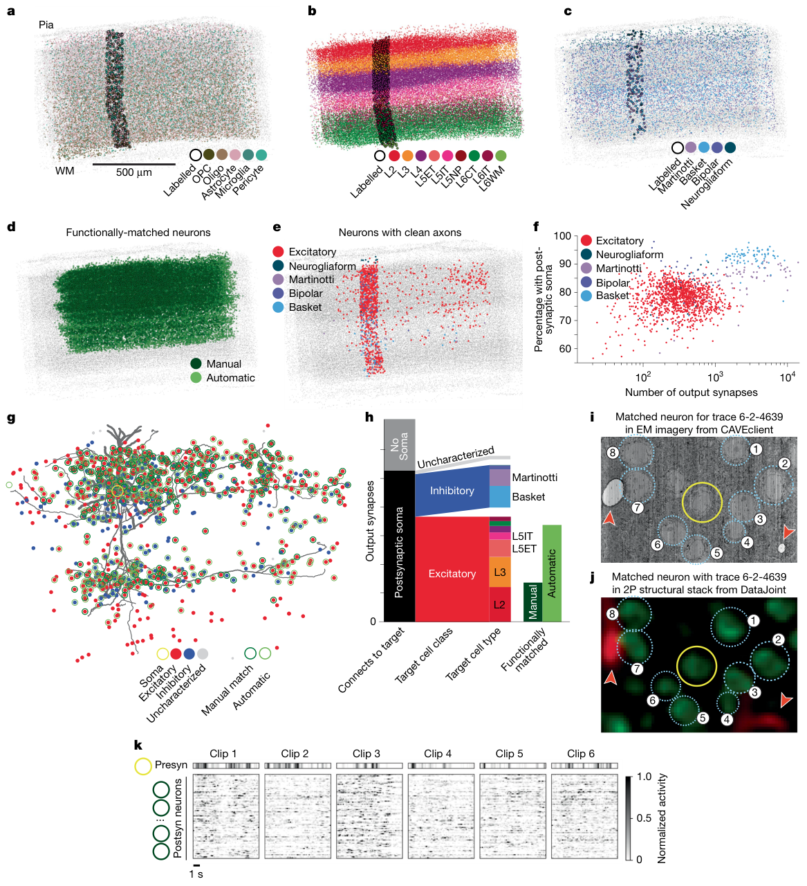</a> **[从单个锥体细胞追到突触靶点和功能响应](microns-single-cell-structural-functional/README.md)** Nature 2025 · Fig. 6 · a–k · 矢量与位图混合 顶端两行沿同一组织方向重复细胞分布图。中段左侧展开单细胞及靶点，中央汇总连接去向，右侧竖排电镜与双光子图。底部热图回到视觉刺激。 |
|  **[GNoME · 筛选闭环、发现规模与晶体实例](gnome-discovery-loop-and-validation/README.md)** Nature 2023 · Fig. 1 · a–e · 矢量与位图混合 第一行通栏画两条候选生成支路和筛选反馈。下方两行各分两栏。中行右栏在一个字母内嵌入六个已验证结构，与左边发现数量的时间轴对照。 |  **[沿薄膜深度追踪钙钛矿的成分偏析](perovskite-depth-composition/README.md)** Nature 2023 · Fig. 1 · a–h · 矢量与位图混合 上部放器件剖面、晶格示意与处理分子。中左两列排深度剖面，下方并排参考膜与处理膜的三个取样深度。右列上下对齐两组衍射谱。 |
|  **[把八座冰架的退缩放回同一幅区域地图](north-greenland-ice-shelf-change/README.md)** Nature Communications 2023 · Fig. 1 · a–i · 矢量与位图混合 上方两排八个局部地图按冰架分格，共用其下方一整行色标。下方一幅区域图标出其位置、体积变化以及各处的质量收支柱状图。 |  **[果蝇幼虫全脑重建与三类神经元](larval-brain-connectome-reconstruction/README.md)** Science 2023 · Fig. 1 · A–H · 位图参考 左上用整幅彩色神经重建定位全脑。右上四格把重建完整度、左右配对与通路关系排成两层。底行三张同构的「神经元形态＋计数柱图」并排，可沿同一视角比较。 |

## 多工况与方法对照

| | |
|---|---|
|  **[DALL·E · 八条提示词与四种候选池大小](dalle-contrastive-reranking-contact-sheet/README.md)** ICML 2021 · Fig. 6 · 原图无字母；8 列 × 4 行 · 位图参考 每列上方写一条 MS-COCO 提示词，下方沿同一列排四幅生成图。行名是 best of 512、64、8、1。共 32 个图像单元，论文没有逐格编字母。原文将整幅图嵌为 3364 × 1753 像素位图。 | <a href="gns-ablation-and-boxbath-rollouts/README.md">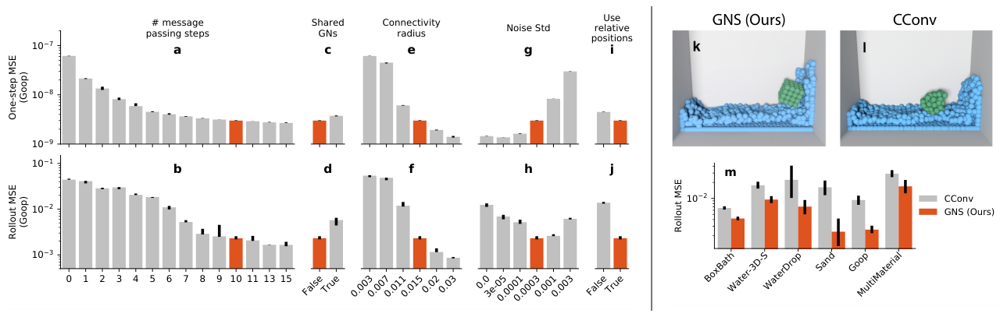</a> **[GNS · 五组消融、同场景预测与跨材料误差](gns-ablation-and-boxbath-rollouts/README.md)** ICML 2020 · Fig. 4 · a–m · 矢量与位图混合 左侧五列消融各用上下两张柱图，共用横轴。右上给同一 BoxBath 场景的两幅模拟快照，右下为不同材料的误差总图。原图包含可编辑的曲线轴标与柱形，两张模拟快照为嵌入图像。 |
| <a href="neuralgcm-weather-skill-and-maps/README.md">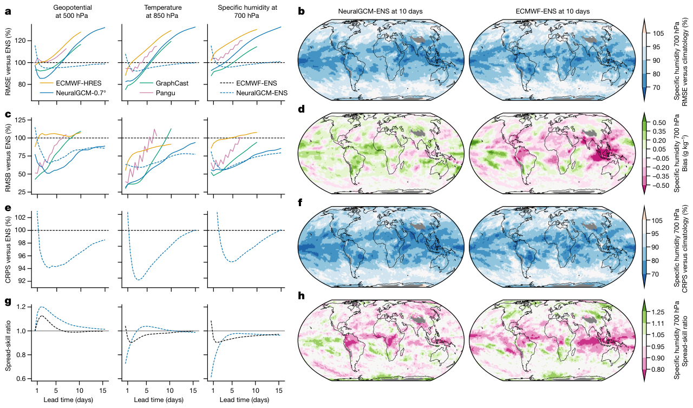</a> **[NeuralGCM · 四种预报指标与全球误差地图](neuralgcm-weather-skill-and-maps/README.md)** Nature 2024 · Fig. 2 · a–h · 矢量与位图混合 四行分别对应四种指标。每行左侧用三幅并列折线比较大气变量，右侧用两张同投影地图比较模型，并在行末放对应色标。 | <a href="tcv-plasma-control-demonstrations/README.md">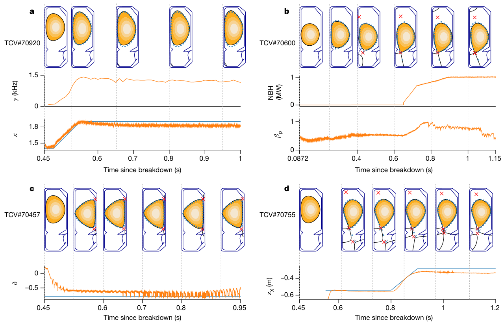</a> **[TCV · 四种等离子体构型的控制轨迹](tcv-plasma-control-demonstrations/README.md)** Nature 2022 · Fig. 3 · a–d · 矢量 四组放电实验占据两行两列。每组上方横排等离子体截面的时间快照，下方的测量或目标轨迹共用时间方向，便于在形状和数值之间切换。 |
| <a href="plasmon-interference-photon-number/README.md">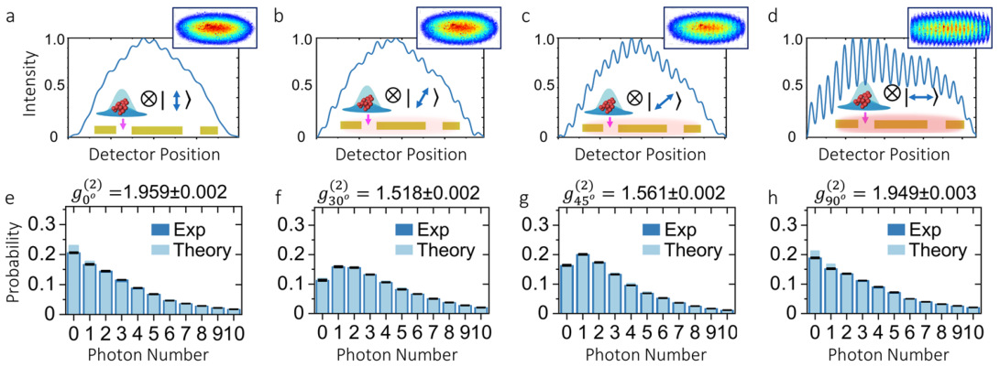</a> **[用上下两排一一配对干涉图样和光子数统计](plasmon-interference-photon-number/README.md)** Nature Communications 2021 · Fig. 2 · a–h · 位图参考 两行四列以实验条件为列。每个上格放远场空间强度剖面、小幅强度图和偏振／狭缝示意。对应的下格放光子数概率分布和二阶相关值。 | <a href="cellpose-human-loop-annotation-budget/README.md">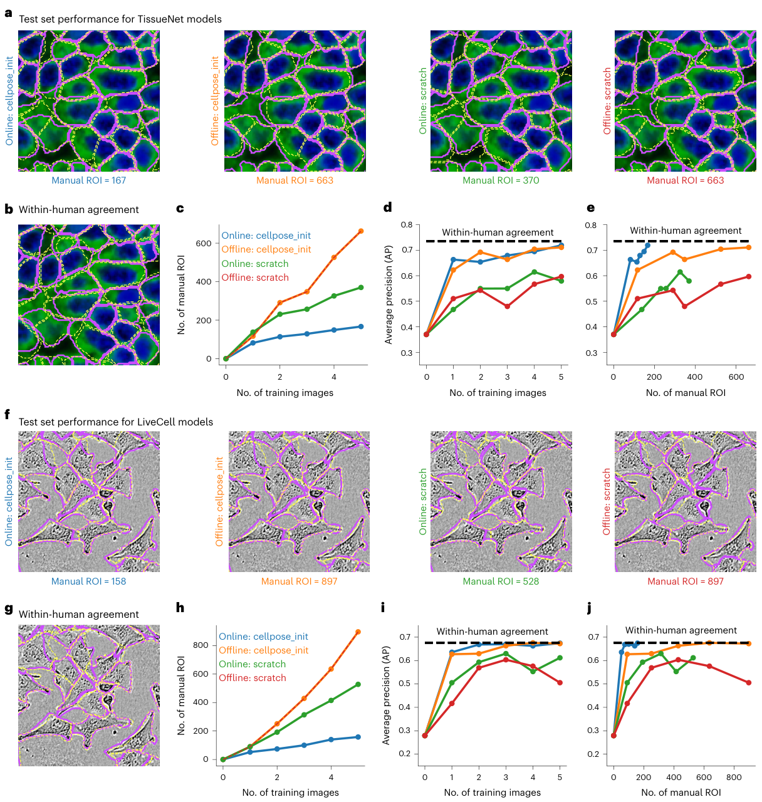</a> **[Cellpose 2.0 · 两套数据上的分割质量与标注预算](cellpose-human-loop-annotation-budget/README.md)** Nature Methods 2022 · Fig. 5 · a–j · 矢量与位图混合 上下两组分别对应 TissueNet 和 LiveCell。每组先并排四幅同一图像的分割结果，下一行以一幅人工复标图加三幅定量曲线收束。 |

## 引线与局部展开

| | |
|---|---|
| <a href="hydrogel-motion-sensor-body-readouts/README.md">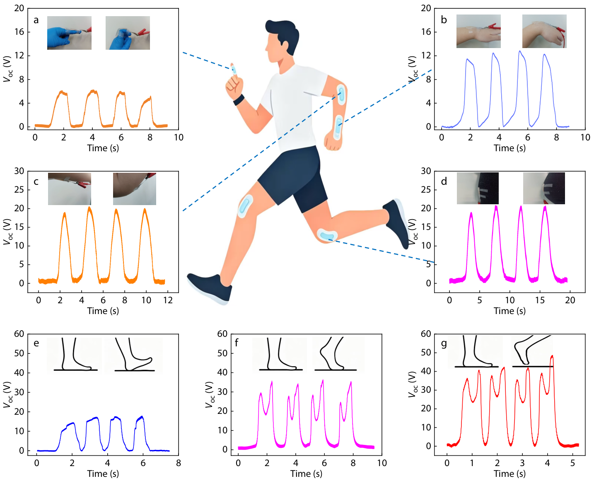</a> **[水凝胶传感器 · 身体测点连到电压曲线](hydrogel-motion-sensor-body-readouts/README.md)** Chinese Journal of Polymer Science 2026 · Fig. 9 · a–g · 矢量与位图混合 中央跑步者身上的四个贴片各有一条引线。循着膝部贴片读到 d，照片给出弯膝动作，曲线给出膝关节反复弯曲时的电压响应。 | <a href="kan-edge-spline-grid-extension/README.md">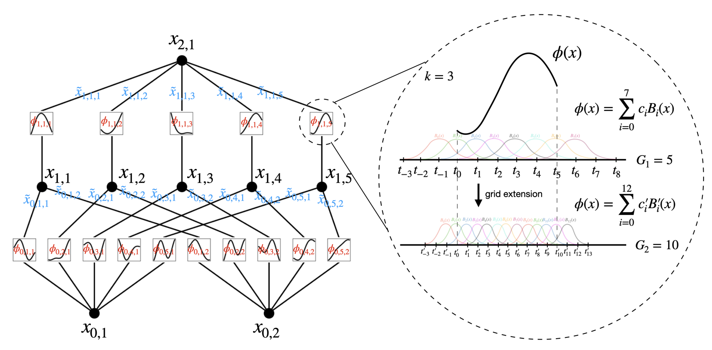</a> **[KAN · 从网络的一条边展开样条函数](kan-edge-spline-grid-extension/README.md)** ICLR 2025 · Fig. 2.2 · 原图无字母 · 网络与函数局部 · 位图参考 小函数图直接画在边上。选中的一条边用虚线圈出，跨图引线把它接到右侧，展示同一函数在粗、细网格上的样条表示。 |
|  **[集群避障 · 从误差发生的时刻追到队形](flock-obstacle-time-and-formation/README.md)** Nature Communications 2025 · Fig. 7 · a、b · 矢量与位图混合 b 的两排时间曲线选出三个时刻，引线接到 a 的三列队形。对照同一时刻的两种队形，可以定位碰撞风险出现在哪里。 |  **[细胞形态空间 · 从统计点找到显微图像](perturbome-morphospace-exemplars/README.md)** Nature Communications 2019 · Fig. 3 · a–f · 矢量与位图混合 c 将处理条件压缩到二维形态空间，跨面板虚线把代表点连到 d 的细胞图像。点云中的差异由此可以回到具体形态上辨认。 |
|  **[呼吸监测 · 从实验台的屏幕读到实时波形](graphene-respiration-monitor-screen/README.md)** npj Flexible Electronics 2022 · Fig. 5 · a–h · 矢量与位图混合 f 的笔记本屏幕被红框圈出，两条虚线接到 g 的显示界面。读者能在装置照片中找到信号来源，又能在旁边看清波形。 |  |

## 共用数据与坐标

| | |
|---|---|
| <a href="upsetr-intersection-and-attributes/README.md">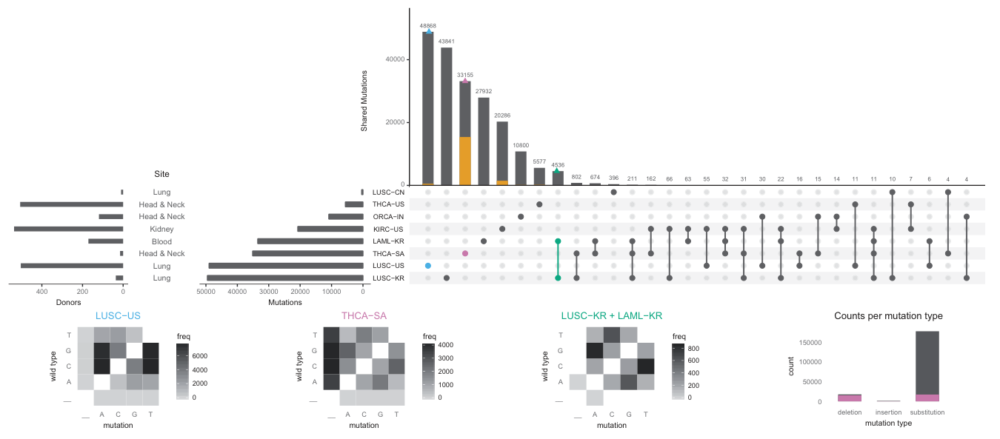</a> **[UpSetR · 同一列连起集合组合、计数与属性](upsetr-intersection-and-attributes/README.md)** Bioinformatics 2017 · Fig. 1 · 原图无字母 · 按五个功能区阅读 · 矢量与位图混合 点阵的一列定义一个集合交集。沿列向上读其计数，再沿颜色去找下方对应的属性热图，可以一直追踪同一批变异。 |  **[收缩微通道 · 从二维速度场取剖面和导数](microchannel-flow-field-and-profiles/README.md)** Experiments in Fluids 2020 · Fig. 8 · a–e · 位图参考 a 把实验与仿真放进同一通道轮廓。d 从中心轴取出速度，e 再对轴向位置求导，将二维图中的加速与减速变成可读的曲线。 |
| <a href="frb-dynamic-spectrum-projections/README.md">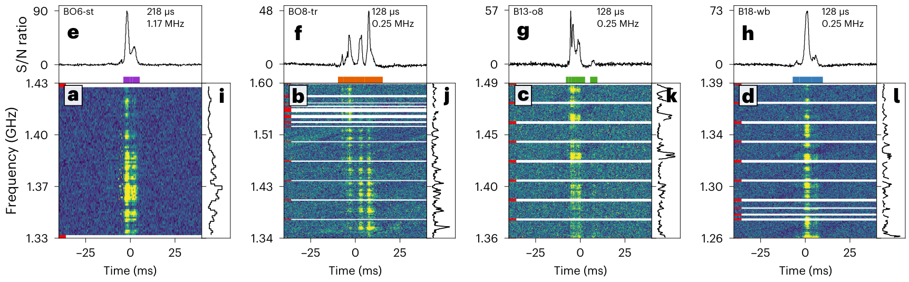</a> **[快速射电暴 · 时频图和两侧投影共用坐标](frb-dynamic-spectrum-projections/README.md)** Nature Astronomy 2024 · Fig. 2 · a–l · 矢量与位图混合 每次暴发占一列。热图上方是沿频率平均的时间波形，彩条选中的时间窗又决定右侧频谱使用哪些数据。 | <a href="aml-clonal-lineage-and-sampling/README.md">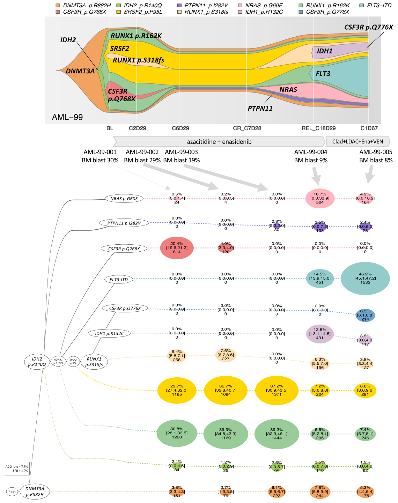</a> **[克隆演化 · 谱系树的末端接到五次采样](aml-clonal-lineage-and-sampling/README.md)** Nature Communications 2020 · Fig. 7 · 原图无字母 · 谱系、采样与推断 · 矢量与位图混合 左侧分支接到下方气泡矩阵的一行，每列对应一次采样。上方同色面积带表示由离散观测推断的克隆比例随时间变化。 |
|  **[估计图 · 左侧对照均值就是右侧差值零点](estimation-plot-aligned-difference/README.md)** Nature Methods 2019 · Fig. 1 · a–e · 位图参考 e 把右侧差值轴的零点放在左侧对照组均值的高度，处理组均值对应右侧的差值点。左右两边用同一段垂直距离表达组间差异。 | <a href="gw150914-strain-reconstruction-residuals/README.md">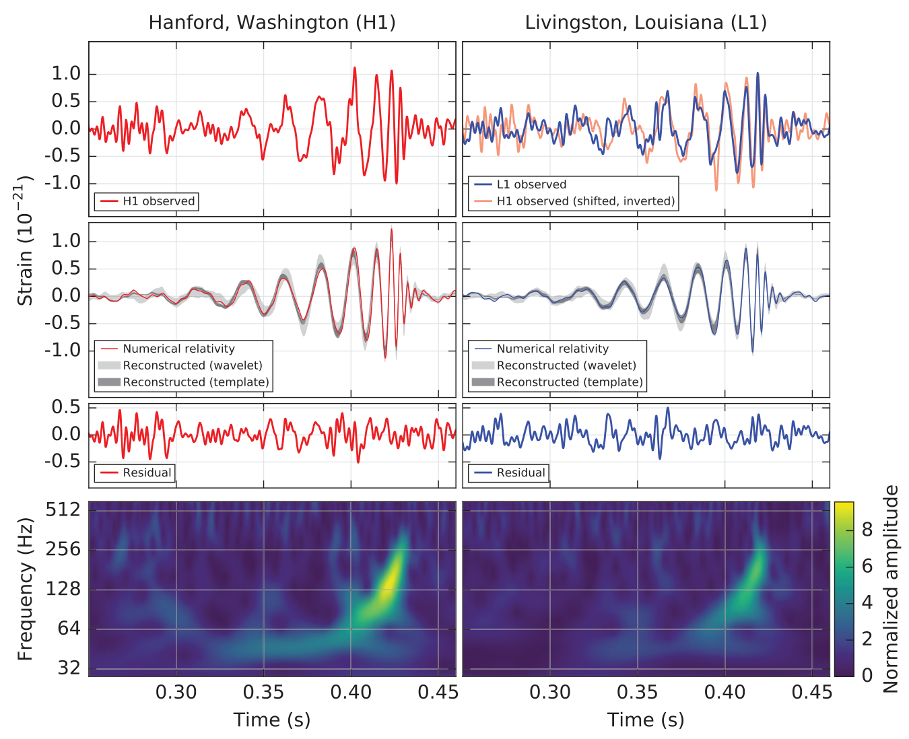</a> **[GW150914 · 实测与模型相减得到下一行残差](gw150914-strain-reconstruction-residuals/README.md)** Physical Review Letters 2016 · Fig. 1 · 原图无字母 · 两列各四行 · 矢量与位图混合 每个探测器占一列，记录、模型、残差与时频图沿同一时间轴展开。第三行的每个点都能回到前两行，核对同一时刻相减的两个值。 |
| <a href="european-power-exchange-chords/README.md">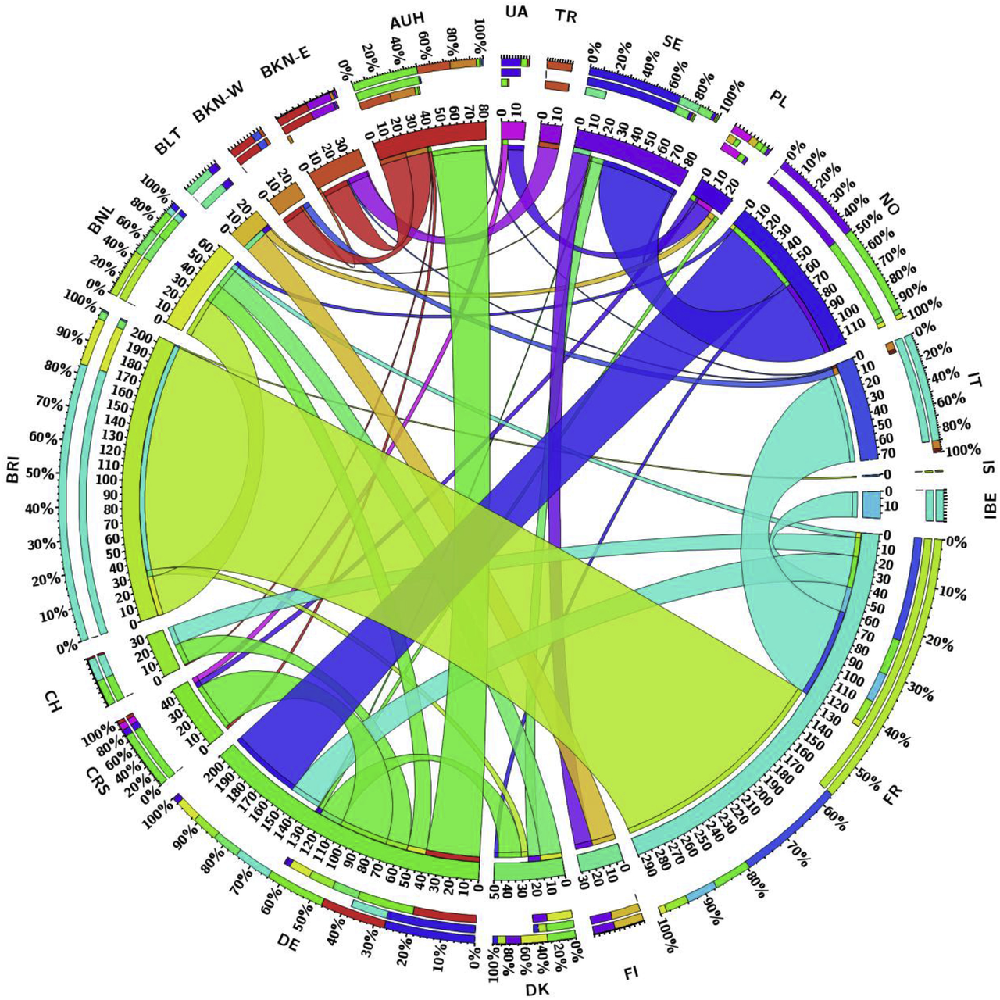</a> **[欧洲电网 · 沿交换带读到地区总量和份额](european-power-exchange-chords/README.md)** Renewable Energy 2019 · Fig. 18 · 原图无字母 · 三层同心视图 · 位图参考 弦带连接一对电力交换地区，带宽表示电量。顺着端点读到同一地区的弧段，能在同一角位置读取 TWh 刻度和外层百分比。 |  |

[另见双稳态折纸机器人 Fig. 1 · A–J](../architecture/magnetic-bistable-origami-robot-design-actuation/README.md)。这张已收录在 Architecture 的图把折纸结构、力学曲线、装置和八种运动模式放在同一页。
