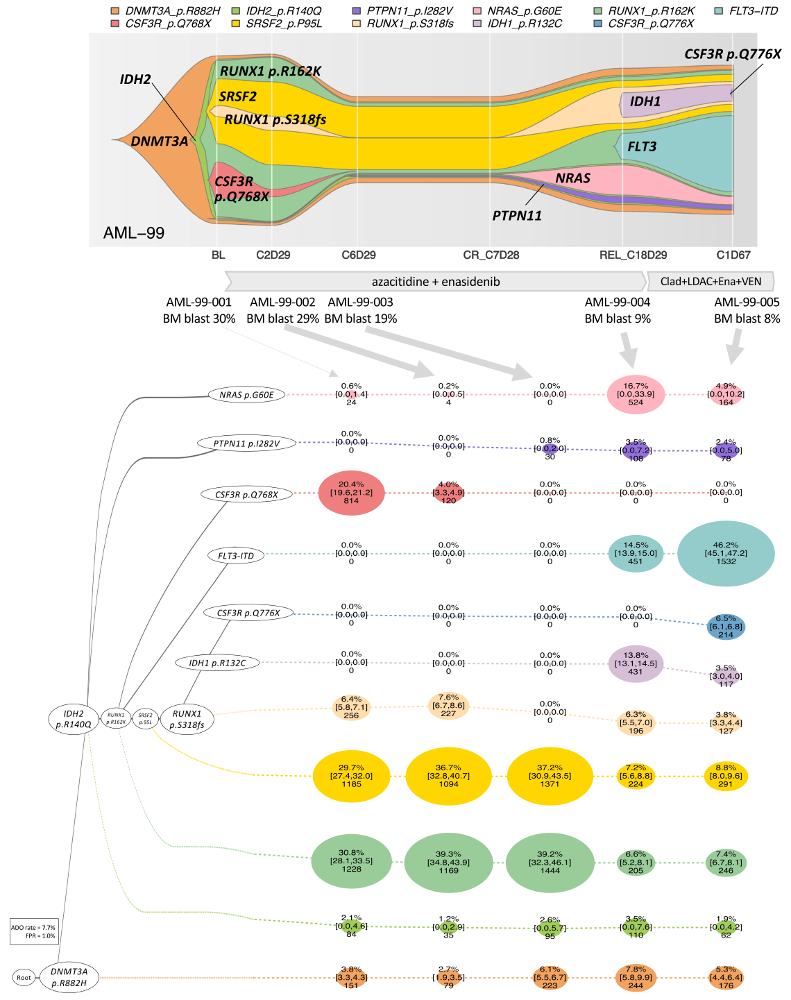

# 克隆演化 · 谱系树的末端接到五次采样

[大图目录](../README.md) · [共用数据与坐标](../README.md#linked-data) · [单页 PDF](figure.pdf) · [来源记录](metadata.json)

**Nature Communications 2020 · Fig. 7 · 原图无字母 · 谱系、采样与推断**

## 怎样读这张图

从左下谱系树沿 FLT3-ITD 分支向右读。该行五次采样中，前三次的比例为零，第四、第五次分别为 14.5% 和 46.2%。沿列向上能定位治疗与采样时点，再看上方青色带怎样连接这些离散观测。

## 出处与原件

*Clonal evolution of acute myeloid leukemia revealed by high-throughput single-cell genomics*。Kiyomi Morita, Feng Wang, Katharina Jahn, et al.。

上下两部分可以单独选择。上方鱼形面积图包含位图元素，下方谱系树、气泡等保留矢量路径。部分文字在源 PDF 中为轮廓。

CC BY 4.0。[论文图版](https://www.nature.com/articles/s41467-020-19119-8/figures/7) · [原始文件](https://www.nature.com/articles/s41467-020-19119-8.pdf) · [许可条款](https://creativecommons.org/licenses/by/4.0/) · [版权说明](https://www.nature.com/articles/s41467-020-19119-8#rightslink)
