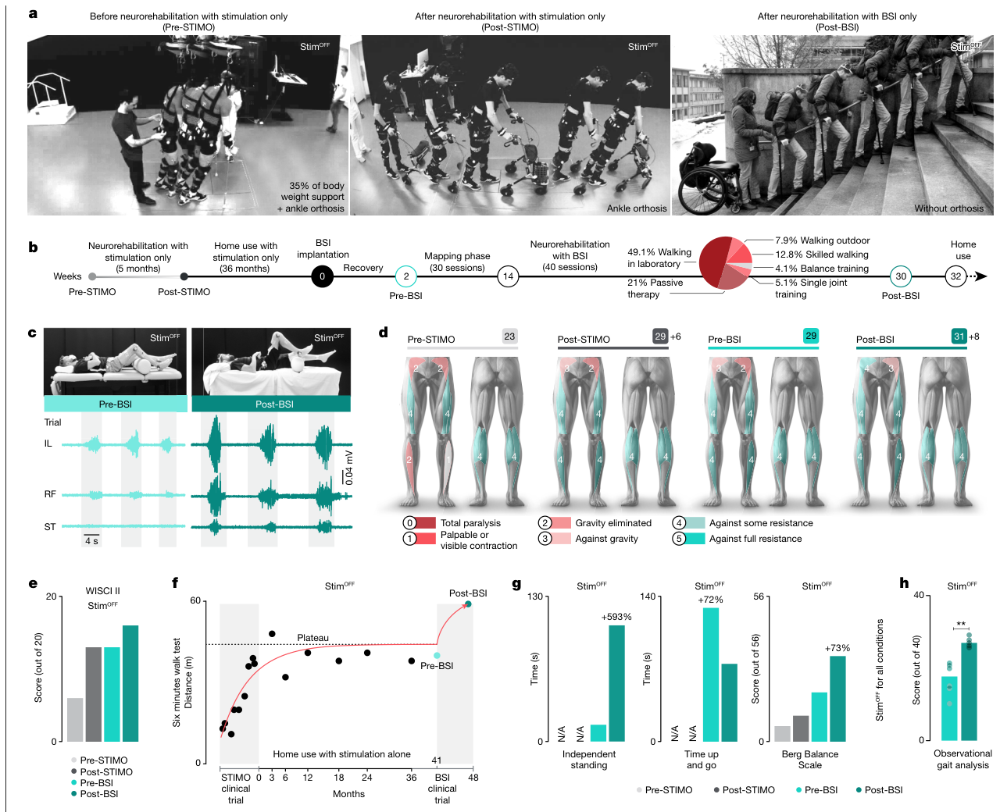

# 从无刺激步行连拍到康复评估

[大图目录](../README.md) · [混合矢量 PDF · 下载单页图版](figure.pdf) · [来源记录](metadata.json)

**Nature 2023 · Fig. 4 · a–h（8 个标记面板）**

## 这张图怎么读

a 比较三个阶段在关闭刺激时的行走，b 给出两段临床试验与训练日程。c 将屈髋动作和肌电配对，d 给出下肢运动评分。e–h 分别检查步行独立性、六分钟步行、承重与平衡等能力以及观察式步态评分。全图跟踪一位参与者。

**版式**　顶部三组连拍把同一位参与者的临床阶段并置。横跨整行的时间轴标明干预。中间把屈髋照片、肌电和身体分布图配成组，底部横排四类结局评估。

## 出处与文件

*Walking naturally after spinal cord injury using a brain–spine interface*。Henri Lorach, Andrea Galvez, Valeria Spagnolo, et al.。

PDF 同时保留矢量路径与嵌入位图。照片、显微图像或热图等位图部分保留原分辨率。部分文字可以选取。 从论文 PDF 提取完整图版，另存为单页 PDF，并等比生成预览。面板沿用原文顺序。

CC BY 4.0。已核对论文的版权与许可声明。

[原图出处](https://www.nature.com/articles/s41586-023-06094-5/figures/4) · [发布方图像或全文](https://pmc-oa-opendata.s3.amazonaws.com/PMC10232367.1/PMC10232367.1.pdf) · [许可条款](https://creativecommons.org/licenses/by/4.0/)
