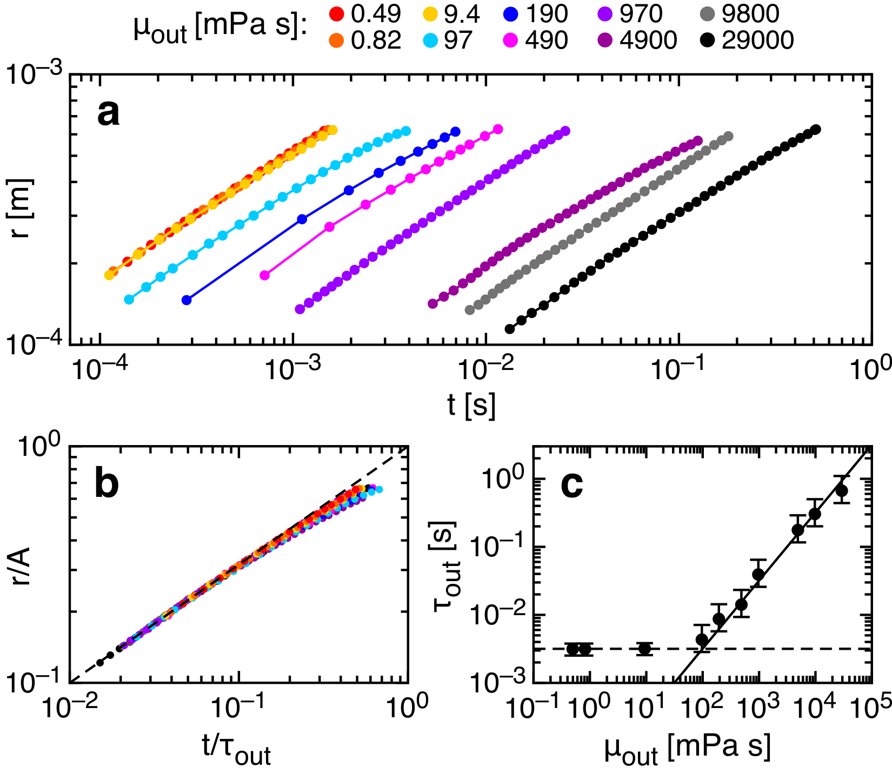

# 气泡合并 · 拟合出来的时间尺度成为下一幅图的纵轴

[大图目录](../README.md) · [共用数据与坐标](../README.md#linked-data) · [作者独立 PDF](original.pdf) · [SVG · 从 PDF 导出，文字转轮廓](figure.svg) · [来源记录](metadata.json)

**Nature Communications 2014 · Fig. 2 · a–c**

## 怎样读这张图

a 用颜色区分硅油黏度。选最右侧的黑色点列，在 b 中找到同色的数据：颈部半径除以气泡半径 A，时间除以这一组的拟合尺度 τ_out。c 把每组 τ_out 对外部流体黏度作图，并给出拟合误差。低黏度段近似水平，高黏度段上升，解释了 a 中各组相差的时间尺度。

## 出处与原件

*Coalescence of bubbles and drops in an outer fluid*。Joseph D. Paulsen, Rémi Carmigniani, Anerudh Kannan, Justin C. Burton, Sidney R. Nagel。

作者在 TeX 源包中提供的独立矢量 PDF，三个面板的散点、参考线和轴标均保留。 原件位于作者源包的 `Fig2.pdf`。

作者源包采用 arXiv 非独占传播许可，单图另行复用的许可未核实。 [原图出处](https://www.nature.com/articles/ncomms4182/figures/2) · [作者源包](https://arxiv.org/src/1407.6657v1) · [许可](https://arxiv.org/licenses/nonexclusive-distrib/1.0/)
