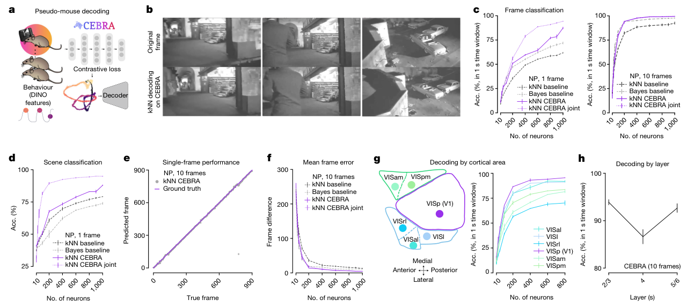

# 从视觉皮层活动解码电影帧

[大图目录](../README.md) · [混合矢量 PDF · 下载单页图版](figure.pdf) · [来源记录](metadata.json)

**Nature 2023 · Fig. 5 · a–h（8 个标记面板）**

## 这张图怎么读

a 给出从神经信号到帧分类的路径。b 上下对照原始帧和从钙记录解码的帧。c 对比短、长感受野，d 换成场景分类，e 与 f 用帧号对应关系和平均绝对误差衡量错到哪里。g、h 分别检查视觉脑区与 V1 层别。

**版式**　上排 a–c 从解码流程、成对电影帧过渡到准确率曲线。下排 d–h 依次放场景识别、帧号对照、误差以及脑区与层别比较。

## 出处与文件

*Learnable latent embeddings for joint behavioural and neural analysis*。Steffen Schneider, Jin Hwa Lee, Mackenzie Weygandt Mathis。

PDF 同时保留矢量路径与嵌入位图。照片、显微图像或热图等位图部分保留原分辨率。部分文字可以选取。 从论文 PDF 提取完整图版，另存为单页 PDF，并等比生成预览。面板沿用原文顺序。

CC BY 4.0。已核对论文的版权与许可声明。b 含实验所用电影的画面，研究论文的许可声明未单列电影素材的独立授权。

[原图出处](https://www.nature.com/articles/s41586-023-06031-6/figures/5) · [发布方图像或全文](https://pmc-oa-opendata.s3.amazonaws.com/PMC10172131.1/PMC10172131.1.pdf) · [许可条款](https://creativecommons.org/licenses/by/4.0/)
