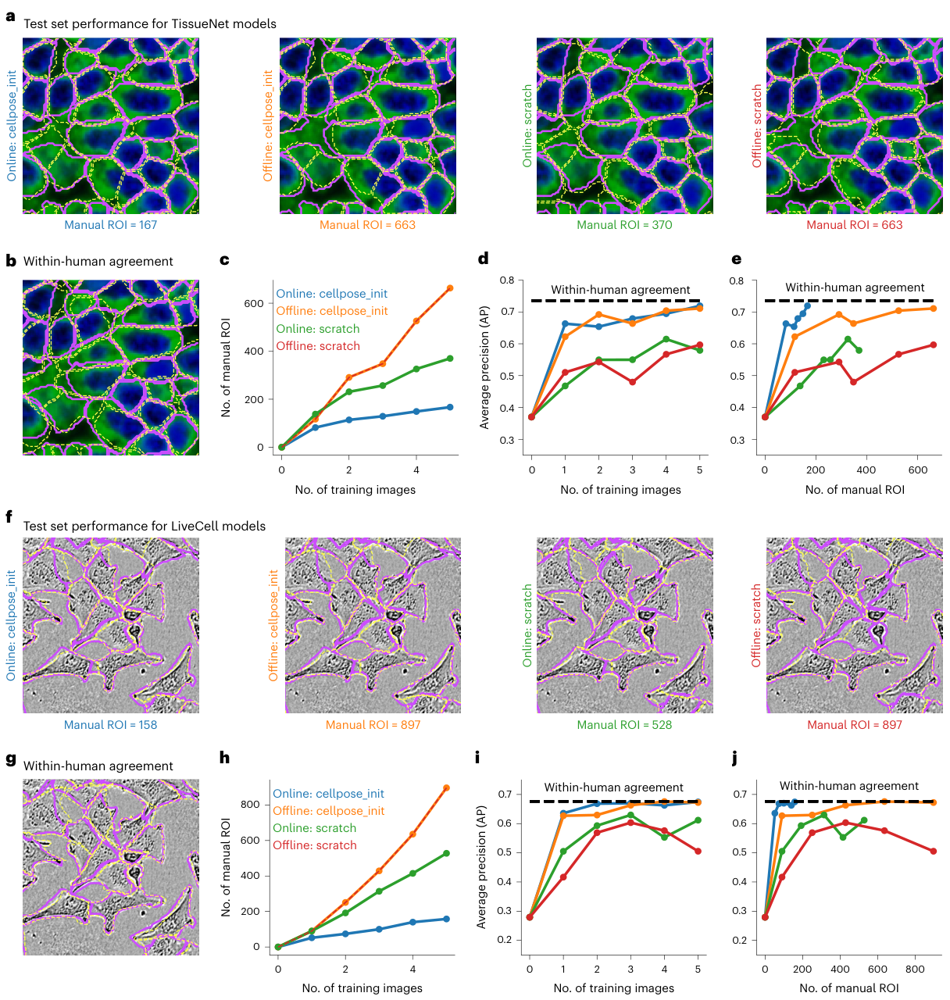

# Cellpose 2.0 · 两套数据上的分割质量与标注预算

[大图目录](../README.md) · [混合矢量 PDF · 下载单页图版](figure.pdf) · [来源记录](metadata.json)

**Nature Methods 2022 · Fig. 5 · a–j（10 个标记面板）**

## 这张图怎么读

a 比较四种训练和标注策略对同一 TissueNet 图像的预测，b 用同一人两次标注说明人工一致性。c 数人工勾画的区域，d、e 分别以训练图像数和手工区域数解释平均精度。f–j 在 LiveCell 的 A172 图像上复用同一顺序。

**版式**　上下两组分别对应 TissueNet 和 LiveCell。每组先并排四幅同一图像的分割结果，下一行以一幅人工复标图加三幅定量曲线收束。

## 出处与文件

*Cellpose 2.0: how to train your own model*。Marius Pachitariu, Carsen Stringer。

PDF 同时保留矢量路径与嵌入位图。照片、显微图像或热图等位图部分保留原分辨率。部分文字可以选取。 从论文 PDF 提取完整图版，另存为单页 PDF，并等比生成预览。面板沿用原文顺序。

CC BY 4.0（论文及无单独署名例外的图材。原图注列明 TissueNet 和 LiveCell 的样本来源）。

[原图出处](https://www.nature.com/articles/s41592-022-01663-4/figures/5) · [发布方图像或全文](https://www.nature.com/articles/s41592-022-01663-4.pdf) · [许可条款](https://creativecommons.org/licenses/by/4.0/)
