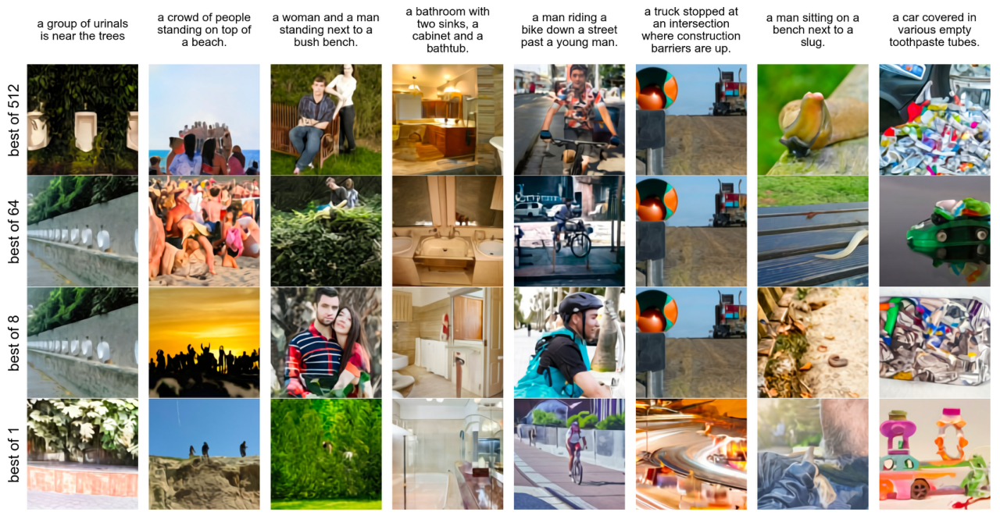

# DALL·E · 八条提示词与四种候选池大小

[大图目录](../README.md) · [位图参考 · 下载单页图版](figure.pdf) · [来源记录](metadata.json)

**ICML 2021 · Fig. 6 · 原图无字母；8 列 × 4 行（32 幅图像）**

## 这张图怎么读

先纵读一列，观察同一提示词在四种候选数下被对比模型选中的结果，例如海滩上的人群或在施工路口停下的卡车。再横读一行，看固定候选数时不同题材的表现。每格都是生成样本，候选数是这一页唯一改变的比较条件。

**版式**　每列上方写一条 MS-COCO 提示词，下方沿同一列排四幅生成图。行名是 best of 512、64、8、1。共 32 个图像单元，论文没有逐格编字母。原文将整幅图嵌为 3364 × 1753 像素位图。

## 出处与文件

*Zero-Shot Text-to-Image Generation*。Aditya Ramesh, Mikhail Pavlov, Gabriel Goh, Scott Gray, Chelsea Voss, Alec Radford, Mark Chen, Ilya Sutskever。

出版 PDF 的整图以位图为主，放大或在 Illustrator 中打开时，图内曲线仍是像素。 从论文 PDF 提取完整图版，另存为单页 PDF，并等比生成预览。面板沿用原文顺序。

CC BY 4.0（PMLR 正式出版协议要求署名，并给出原论文在 PMLR 的链接）。

[原图出处](https://proceedings.mlr.press/v139/ramesh21a.html) · [发布方图像或全文](https://proceedings.mlr.press/v139/ramesh21a/ramesh21a.pdf) · [许可条款](https://creativecommons.org/licenses/by/4.0/) · [PMLR 出版协议](https://proceedings.mlr.press/pmlr-license-agreement.pdf)

<!-- source extras -->

PDF 中嵌入的整图为 3364 × 1753 像素，可直接查看原分辨率。[下载嵌入图像](embedded.jpg)
