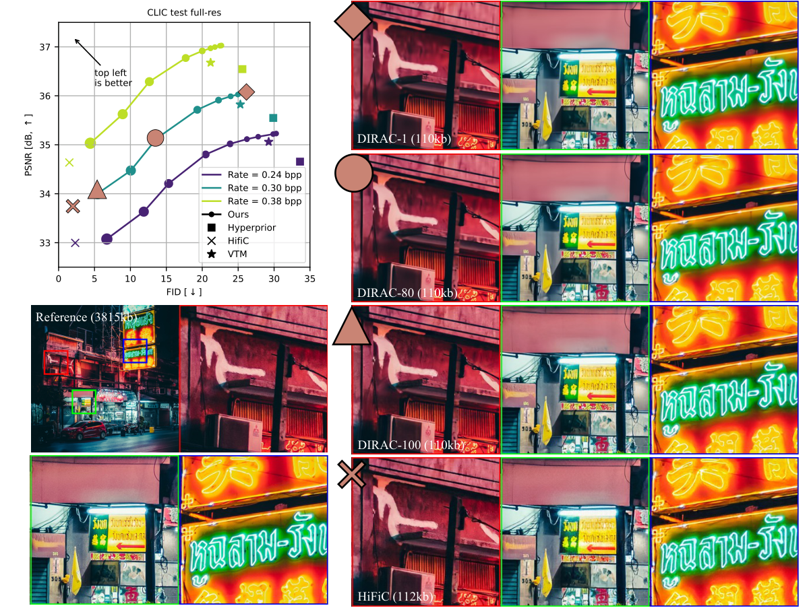

# DIRAC 图像压缩 · 用相同标记找到三个解码步数各自的街景重建

[大图目录](../README.md) · [从模型选择读到输出](../README.md#model-to-output) · [作者原始 PDF](original.pdf) · [来源记录](metadata.json)

**arXiv preprint (v1) 2023 · Fig. 1 · 左上性能曲线、左下参考图与三个裁区、右侧四行重建（无字母编号，按六组阅读）**

## 沿一个模型读图

0.30 bpp 青线上的圆 → 同一解码器取 80 个采样步骤 → 右侧 DIRAC-80 行的三个重建裁块。图中是三个码率下实测的感知–失真权衡，作者用插值匹配码率。图内给出采样步数，解码器结构见该版本图 2。

先选青线中间的圆，移到右侧同样带圆标的 DIRAC-80。沿着这一行看外墙纹理、远处的小招牌和霓虹文字，再与上方菱形的 1 步、下方三角形的 100 步比较。左下原图用红、绿、蓝框给三个裁区定位。左上 FID 与 PSNR 汇总整个 CLIC 测试集，街景展示其中一个样本。

## 出处与文件

*Neural Image Compression with a Diffusion-Based Decoder*。Noor Fathima Ghouse, Jens Petersen, Auke Wiggers, Tianlin Xu, Guillaume Sautière。

作者 TeX 源包内独立 PDF。性能曲线、点标记与标签保留矢量对象，部分图中文字已转为轮廓；照片及局部裁块为嵌入位图。

CC BY 4.0。

[论文](https://arxiv.org/abs/2301.05489v1) · [原图出处](https://arxiv.org/pdf/2301.05489v1#page=3) · [作者源包](https://arxiv.org/src/2301.05489v1) · [许可说明](https://creativecommons.org/licenses/by/4.0/)
