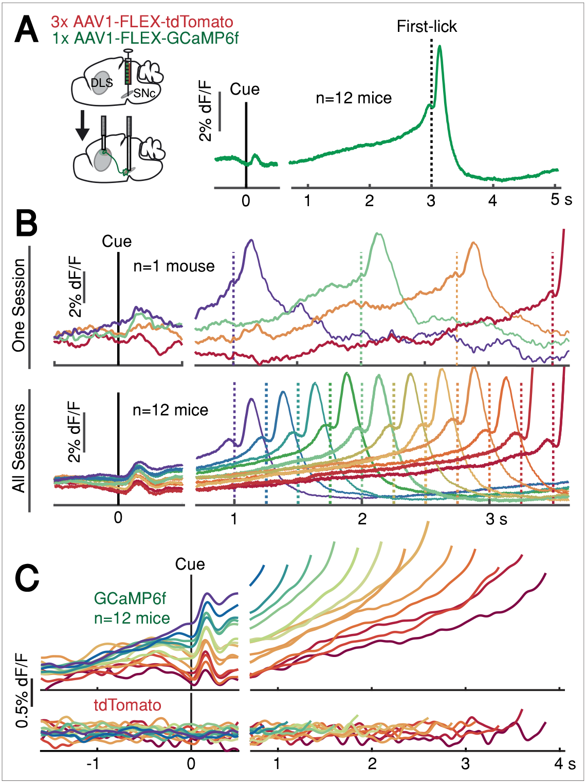

# 把同一批试次分别对齐提示与首次动作

[大图目录](../README.md) · [按事件对齐与汇总](../README.md#event-alignment) · [单页 PDF](figure.pdf) · [来源记录](metadata.json)

**eLife 2021 · Fig. 2 · A–C**

## 怎样读这张图

A 先取首次舔舐发生在提示后 3 至 3.25 秒的一组试次。沿绿色曲线从左读到断口，左端以提示为准，右端改按每次试验的首次舔舐对齐；黑色虚线标出这一动作。B 把早舔和晚舔的试次分组，用同色曲线与虚线标出每组的信号和动作时刻。C 放大纵轴，只绘到动作前 150 毫秒，可直接比较同一时间组的钙信号与对照荧光。

## 出处与原件

*Slowly evolving dopaminergic activity modulates the moment-to-moment probability of reward-related self-timed movements*。Allison E Hamilos, Giulia Spedicato, Ye Hong, Fangmiao Sun, Yulong Li, John A Assad。

单页 PDF 保留信号曲线、坐标、虚线、文字和装置示意中的矢量对象；左侧示意中含少量小位图。

CC BY 4.0。 [原图出处](https://elifesciences.org/articles/62583/figures#fig2) · [来源 PDF](https://pmc-oa-opendata.s3.amazonaws.com/PMC8860451.1/PMC8860451.1.pdf) · [许可](https://creativecommons.org/licenses/by/4.0/) · [Fig. 2 配套数据](https://cdn.elifesciences.org/articles/62583/elife-62583-fig2-data1-v3.zip)
