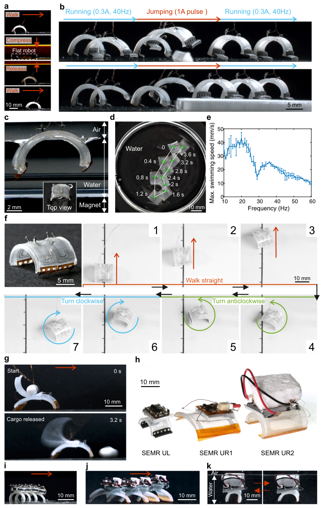

# 电磁软机器人的运动序列与实测速度

[大图目录](../README.md) · [混合矢量 PDF · 下载单页图版](figure.pdf) · [来源记录](metadata.json)

**Nature Communications 2022 · Fig. 4 · a–k（11 个标记面板）**

## 这张图怎么读

a、b 把抗压恢复和越障画成时间序列。c–e 从入水姿态追到游动速度，f 的 1–7 帧连起直行和转向。g 是搬运释放，h–k 对应三款无系绳原型及其奔跑、游动。

**版式**　上层以连续摄影展示压平恢复和越障，中间并列水上装置、游动轨迹和频率响应。一条通栏编号轨迹示范转弯，下层以实物和连拍收束到无系绳原型。

## 出处与文件

*Ultrafast small-scale soft electromagnetic robots*。Guoyong Mao, David Schiller, Doris Danninger, Bekele Hailegnaw, Florian Hartmann, Thomas Stockinger, Michael Drack, Nikita Arnold, Martin Kaltenbrunner。

PDF 同时保留矢量路径与嵌入位图。照片、显微图像或热图等位图部分保留原分辨率。部分文字可以选取。 从论文 PDF 提取完整图版，另存为单页 PDF，并等比生成预览。面板沿用原文顺序。

CC BY 4.0。 © The Author(s) 2022

[原图出处](https://www.nature.com/articles/s41467-022-32123-4/figures/4) · [发布方图像或全文](https://www.nature.com/articles/s41467-022-32123-4.pdf) · [许可条款](https://creativecommons.org/licenses/by/4.0/)
