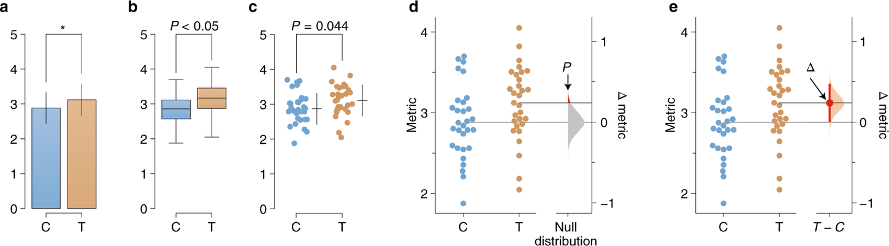

# 估计图 · 左侧对照均值就是右侧差值零点

[大图目录](../README.md) · [共用数据与坐标](../README.md#linked-data) · [出版社原图](original.png) · [来源记录](metadata.json)

**Nature Methods 2019 · Fig. 1 · a–e**

## 怎样读这张图

a–c 用柱、箱线和散点逐步展开同一份两组数据。d 加入零假设分布。e 保留原始观测，并让读者沿水平方向从对照均值读到右轴的零、从处理均值读到估计差值；右侧同时显示均值差的自助法分布与置信区间。

## 出处与原件

*Moving beyond P values: data analysis with estimation graphics*。Joses Ho, Tayfun Tumkaya, Sameer Aryal, Hyungwon Choi, Adam Claridge-Chang。

1852 × 513 像素的出版社 PNG。未取得可核验的对应矢量原图。

出版社提供原图浏览；未核实可单独复用此图的开放许可。DABEST 的软件许可证仅适用于软件。[论文图版](https://www.nature.com/articles/s41592-019-0470-3/figures/1) · [原始图像](https://media.springernature.com/full/springer-static/image/art%3A10.1038%2Fs41592-019-0470-3/MediaObjects/41592_2019_470_Fig1_HTML.png) · [版权说明](https://www.nature.com/articles/s41592-019-0470-3#rightslink)
