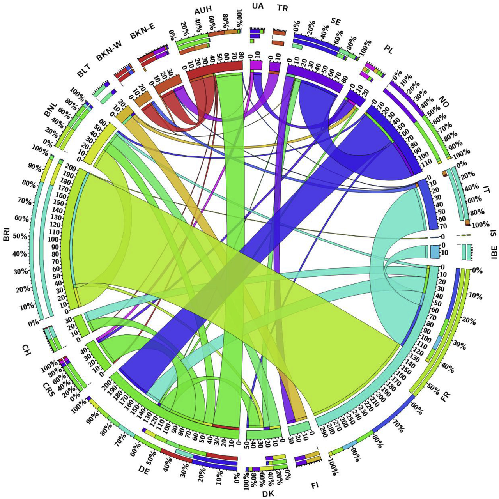

# 欧洲电网 · 沿交换带读到地区总量和份额

[大图目录](../README.md) · [共用数据与坐标](../README.md#linked-data) · [出版社原图](original.jpg) · [来源记录](metadata.json)

**Renewable Energy 2019 · Fig. 18 · 原图无字母 · 三层同心视图**

## 怎样读这张图

以 BRI（英国与爱尔兰）为例。先沿内圈色带追踪与哪些地区交换电力，再回到 BRI 的圆弧读 TWh 刻度。外围三道百分比条由内向外给出出口、进口及两者合计的份额。数据来自作者对 2050 年的情景模拟。

## 出处与原件

*Flexible electricity generation, grid exchange and storage for the transition to a 100% renewable energy system in Europe*。Michael Child, Claudia Kemfert, Dmitrii Bogdanov, Christian Breyer。

出版社独立高清 JPEG 原件，3158 × 3157 像素。核查机构库中正式论文副本第 16 页（含机构封页），该图在 PDF 中为单幅 1895 × 1895 位图。

CC BY 4.0。[论文图版](https://www.sciencedirect.com/science/article/pii/S0960148119302319#fig18) · [原始图像](https://ars.els-cdn.com/content/image/1-s2.0-S0960148119302319-gr18_lrg.jpg) · [许可条款](https://creativecommons.org/licenses/by/4.0/) · [版权说明](https://www.econstor.eu/bitstream/10419/200100/1/Child_2019_Flexible-Electricity-Generation%20Full%20Text.pdf)
