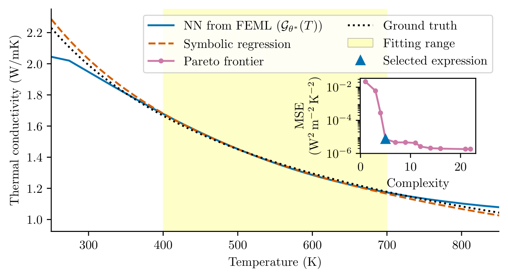

# FEML 热导率 · 从复杂度 5 的拐点读到温度区间外的预测

[大图目录](../README.md) · [从模型选择读到输出](../README.md#model-to-output) · [作者独立 PDF](original.pdf) · [来源记录](metadata.json)

**Scientific Reports 2026 · Fig. 18 · 主图与右上插图（无字母编号）**

## 沿一个模型读图

右上蓝色三角（复杂度 5）→ 正文式（10）的幂律 k(T) = (884.2/T)^0.6547 → 主图橙色虚线。前沿与函数输出同图；具体公式在正文，图内没有结构图。

先看右上粉色前沿的蓝色三角。它选中通过正值筛选的复杂度 5 候选，正文式（10）给出 k(T) = (884.2/T)^0.6547。回到主图看橙色虚线：在黄色的 400–700 K 拟合区内，它紧贴黑色真值点线；超过 700 K 后，仍可逐温度与真值和神经网络的蓝线比较。

## 出处与文件

*Missing physics discovery through fully differentiable finite element-based machine learning*。Ado Farsi, Nacime Bouziani, David A. Ham。

作者 TeX 源包中的独立矢量 PDF。散点、填色区域、曲线与文字可单独选取。

CC BY 4.0。

[原图出处](https://www.nature.com/articles/s41598-026-65125-z/figures/18) · [作者源包](https://arxiv.org/src/2507.15787v3) · [许可说明](https://creativecommons.org/licenses/by/4.0/)
