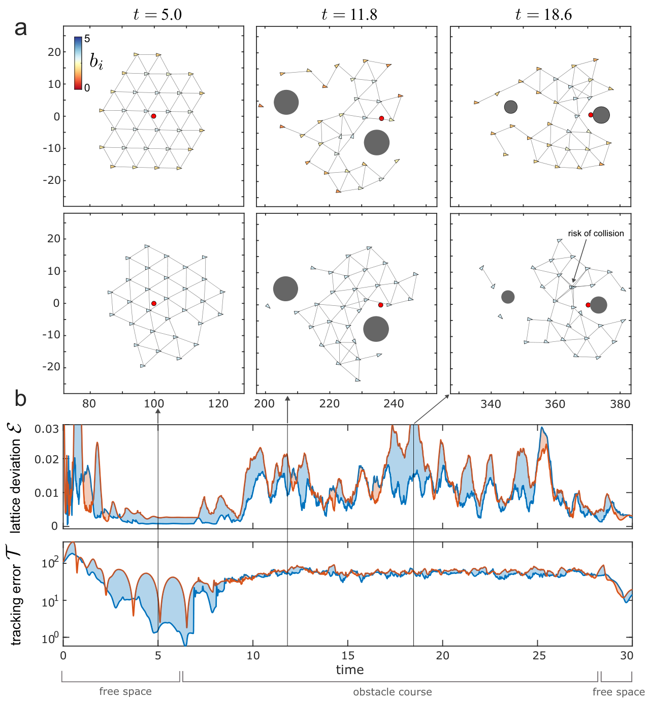

# 集群避障 · 从误差发生的时刻追到队形

[大图目录](../README.md) · [引线与局部展开](../README.md#cross-panel-links) · [单页 PDF](figure.pdf) · [来源记录](metadata.json)

**Nature Communications 2025 · Fig. 7 · a、b**

## 怎样读这张图

先在 b 的时间轴上找标记，再顺着灰线向上看 a。三个时刻各有上下两种队形。最右一列的箭头指出其中一组在障碍物旁的碰撞风险，下方曲线给出这段过程的队形偏差与跟踪误差。

## 出处与原件

*Optimal flock formation induced by agent heterogeneity*。Arthur N. Montanari, Ana Elisa D. Barioni, Chao Duan, Adilson E. Motter。

完整 a、b 组。轨迹、队形、时间引线与坐标可在 PDF 中选择；窄色标为位图。

CC BY-NC-ND 4.0。[论文图版](https://www.nature.com/articles/s41467-025-64233-0/figures/7) · [原始文件](https://pmc-oa-opendata.s3.amazonaws.com/PMC12578833.1/PMC12578833.1.pdf) · [许可条款](https://creativecommons.org/licenses/by-nc-nd/4.0/) · [版权说明](https://www.nature.com/articles/s41467-025-64233-0#rightslink)
