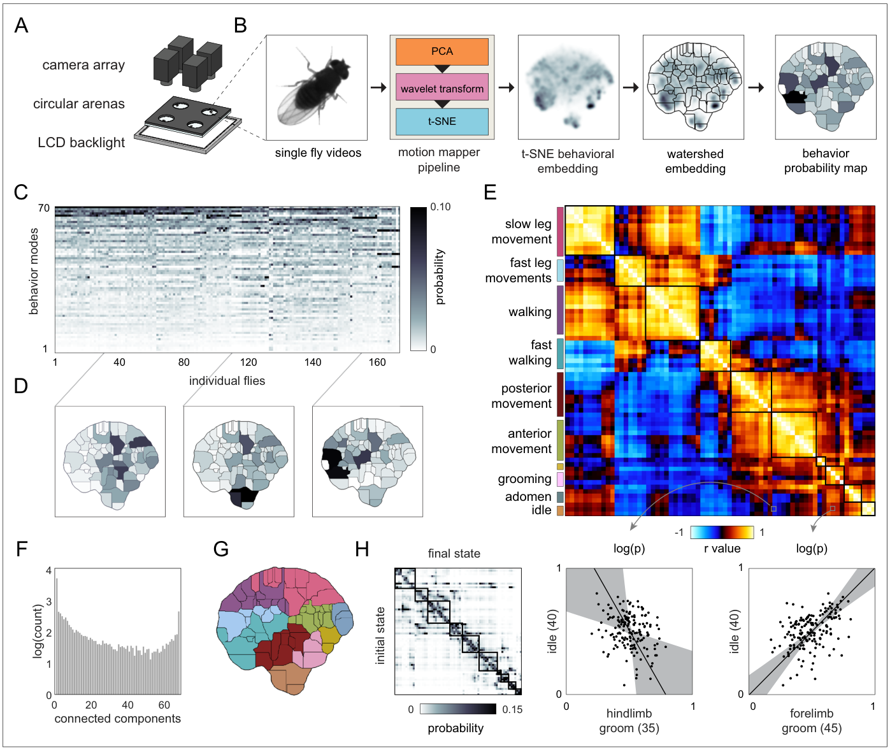

# 果蝇行为图谱 · 从个体列追到行为地图与转移矩阵

[大图目录](../README.md) · [共用数据与坐标](../README.md#linked-data) · [单页 PDF](figure.pdf) · [来源记录](metadata.json)

**eLife 2021 · Fig. 2 · A–H**

## 怎样读这张图

先看 B 怎样把单果蝇录像转换成行为地图。C 每行代表一种行为，每列代表一只果蝇。D 三幅图来自 C 中被引线标出的三个个体，每幅沿用同一组区域边界，深浅表示这只果蝇在各行为上的概率。E 把行为按跨个体相关性分组，G 将组别颜色贴回地图，H 的对角分块对应同一分组，格子表示相邻视频帧从一种行为转到另一种的概率。

## 出处与原件

*The structure of behavioral variation within a genotype*。Zachary Werkhoven, Alyssa Bravin, Kyobi Skutt-Kakaria, Pablo Reimers, Luisa F Pallares, Julien Ayroles, Benjamin L de Bivort。

论文 PDF 保留文字、面板引线、部分坐标与散点等矢量对象，行为热图、地图等含位图。

CC BY 4.0。 [原图出处](https://elifesciences.org/articles/64988/figures#fig2) · [来源 PDF](https://pmc-oa-opendata.s3.amazonaws.com/PMC8526060.1/PMC8526060.1.pdf) · [许可](https://creativecommons.org/licenses/by/4.0/)
