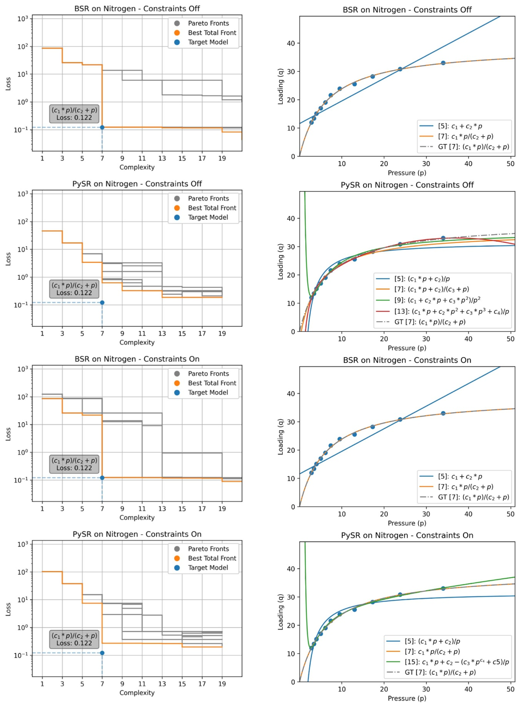

# 符号回归 · 从帕累托拐点读到拟合曲线

[大图目录](../README.md) · [从模型选择读到输出](../README.md#model-to-output) · [期刊原图](original.jpg) · [来源记录](metadata.json)

**Machine Learning: Science and Technology 2024 · Fig. 5 · 四行 × 两列（图内无字母）**

## 怎样读这张图

先读第一行左图。橙色前沿在复杂度 7 达到蓝色目标点，标注损失为 0.122。转到同一行右图，图例里的 [7] 给出对应公式，橙色吸附曲线与灰色目标曲线几乎重合；[5] 的蓝色直线在较高压力处继续上升。上下四行依次是关闭约束的 BSR、PySR 和打开约束的 BSR、PySR，同一套氮吸附观测重复出现在每一行右侧。

## 出处与原件

*Incorporating background knowledge in symbolic regression using a computer algebra system*。Charles Fox, Neil D Tran, F Nikki Nacion, Samiha Sharlin, Tyler R Josephson。

从期刊 PDF 第 9 页直接取出嵌入的完整 JPEG（1352 × 1835）。作者公开的 TeX 源包也以八幅 PNG 排成此图。

CC BY 4.0。 [原图出处](https://iopscience.iop.org/article/10.1088/2632-2153/ad4a1e/pdf#page=9) · [来源 PDF](https://iopscience.iop.org/article/10.1088/2632-2153/ad4a1e/pdf) · [许可](https://creativecommons.org/licenses/by/4.0/) · [作者项目](https://github.com/ATOMSLab/pySR_adsorption)
