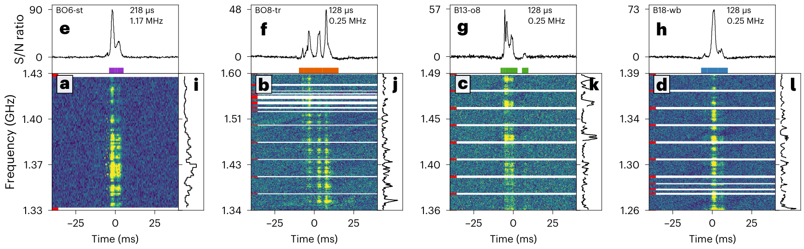

# 快速射电暴 · 时频图和两侧投影共用坐标

[大图目录](../README.md) · [共用数据与坐标](../README.md#linked-data) · [单页 PDF](figure.pdf) · [来源记录](metadata.json)

**Nature Astronomy 2024 · Fig. 2 · a–l**

## 怎样读这张图

以第一列为例，a 的横轴是时间，纵轴是频率。沿频率平均得到 e。再看 e 下方紫色短条，在这段时间内平均便得到 i。其余三列对另外三次暴发采用相同的读法。

## 出处与原件

*A link between repeating and non-repeating fast radio bursts through their energy distributions*。F. Kirsten et al.。

矢量与位图混合的论文图版。单图 PDF 保留原图版中的文字、曲线和坐标轴；动态频谱保留为位图。渲染层检出 151 个绘图对象和 4 个图像放置实例。

CC BY 4.0，第三方材料以各自的署名说明为准。[论文图版](https://www.nature.com/articles/s41550-023-02153-z/figures/2) · [原始文件](https://research.chalmers.se/publication/539316/file/539316_Fulltext.pdf) · [许可条款](https://creativecommons.org/licenses/by/4.0/) · [版权说明](https://www.nature.com/articles/s41550-023-02153-z#rightslink)
