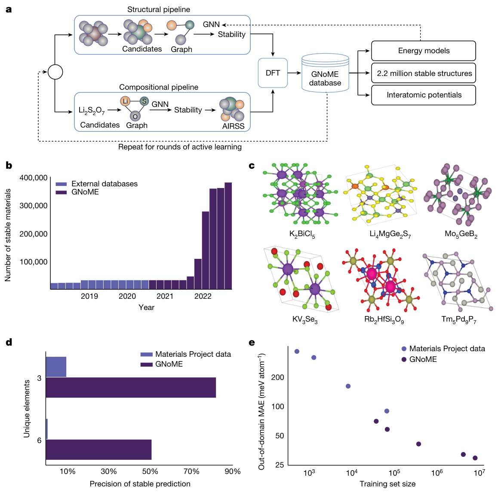

# GNoME · 筛选闭环、发现规模与晶体实例

[大图目录](../README.md) · [混合矢量 PDF · 下载单页图版](figure.pdf) · [来源记录](metadata.json)

**Nature 2023 · Fig. 1 · a–e（5 个标记面板）**

## 这张图怎么读

a 说明结构或组分进入模型筛选后如何经密度泛函理论验证并回流。b 给发现规模，c 展示独立实验验证的六个结构实例。d 看高组分复杂度区域的发现占比，e 看随机结构搜索样本上的泛化。

**版式**　第一行通栏画两条候选生成支路和筛选反馈。下方两行各分两栏。中行右栏在一个字母内嵌入六个已验证结构，与左边发现数量的时间轴对照。

## 出处与文件

*Scaling deep learning for materials discovery*。Amil Merchant, Simon Batzner, Samuel S. Schoenholz, Muratahan Aykol, Gowoon Cheon, Ekin Dogus Cubuk。

PDF 同时保留矢量路径与嵌入位图。照片、显微图像或热图等位图部分保留原分辨率。部分文字可以选取。 从论文 PDF 提取完整图版，另存为单页 PDF，并等比生成预览。面板沿用原文顺序。

CC BY 4.0（论文及无单独署名例外的图材。c 所示实例的实验来源见原图注参考文献 50–55）。

[原图出处](https://www.nature.com/articles/s41586-023-06735-9/figures/1) · [发布方图像或全文](https://www.nature.com/articles/s41586-023-06735-9.pdf) · [许可条款](https://creativecommons.org/licenses/by/4.0/)
