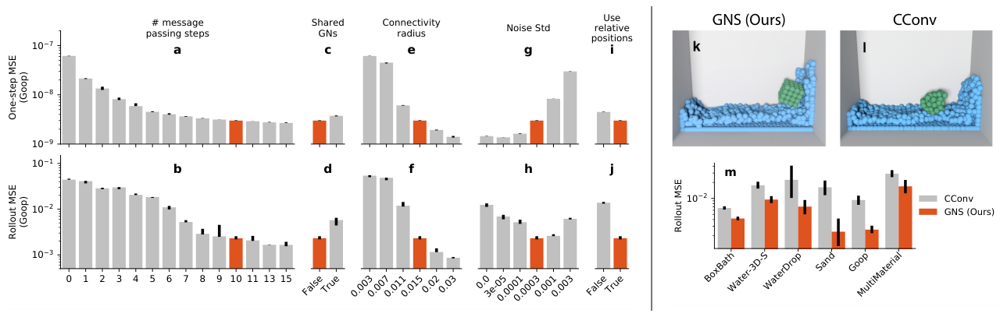

# GNS · 五组消融、同场景预测与跨材料误差

[大图目录](../README.md) · [混合矢量 PDF · 下载单页图版](figure.pdf) · [来源记录](metadata.json)

**ICML 2020 · Fig. 4 · a–m（13 个标记面板）**

## 这张图怎么读

a、b 比较消息传递步数对单步及多步预测误差的影响。沿 c–j 横读其余四种设置，每列都保持上行为单步、下行为多步。k、l 对照 GNS 与 CConv 推演 50 步后的场景。m 汇总各材料上的多步误差。

**版式**　左侧五列消融各用上下两张柱图，共用横轴。右上给同一 BoxBath 场景的两幅模拟快照，右下为不同材料的误差总图。原图包含可编辑的曲线轴标与柱形，两张模拟快照为嵌入图像。

## 出处与文件

*Learning to Simulate Complex Physics with Graph Networks*。Alvaro Sanchez-Gonzalez, Jonathan Godwin, Tobias Pfaff, Rex Ying, Jure Leskovec, Peter W. Battaglia。

PDF 同时保留矢量路径与嵌入位图。照片、显微图像或热图等位图部分保留原分辨率。部分文字可以选取。 从论文 PDF 提取完整图版，另存为单页 PDF，并等比生成预览。面板沿用原文顺序。

CC BY 4.0（PMLR 正式出版协议要求署名，并给出原论文在 PMLR 的链接）。

[原图出处](https://proceedings.mlr.press/v119/sanchez-gonzalez20a.html) · [发布方图像或全文](https://proceedings.mlr.press/v119/sanchez-gonzalez20a/sanchez-gonzalez20a.pdf) · [许可条款](https://creativecommons.org/licenses/by/4.0/) · [PMLR 出版协议](https://proceedings.mlr.press/pmlr-license-agreement.pdf)
