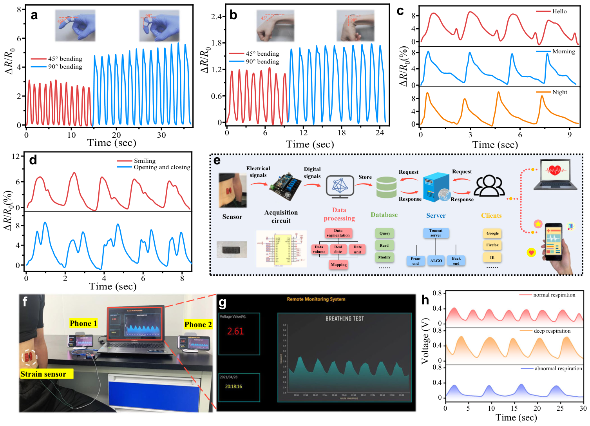

# 呼吸监测 · 从实验台的屏幕读到实时波形

[大图目录](../README.md) · [引线与局部展开](../README.md#cross-panel-links) · [单页 PDF](figure.pdf) · [SVG · 文字转轮廓](figure.svg) · [来源记录](metadata.json)

**npj Flexible Electronics 2022 · Fig. 5 · a–h**

## 怎样读这张图

上部 a–d 给出动作传感曲线，e 交代信号怎样进入采集和显示系统。沿 f 中屏幕的两条红色引线读到 g 的波形；右边 h 再用三段记录比较不同呼吸状态。

## 出处与原件

*Multiscale and hierarchical wrinkle enhanced graphene/Ecoflex sensors integrated with human-machine interfaces and cloud-platform*。Jian Zhou, Xinxin Long, Jian Huang, Caixuan Jiang, Fengling Zhuo, Chen Guo, Honglang Li, YongQing Fu, Huigao Duan。

完整 a–h。实验照片等共用一幅位图；红框、跨屏引线、多条曲线和文字等保留为独立 PDF 对象。

CC BY 4.0。[论文图版](https://www.nature.com/articles/s41528-022-00189-1/figures/5) · [原始文件](https://www.nature.com/articles/s41528-022-00189-1.pdf) · [许可条款](https://creativecommons.org/licenses/by/4.0/) · [版权说明](https://www.nature.com/articles/s41528-022-00189-1#rightslink)
