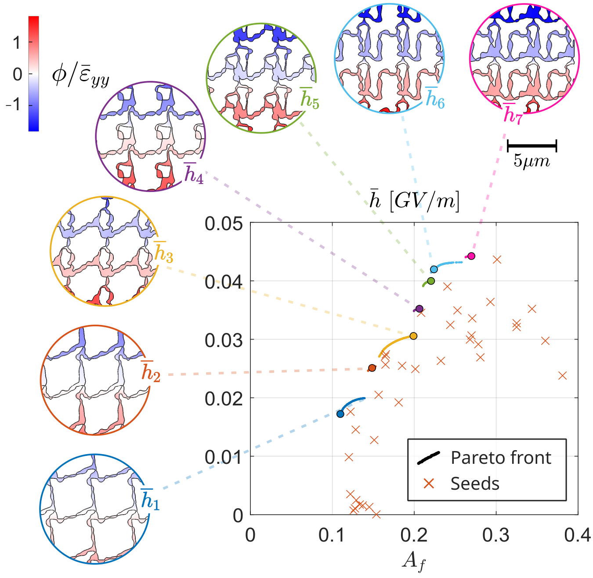

# 挠曲电应变传感器 · 七个前沿点各自连到结构和电势场

[大图目录](../README.md) · [从模型选择读到输出](../README.md#model-to-output) · [作者原始 PDF](original.pdf) · [来源记录](metadata.json)

**Journal of the Mechanics and Physics of Solids 2024 · Fig. 6 · 右下前沿图与七个带编号的圆形局部图（h̄₁ 至 h̄₇）**

## 沿一个模型读图

右下金黄色前沿点 → 同色虚线 → h̄₃ 的周期微结构 → 该结构上的归一化电势分布。另六个点均可沿各自的虚线追到对应输出。输出是数值场，图中没有独立实测或显式回归函数。

在右下图靠近面积分数 0.2、等效压电系数 0.03 GV/m 处找到金黄色圆点。沿金黄色虚线向左读到 h̄₃，细杆的连接形状给出设计，杆身的蓝白红填色给出同一结构在指定应变下的局部电势。换到右上方粉色的 h̄₇，就能用同一色标比较另一种结构；前沿分支的颜色标识拓扑族，场值由左上独立色标解释。

电势来自计算模型。独立 PDF 中部分图层为位图。作者以 CC BY-NC-ND 4.0 发布，保留原件，发布改编图须另获许可。

## 出处与文件

*Topology optimization of flexoelectric metamaterials with apparent piezoelectricity*。Francesco Greco, David Codony, Hossein Mohammadi, Sonia Fernández-Méndez, Irene Arias。

作者 TeX 源包随附的整图 PDF，原字节保存。含 1459 个矢量绘图对象和 8 个位图绘制实例；部分文字是轮廓或嵌在图层中。

CC BY-NC-ND 4.0。

[论文](https://doi.org/10.1016/j.jmps.2023.105477) · [原图出处](https://arxiv.org/html/2303.09448v2#S5.F6) · [作者源包](https://arxiv.org/src/2303.09448v2) · [许可说明](https://creativecommons.org/licenses/by-nc-nd/4.0/)
