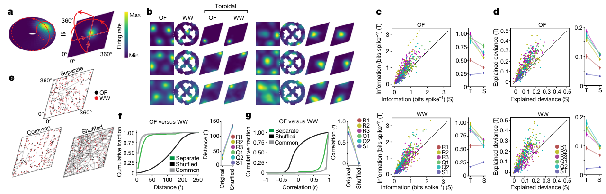

# 把同一网格细胞放回物理空间和环面

[大图目录](../README.md) · [混合矢量 PDF · 下载单页图版](figure.pdf) · [来源记录](metadata.json)

**Nature 2022 · Fig. 2 · a–g（7 个标记面板）**

## 这张图怎么读

a 定义推断的环面坐标，b 的每行在开放场和架高网格跑道中展示同一个细胞，并把它映回共同环面。c、d 比较环面位置和空间位置解释放电的能力。e 连同一细胞在两种环境中的场中心，f、g 分别统计距离与放电图相关。

**版式**　左上用环面及其二维展开解释坐标，中上用多行细胞热图对照环境，右列放信息量与模型拟合。左下和中下以连线图、累积分布检验位置稳定性。

## 出处与文件

*Toroidal topology of population activity in grid cells*。Richard J. Gardner, Erik Hermansen, Marius Pachitariu, et al.。

PDF 同时保留矢量路径与嵌入位图。照片、显微图像或热图等位图部分保留原分辨率。部分文字可以选取。 从论文 PDF 提取完整图版，另存为单页 PDF，并等比生成预览。面板沿用原文顺序。

CC BY 4.0。已核对论文的版权与许可声明。

[原图出处](https://www.nature.com/articles/s41586-021-04268-7/figures/2) · [发布方图像或全文](https://pmc-oa-opendata.s3.amazonaws.com/PMC8810387.1/PMC8810387.1.pdf) · [许可条款](https://creativecommons.org/licenses/by/4.0/)
