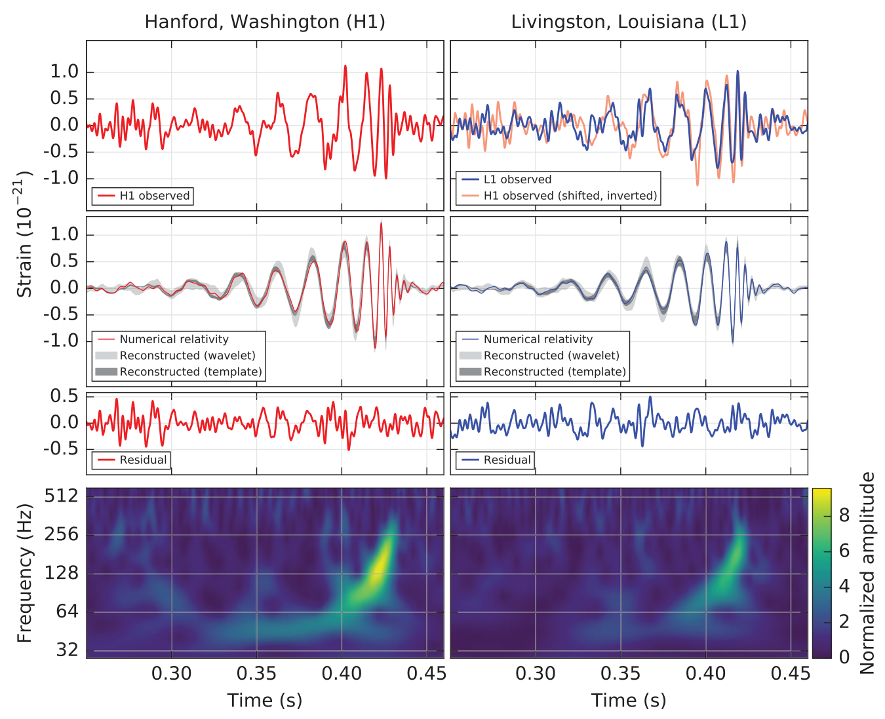

# GW150914 · 实测与模型相减得到下一行残差

[大图目录](../README.md) · [共用数据与坐标](../README.md#linked-data) · [单页 PDF](figure.pdf) · [来源记录](metadata.json)

**Physical Review Letters 2016 · Fig. 1 · 原图无字母 · 两列各四行**

## 怎样读这张图

左列为 Hanford，右列为 Livingston。沿一列从上往下，先读滤波后的实测应变，再看数值相对论波形与两种重建区间。第三行用实测减去数值相对论波形，最下行给出同一事件的时频表示。

## 出处与原件

*Observation of Gravitational Waves from a Binary Black Hole Merger*。B. P. Abbott et al. (LIGO Scientific Collaboration and Virgo Collaboration)。

三排波形、残差曲线、轴与标注保留矢量，底部的两张时频图含位图。

CC BY 3.0。[论文图版](https://gwosc.org/events/GW150914/) · [原始文件](https://arxiv.org/pdf/1602.03837) · [许可条款](https://creativecommons.org/licenses/by/3.0/) · [版权说明](https://doi.org/10.1103/PhysRevLett.116.061102)
