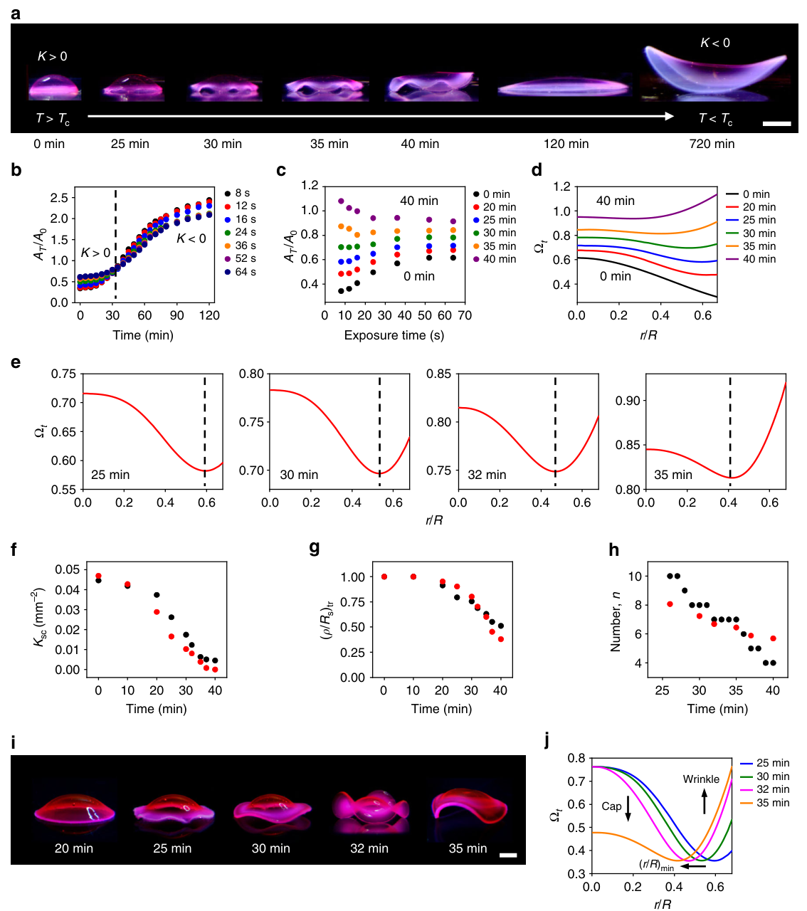

# 一只水凝胶球冠的冷却变形全过程

[大图目录](../README.md) · [混合矢量 PDF · 下载单页图版](figure.pdf) · [来源记录](metadata.json)

**Nature Communications 2018 · Fig. 5 · a–j（10 个标记面板）**

## 这张图怎么读

从 a 的球冠追踪曲率变号。b–e 将曝光、冷却时间和径向生长联系起来。f–h 分别核对中心曲率、形状过渡位置和皱纹数。i、j 再用同一组时刻检验能否复现瞬态外形。

**版式**　顶端用一条黑底时间序列横贯全图。中部从三张校准图过渡到分时径向曲线，再排三张理论与实验对照。末行回到实物复现及其设计曲线。

## 出处与文件

*Bioinspired 3D structures with programmable morphologies and motions*。Amirali Nojoomi, Hakan Arslan, Kwan Lee, Kyungsuk Yum。

PDF 同时保留矢量路径与嵌入位图。照片、显微图像或热图等位图部分保留原分辨率。部分文字可以选取。 从论文 PDF 提取完整图版，另存为单页 PDF，并等比生成预览。面板沿用原文顺序。

CC BY 4.0。 © The Author(s) 2018

[原图出处](https://www.nature.com/articles/s41467-018-05569-8/figures/5) · [发布方图像或全文](https://www.nature.com/articles/s41467-018-05569-8.pdf) · [许可条款](https://creativecommons.org/licenses/by/4.0/)
