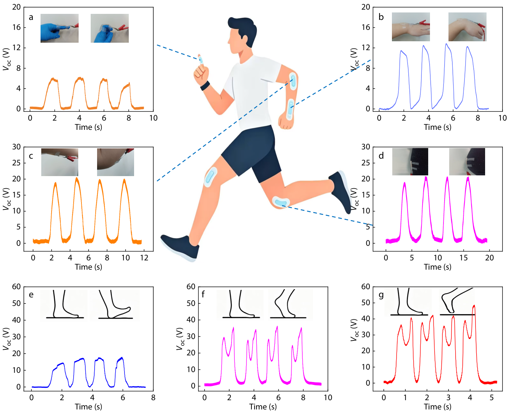

# 水凝胶传感器 · 身体测点连到电压曲线

[大图目录](../README.md) · [引线与局部展开](../README.md#cross-panel-links) · [单页 PDF](figure.pdf) · [来源记录](metadata.json)

**Chinese Journal of Polymer Science 2026 · Fig. 9 · a–g**

## 怎样读这张图

先看中央人物身上的贴片。四条虚线分别指向手指、手腕、手肘和膝部的 a–d。每个小图把动作照片放在电压记录旁。底排 e–g 继续比较足部动作的不同电压记录。

## 出处与原件

*Room-temperature Autocatalytic Multifunctional Hydrogels for Triboelectric Nanogenerators and Self-powered Sensors*。Xin-Yu Ye, Jie He, Zhao-Wen Yang, Tai-Hong Chen, Yin-Jie Peng。

完整 a–g。电压随时间变化的曲线、刻度、标签等保留为矢量路径或文字，跑步者与实拍素材为嵌入位图。

原刊标注 © Chinese Chemical Society；未确认单独的开放复用许可。[论文图版](https://www.cjps.org/rc-pub/front/front-article/download/164715991/lowqualitypdf/Room-temperature%20Autocatalytic%20Multifunctional%20Hydrogels%20for%20Triboelectric%20Nanogenerators%20and%20Self-powered%20Sensors.pdf#page=12) · [原始文件](https://www.cjps.org/rc-pub/front/front-article/download/164715991/lowqualitypdf/Room-temperature%20Autocatalytic%20Multifunctional%20Hydrogels%20for%20Triboelectric%20Nanogenerators%20and%20Self-powered%20Sensors.pdf)
