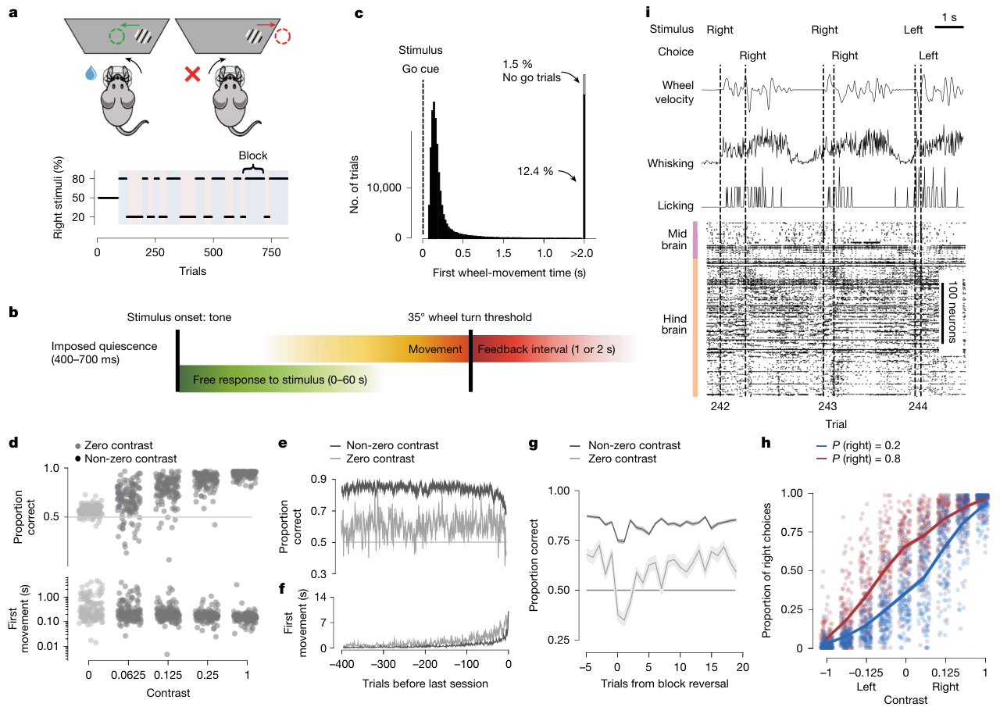

# 从转轮选择任务到同一试次的神经记录

[大图目录](../README.md) · [混合矢量 PDF · 下载单页图版](figure.pdf) · [来源记录](metadata.json)

**Nature 2025 · Fig. 1 · a–i（9 个标记面板）**

## 这张图怎么读

先沿 a、b 找到刺激、转轮动作和反馈，再在 i 的三个实际试次里对齐转轮、视频提取量及多脑区放电。c、d 检查反应时间和刺激对比度。e、f 检查临近会话结束时的变化，g、h 检查先验区块切换如何改变选择。

**版式**　上半部左侧是任务装置和事件时间轴，中央是反应时，右侧的纵向长面板沿三次试验对齐行为与神经元放电。底部四组小图概括会话进程、区块切换和选择偏差。

## 出处与文件

*A brain-wide map of neural activity during complex behaviour*。International Brain Laboratory, Dora Angelaki, Brandon Benson, et al.。

PDF 同时保留矢量路径与嵌入位图。照片、显微图像或热图等位图部分保留原分辨率。部分文字可以选取。 从论文 PDF 提取完整图版，另存为单页 PDF，并等比生成预览。面板沿用原文顺序。

CC BY 4.0。已核对论文的版权与许可声明。a 改编自原文参考文献 23（eLife，CC BY 4.0），使用时须保留其署名。

[原图出处](https://www.nature.com/articles/s41586-025-09235-0/figures/1) · [发布方图像或全文](https://pmc-oa-opendata.s3.amazonaws.com/PMC12408349.1/PMC12408349.1.pdf) · [许可条款](https://creativecommons.org/licenses/by/4.0/)

<!-- source extras -->

a 的任务示意改编自 International Brain Laboratory 等人在 eLife 发表的 *Standardized and reproducible measurement of decision-making in mice*（2021，CC BY 4.0）。[原文](https://doi.org/10.7554/eLife.63711) · [同一工作在本库的 Fig. 4](../ibl-mouse-prior-cross-lab-replication/README.md)
