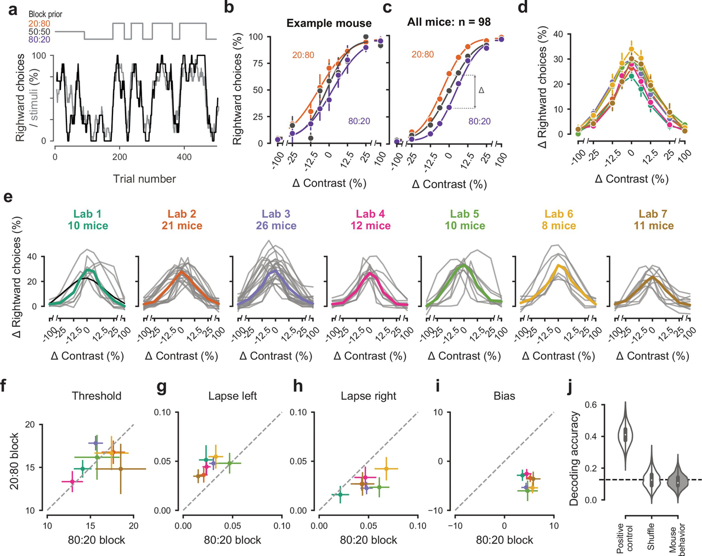

# 从一只小鼠的先验偏差到跨实验室复核

[大图目录](../README.md) · [位图参考 · 下载出版社原图](original.jpg) · [来源记录](metadata.json)

**eLife 2021 · Fig. 4 · a–j（10 个标记面板）**

## 这张图怎么读

a 记录刺激先验切换及小鼠实际选择，b、c 用两条心理物理曲线定义区块偏移，d 汇总对比度效应。e 并排展示七个实验室，f–i 分解阈值、左右失误率和偏差，j 检验能否凭这些行为量识别实验室。

**版式**　第一行从单只小鼠的连续选择过渡到区块间的偏移定义和汇总。中间七个实验室各占一格、共用坐标。最下排比较心理物理参数，并以分类结果检查实验室差异。

## 出处与文件

*Standardized and reproducible measurement of decision-making in mice*。The International Brain Laboratory, Valeria Aguillon-Rodriguez, Dora Angelaki, et al.。

出版方独立图像为 2505 × 1984 像素，原文件按下载字节保存。 原文件保留下载字节，预览等比缩小。

CC BY 4.0。已核对论文的版权与许可声明。

[原图出处](https://elifesciences.org/articles/63711#fig4) · [发布方图像或全文](https://iiif.elifesciences.org/lax:63711%2Felife-63711-fig4-v3.tif/full/full/0/default.jpg) · [许可条款](https://creativecommons.org/licenses/by/4.0/)
