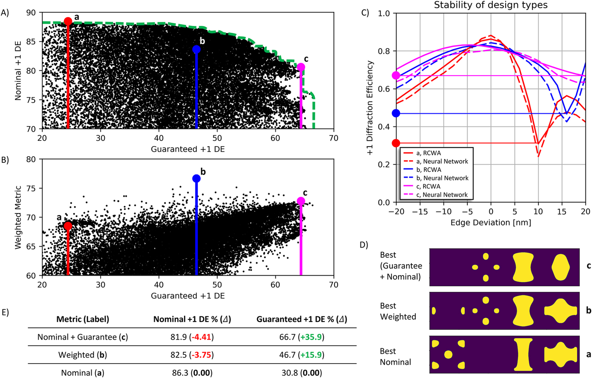

# 超表面制造偏差 · 从前沿设计追到掩模与衍射效率曲线

[大图目录](../README.md) · [从模型选择读到输出](../README.md#model-to-output) · [原始 JPG](original.jpg) · [来源记录](metadata.json)

**Nanophotonics 2021 · Fig. 4 · A–E，设计编号为小写 a、b、c**

## 沿一个模型读图

A 的粉色前沿点 c → D 第一行同名超胞掩模 → C 的粉色实线与虚线 → E 中标称和保证效率。蓝色 b 依据 B 的加权目标选择，位于 A 的绿色前沿内部。输出是网络预测和电磁数值校验，未给出硬件实测或解析函数。

先找 A 中位于绿色前沿右侧的粉色 c，再到 D 的第一行辨认 c 的黄色掩模。C 仍用粉色表示 c，实线为严格耦合波分析（RCWA）的计算结果，虚线为神经网络预测。对照红色 a，边缘偏差增大时两种结构的效率下降幅度显著不同；E 的保证效率一列给出 c 为 66.7%、a 为 30.8%。B 解释蓝色 b 如何按另一种加权指标选出。

出版社发布的独立原图为 JPEG，未取得可分层编辑的矢量文件。衍射效率由电磁求解器校验。

## 出处与文件

*Establishing exhaustive metasurface robustness against fabrication uncertainties through deep learning*。Ronald P. Jenkins, Sawyer D. Campbell, Douglas H. Werner。

出版社发布的独立 JPEG，1943 × 1243 像素；整图为位图，文字、曲线及掩模均未分层。

CC BY 4.0。

[论文](https://doi.org/10.1515/nanoph-2021-0428) · [原图出处](https://www.degruyterbrill.com/document/doi/10.1515/nanoph-2021-0428/asset/graphic/j_nanoph-2021-0428_fig_004.jpg) · [原文件](https://www.degruyterbrill.com/document/doi/10.1515/nanoph-2021-0428/asset/graphic/j_nanoph-2021-0428_fig_004.jpg) · [许可说明](https://creativecommons.org/licenses/by/4.0/)
