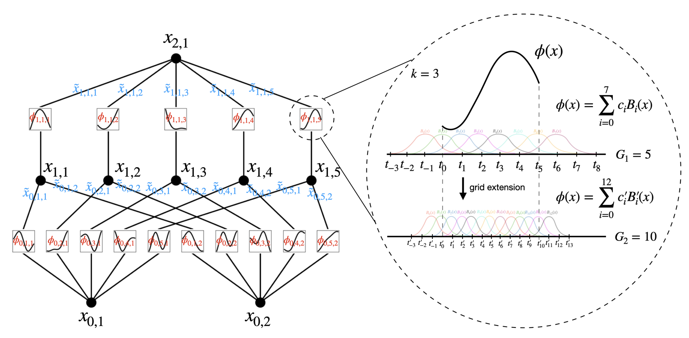

# KAN · 从网络的一条边展开样条函数

[大图目录](../README.md) · [引线与局部展开](../README.md#cross-panel-links) · [作者投稿 PNG](original.png) · [来源记录](metadata.json)

**ICLR 2025 · Fig. 2.2 · 原图无字母 · 网络与函数局部**

## 怎样读这张图

沿左图从输入节点经过边上的函数走到输出。上层右侧一条边被圈出，右边的放大区域给出函数及两套网格上的基函数。原文图号为 2.2。

## 出处与原件

*KAN: Kolmogorov-Arnold Networks*。Ziming Liu, Yixuan Wang, Sachin Vaidya, Fabian Ruehle, James Halverson, Marin Soljačić, Thomas Y. Hou, Max Tegmark。

作者 arXiv v5 的 TeX 源码直接引用 figs/spline_notation.png。保留投稿 PNG 原件（3386 × 1664 像素）；v5 论文第 4 页此图也由单幅位图构成。

CC BY 4.0。[论文图版](https://arxiv.org/pdf/2404.19756v5#page=4) · [原始文件](https://arxiv.org/src/2404.19756v5) · [会议论文](https://proceedings.iclr.cc/paper_files/paper/2025/hash/afaed89642ea100935e39d39a4da602c-Abstract-Conference.html) · [许可条款](https://creativecommons.org/licenses/by/4.0/) · [版权说明](https://arxiv.org/abs/2404.19756v5)
