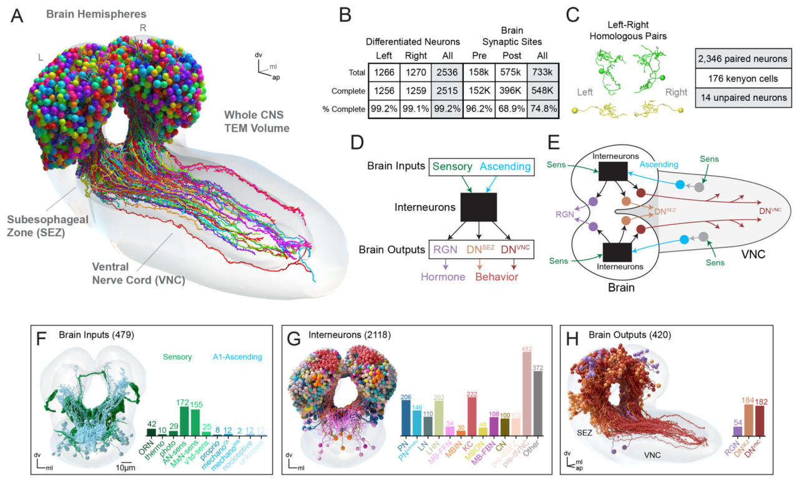

# 果蝇幼虫全脑重建与三类神经元

[大图目录](../README.md) · [位图参考 · 下载单页图版](figure.pdf) · [来源记录](metadata.json)

**Science 2023 · Fig. 1 · A–H（8 个标记面板）**

## 这张图怎么读

A 在电镜体积内标出两个脑半球、食管下区与腹神经索。B 给出重建完整率，C 配对左右同源神经元。D 用框图介绍输入、中间和输出三级，E 把线路放回脑与腹神经索的位置。沿底行看 F 的输入神经元、G 的中间神经元、H 的输出神经元，每格都把形态与相应类别的数量并置。

**版式**　左上用整幅彩色神经重建定位全脑。右上四格把重建完整度、左右配对与通路关系排成两层。底行三张同构的「神经元形态＋计数柱图」并排，可沿同一视角比较。

## 出处与文件

*The connectome of an insect brain*。Michael Winding, Benjamin D Pedigo, Christopher L Barnes, Heather G Patsolic, Youngser Park, Tom Kazimiers, Akira Fushiki, Ingrid V Andrade, Avinash Khandelwal, Javier Valdes-Aleman, Feng Li, Nadine Randel, Elizabeth Barsotti, Ana Correia, Richard D Fetter, Volker Hartenstein, Carey E Priebe, Joshua T Vogelstein, Albert Cardona, Marta Zlatic。

PMC 作者接受稿第 34 页的整图以位图为主，放大或在 Illustrator 中打开时，图内曲线仍是像素。 从此稿提取完整图版，另存为单页 PDF，并等比生成预览。面板沿用原文顺序。

CC BY 4.0（适用于此 PMC 作者接受稿）。 PMC 作者接受稿标明 CC BY 4.0；论文版权页列 American Association for the Advancement of Science 为独家被许可人。

[原图出处](https://pmc.ncbi.nlm.nih.gov/articles/PMC7614541/#F1) · [发布方图像或全文](https://pmc-oa-opendata.s3.amazonaws.com/PMC7614541.1/PMC7614541.1.pdf) · [许可条款](https://creativecommons.org/licenses/by/4.0/) · [Science 正刊论文](https://doi.org/10.1126/science.add9330)

<!-- source extras -->

PDF 中嵌入的整图为 2096 × 1265 像素，可直接查看原分辨率。[下载嵌入图像](embedded.jpg)
