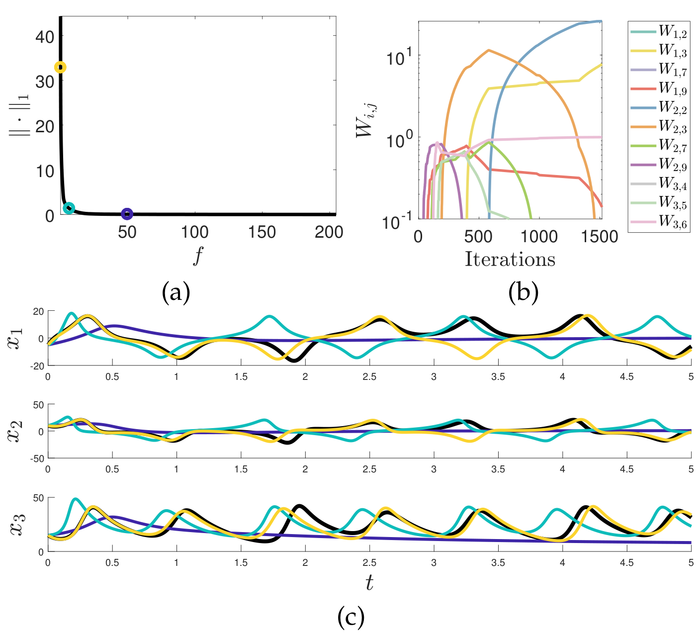

# Lorenz 系统 · 从帕累托选择读到系数与三条状态轨迹

[大图目录](../README.md) · [从模型选择读到输出](../README.md#model-to-output) · [单页 PDF](figure.pdf) · [SVG · 从 PDF 导出](figure.svg) · [来源记录](metadata.json)

**IEEE Transactions on Pattern Analysis and Machine Intelligence 2022 · 作者稿 Fig. 6 · a–c**

## 沿一个模型读图

a 黄、青、紫三个候选点 → c 对应颜色的三条状态随时间的输出；b 展示稀疏多项式系数随延续迭代的变化。

a 的横轴是导数拟合误差 f，纵轴是系数矩阵的 ℓ₁ 范数。选左上黄色点或左下青色点，再在 c 的 x₁、x₂、x₃ 三行逐一找同色曲线，并与黑色 Lorenz 参考轨迹对照。b 从整个求解过程展示曾超过 0.5 的系数分量，图例中的 W 下标区分状态和系数。三个候选点与轨迹的对应由 a 和 c 的颜色给出，b 没有逐点画出三个候选的系数表。

## 出处与文件

*On the Treatment of Optimization Problems With L1 Penalty Terms via Multiobjective Continuation*。Katharina Bieker, Bennet Gebken, Sebastian Peitz。

完整图版裁自作者稿 arXiv v2 第 10 页。另附作者 TeX 源包内 a、b、c 三份原始矢量 PDF。

[a · 帕累托前沿](panel-a.pdf) · [b · 系数随迭代的变化](panel-b.pdf) · [c · 轨迹预测](panel-c.pdf)

CC BY 4.0。

[原图出处](https://arxiv.org/pdf/2012.07483v2#page=10) · [来源 PDF](https://arxiv.org/pdf/2012.07483v2) · [许可说明](https://creativecommons.org/licenses/by/4.0/) · [作者子图源包](https://arxiv.org/src/2012.07483v2)

[SINDy 原理图](../sindy-lorenz-active-terms/README.md)给出了 Lorenz 系统中候选项、非零系数和识别方程的对应关系。
