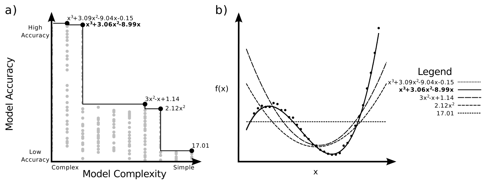

# 多项式选模 · 沿同一个公式从前沿读到拟合曲线

[大图目录](../README.md) · [从模型选择读到输出](../README.md#model-to-output) · [单页矢量 PDF](figure.pdf) · [SVG · 从 PDF 导出](figure.svg) · [来源记录](metadata.json)

**Journal of Machine Learning Research 2012 · Fig. 5 · a、b**

## 沿一个模型读图

a 的黑点 → 点旁的多项式 → b 中同名图例和线型 → 同一组样本上的函数输出。

在 a 左上角选加粗的三次式 x³ + 3.06x² − 8.99x。它与左侧更复杂的候选精度接近，但少一个常数项。移到 b，在图例中找到同一个加粗公式，沿实线看它如何跟随样本的峰、谷和右端上升段。试着再看 a 右下角的 17.01，它在 b 里变成横穿整组样本的一条水平线。

作者用一个合成多项式例子解释模型复杂度与精度的权衡。

## 出处与文件

*Learning Symbolic Representations of Hybrid Dynamical Systems*。Daniel L. Ly, Hod Lipson。

从 JMLR 论文第 10 页（印刷页码 3594）裁取 a、b 两个子图。图内的线条、点和公式均为矢量轮廓，文字可以移动和缩放，无法作为文本改写。

© 2012 Daniel L. Ly 与 Hod Lipson。原文标明作者版权，未核实此图的单独再使用许可。

[论文](https://www.jmlr.org/papers/v13/ly12a.html) · [原图出处](https://www.jmlr.org/papers/volume13/ly12a/ly12a.pdf#page=10) · [论文 PDF](https://www.jmlr.org/papers/volume13/ly12a/ly12a.pdf) · [许可说明](https://www.jmlr.org/papers/volume13/ly12a/ly12a.pdf#page=1)
