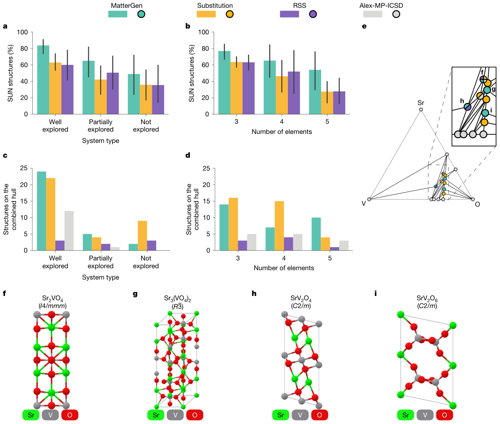

# MatterGen · 从目标化学空间读到四个具体晶体

[大图目录](../README.md) · [混合矢量 PDF · 下载单页图版](figure.pdf) · [来源记录](metadata.json)

**Nature 2025 · Fig. 3 · a–i（9 个标记面板）**

## 这张图怎么读

a、b 比较各方法生成稳定、独特且新颖结构的比例，c、d 统计凸包上的结构数。e 把其中一个 V–Sr–O 化学体系展开。沿放大框里的 f–i，可以逐一点到底行对应晶体。f 是重新发现的已知结构。

**版式**　左上为两行两列统计图，右上用跨两行的三元相图与局部放大框呈现个案。底行四个晶体结构并排，图中字母与放大框中的点相互索引。

## 出处与文件

*A generative model for inorganic materials design*。Claudio Zeni, Robert Pinsler, Daniel Zügner, Andrew Fowler, Matthew Horton, Xiang Fu, Zilong Wang, Aliaksandra Shysheya, Jonathan Crabbé, Shoko Ueda, Roberto Sordillo, Lixin Sun, Jake Smith, Bichlien Nguyen, Hannes Schulz, Sarah Lewis, Chin-Wei Huang, Ziheng Lu, Yichi Zhou, Han Yang, Hongxia Hao, Jielan Li, Chunlei Yang, Wenjie Li, Ryota Tomioka, Tian Xie。

PDF 同时保留矢量路径与嵌入位图。照片、显微图像或热图等位图部分保留原分辨率。部分文字可以选取。 从论文 PDF 提取完整图版，另存为单页 PDF，并等比生成预览。面板沿用原文顺序。

CC BY 4.0（论文及无单独署名例外的图材）。

[原图出处](https://www.nature.com/articles/s41586-025-08628-5/figures/3) · [发布方图像或全文](https://www.nature.com/articles/s41586-025-08628-5.pdf) · [许可条款](https://creativecommons.org/licenses/by/4.0/)
