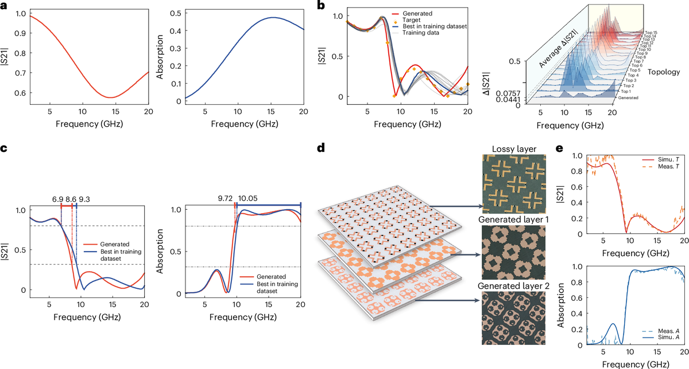

# MetaAI · 三层样品的透射与吸收双重验证

[原始 PNG](original.png) · [绘图数据 XLSX](source-data.xlsx) · [分类目录](../README.md#evidence)

*Nature Machine Intelligence* **8**, 59–69 (2026) · Fig. 5a–e

## 读图

先看 d，从上至下沿三根引线把每个设计层和对应的样品照片配对。接着看 e：上图对照模拟与实测透射，下图对照模拟与实测吸收。若想解释性能来自哪里，a 给出损耗层自身的响应，c 比较生成设计和训练集最佳设计的两种指标，b 右侧则按拓扑排列逐频透射误差。

**绘图数据**　源数据有 5 张工作表，保留作者原表名。Fig.5_b_2 可用于查看候选拓扑的逐频误差。

**同篇图版**　[Fig. 1 设计总览](../../teaser/metaai-current-diffusion-design-overview/README.md) · [Fig. 2 网络结构](../../architecture/metaai-spatial-frequency-transformer/README.md) · [Fig. 3 单层设计](../metaai-single-layer-current-and-spectrum/README.md) · [Fig. 4 可调器件](../metaai-tunable-metasurface-prototype/README.md)

## 出处

Current-diffusion model for metasurface structure discoveries with spatial-frequency dynamics。Erji Li、Yusong Wang 等。2025 年 12 月 31 日在线发表，收入 2026 年卷。

期刊原图为 2165 × 1161 像素的 PNG。期刊标明作者版权并独家授权 Springer Nature Limited。图版作为论文参考留存，发表时复用或改编请查阅期刊的权限说明。

[论文](https://www.nature.com/articles/s42256-025-01162-z) · [期刊原图](https://media.springernature.com/full/springer-static/image/art%3A10.1038%2Fs42256-025-01162-z/MediaObjects/42256_2025_1162_Fig5_HTML.png) · [数据出处](https://static-content.springer.com/esm/art%3A10.1038%2Fs42256-025-01162-z/MediaObjects/42256_2025_1162_MOESM6_ESM.xlsx) · [版权说明](https://www.nature.com/articles/s42256-025-01162-z#rightslink)
