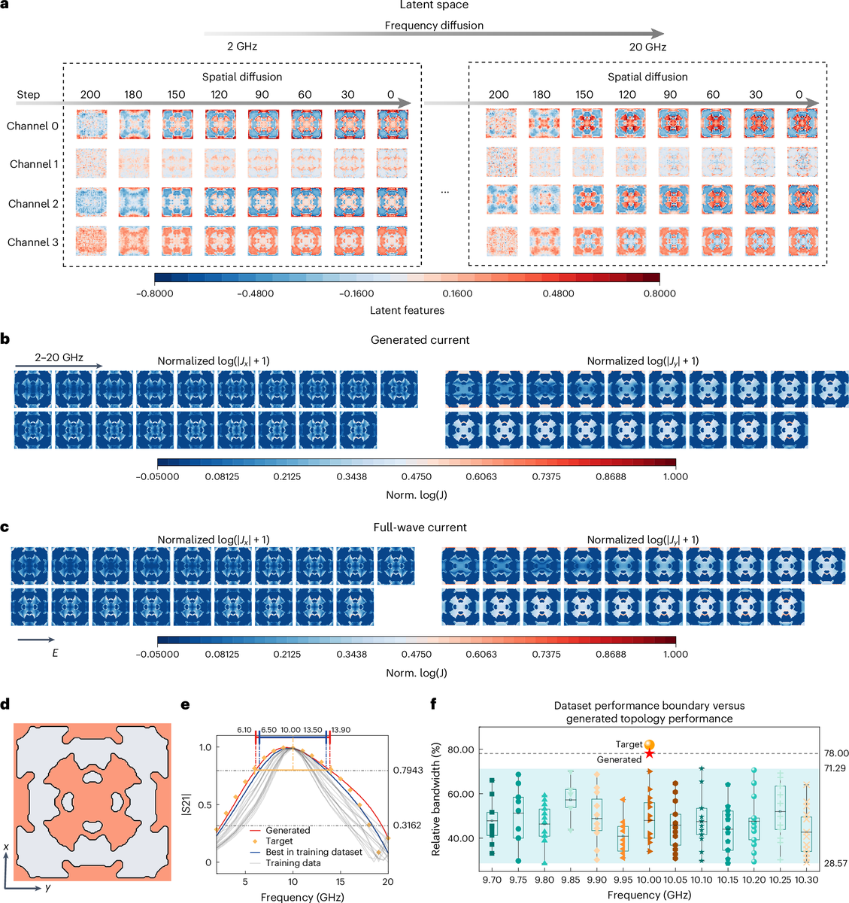

# MetaAI · 从单层拓扑核对生成电流与全波仿真

[原始 PNG](original.png) · [绘图数据 XLSX](source-data.xlsx) · [分类目录](../README.md#linked-data)

*Nature Machine Intelligence* **8**, 59–69 (2026) · Fig. 3a–f

## 读图

先在 b 的 Jₓ 区域选左上第一格，再在 c 找同一位置：二者都是 2 GHz 的 x 向电流，分别来自生成模型和对 d 中拓扑的全波仿真。想看这个结构怎么得到，可以回到 a，沿同一通道从扩散步 200 读到 0，再看 b 的多频电流如何用于投票确定 d。e 比较透射谱，f 将生成设计的相对带宽放到分频率统计的训练集分布上。

**绘图数据**　143 张表。a 有 64 张潜变量矩阵，b、c 各有 38 张电流矩阵（19 个频点 × 2 个分量）。其余三张给出 d 的拓扑、e 的透射曲线和 f 的带宽数据。

**同篇图版**　[Fig. 1 设计总览](../../teaser/metaai-current-diffusion-design-overview/README.md) · [Fig. 2 网络结构](../../architecture/metaai-spatial-frequency-transformer/README.md) · [Fig. 4 可调器件](../metaai-tunable-metasurface-prototype/README.md) · [Fig. 5 多层器件](../metaai-multilayer-transmission-absorption/README.md)

## 出处

Current-diffusion model for metasurface structure discoveries with spatial-frequency dynamics。Erji Li、Yusong Wang 等。2025 年 12 月 31 日在线发表，收入 2026 年卷。

期刊原图为 2162 × 2298 像素的 PNG。期刊标明作者版权并独家授权 Springer Nature Limited。图版作为论文参考留存，发表时复用或改编请查阅期刊的权限说明。

[论文](https://www.nature.com/articles/s42256-025-01162-z) · [期刊原图](https://media.springernature.com/full/springer-static/image/art%3A10.1038%2Fs42256-025-01162-z/MediaObjects/42256_2025_1162_Fig3_HTML.png) · [数据出处](https://static-content.springer.com/esm/art%3A10.1038%2Fs42256-025-01162-z/MediaObjects/42256_2025_1162_MOESM4_ESM.xlsx) · [版权说明](https://www.nature.com/articles/s42256-025-01162-z#rightslink)
