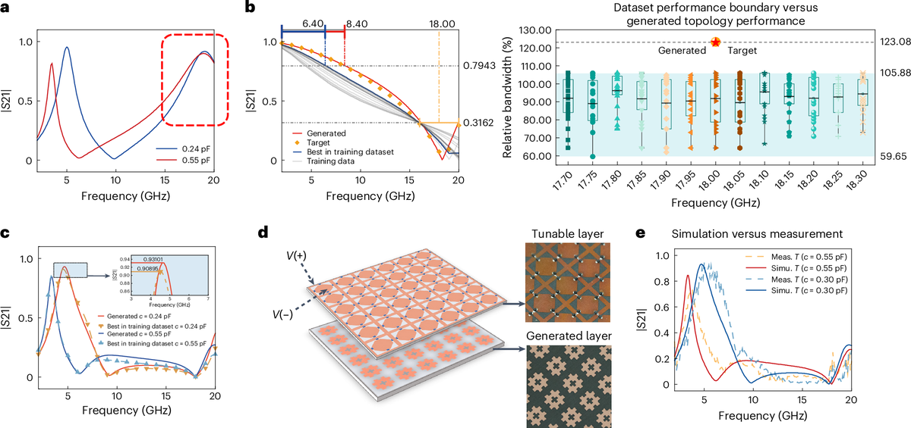

# MetaAI · 可调器件的两层结构、样品与透射测量

[原始 PNG](original.png) · [绘图数据 XLSX](source-data.xlsx) · [分类目录](../README.md#apparatus)

*Nature Machine Intelligence* **8**, 59–69 (2026) · Fig. 4a–e

## 读图

从 d 的上层沿引线找到可调层实物，再从下层找到生成层实物。a 单看可调层，b 交代生成层的目标、预测与训练样本，c 展示两层组合后的透射响应。最后看 e，按图例将同一电容的模拟与实测曲线配成一对。a、c 标注 0.24 和 0.55 pF，e 标注 0.30 和 0.55 pF，后两组比较应以各自面板的图例为准。

**绘图数据**　5 张表。Fig4_c 保存两种设计电容的曲线，Fig4_e 的表头明确列出 0.30、0.55 pF 各自的模拟与实测透射。

**同篇图版**　[Fig. 1 设计总览](../../teaser/metaai-current-diffusion-design-overview/README.md) · [Fig. 2 网络结构](../../architecture/metaai-spatial-frequency-transformer/README.md) · [Fig. 3 单层设计](../metaai-single-layer-current-and-spectrum/README.md) · [Fig. 5 多层器件](../metaai-multilayer-transmission-absorption/README.md)

## 出处

Current-diffusion model for metasurface structure discoveries with spatial-frequency dynamics。Erji Li、Yusong Wang 等。2025 年 12 月 31 日在线发表，收入 2026 年卷。

期刊原图为 2166 × 1019 像素的 PNG。期刊标明作者版权并独家授权 Springer Nature Limited。图版作为论文参考留存，发表时复用或改编请查阅期刊的权限说明。

[论文](https://www.nature.com/articles/s42256-025-01162-z) · [期刊原图](https://media.springernature.com/full/springer-static/image/art%3A10.1038%2Fs42256-025-01162-z/MediaObjects/42256_2025_1162_Fig4_HTML.png) · [数据出处](https://static-content.springer.com/esm/art%3A10.1038%2Fs42256-025-01162-z/MediaObjects/42256_2025_1162_MOESM5_ESM.xlsx) · [版权说明](https://www.nature.com/articles/s42256-025-01162-z#rightslink)
