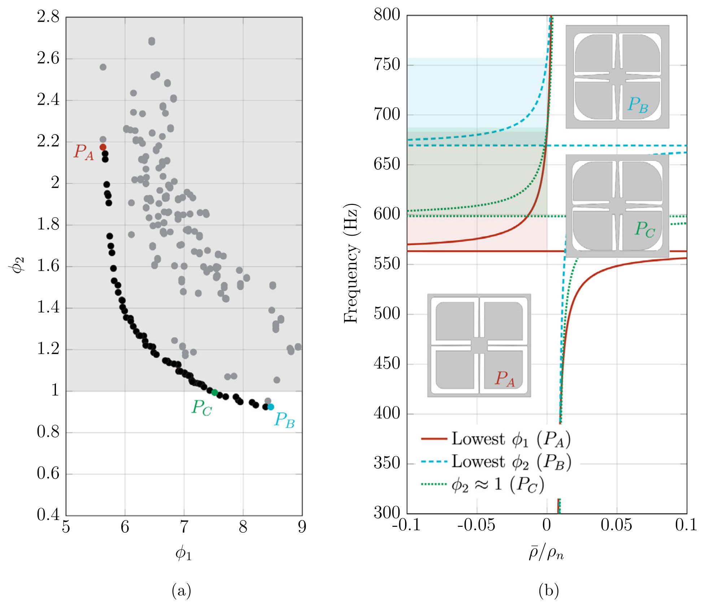

# 声学超材料 · 同一编号串起前沿点、单胞几何与带隙

[大图目录](../README.md) · [从模型选择读到输出](../README.md#model-to-output) · [单页 PDF](figure.pdf) · [来源记录](metadata.json)

**Structures 2025 · Fig. 10 · a、b（b 含三组单胞与频响）**

## 沿一个模型读图

a 的 P_C → b 绿色 P_C 单胞 → 绿色点线表示的有效质量密度频响 → 同色阴影标出的带隙。几何配置、计算响应和目标点同图。作者在随后的表 2 给出 P_C 的带隙中心 643 Hz、宽度 88 Hz。本图展示数值求解结果。

先在 a 的黑色帕累托前沿找到绿色 P_C，第二个目标约为 1。到 b 找同编号的单胞插图，再沿绿色点线读这个结构的归一化有效质量密度随频率的变化。这里的频率在纵轴上，所以带隙的上下限要沿纵向读。红色 P_A 和蓝色 P_B 分别对应两个目标的极端设计，同法可以比较各自的结构、响应和带隙。

## 出处与文件

*A multi-objective design optimization strategy for acoustic/elastic metamaterials under impact loading*。Ana Carolina Azevedo Vasconcelos, Dingena Schott, Jovana Jovanova。

期刊正式版的单页 PDF 摘图。轴标、刻度字形和面板字母为矢量轮廓；前沿上的点、单胞几何与三条频响曲线均位于同一幅内嵌位图中。

CC BY 4.0。

[原图出处](https://repository.tudelft.nl/file/File_ba7af526-6b0e-4632-b2bc-3e6e0f026808?preview=1#page=10) · [来源 PDF](https://repository.tudelft.nl/file/File_ba7af526-6b0e-4632-b2bc-3e6e0f026808?preview=1) · [许可说明](https://creativecommons.org/licenses/by/4.0/)
