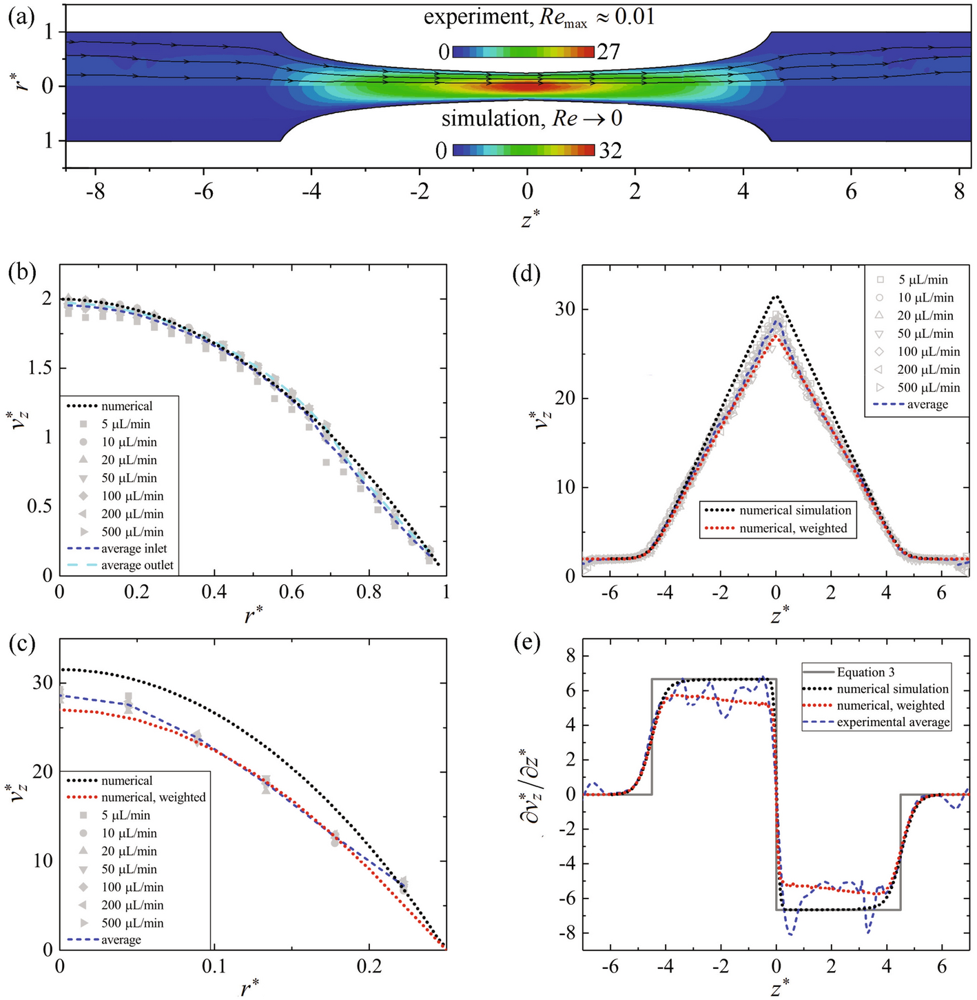

# 收缩微通道 · 从二维速度场取剖面和导数

[大图目录](../README.md) · [共用数据与坐标](../README.md#linked-data) · [出版社原图](original.png) · [来源记录](metadata.json)

**Experiments in Fluids 2020 · Fig. 8 · a–e**

## 怎样读这张图

a 上半是实验、下半是模拟，各有单独的色标。b、c 比较入口或出口及喉部的径向速度剖面，d 沿中心轴画速度随位置的变化，e 给出轴向伸长应变率。从 d 峰顶附近往下看，e 在这里由正转负。

## 出处与原件

*Viscous flow through microfabricated axisymmetric contraction/expansion geometries*。Francisco Pimenta, Kazumi Toda-Peters, Amy Q. Shen, Manuel A. Alves, Simon J. Haward。

1860 × 1902 像素的出版社 PNG。出版 PDF 中整幅图亦为一张位图。

CC BY 4.0，第三方材料以各自的署名说明为准。[论文图版](https://link.springer.com/article/10.1007/s00348-020-03036-z/figures/8) · [原始图像](https://media.springernature.com/full/springer-static/image/art%3A10.1007%2Fs00348-020-03036-z/MediaObjects/348_2020_3036_Fig8_HTML.png) · [许可条款](https://creativecommons.org/licenses/by/4.0/) · [版权说明](https://link.springer.com/article/10.1007/s00348-020-03036-z#rightslink)
