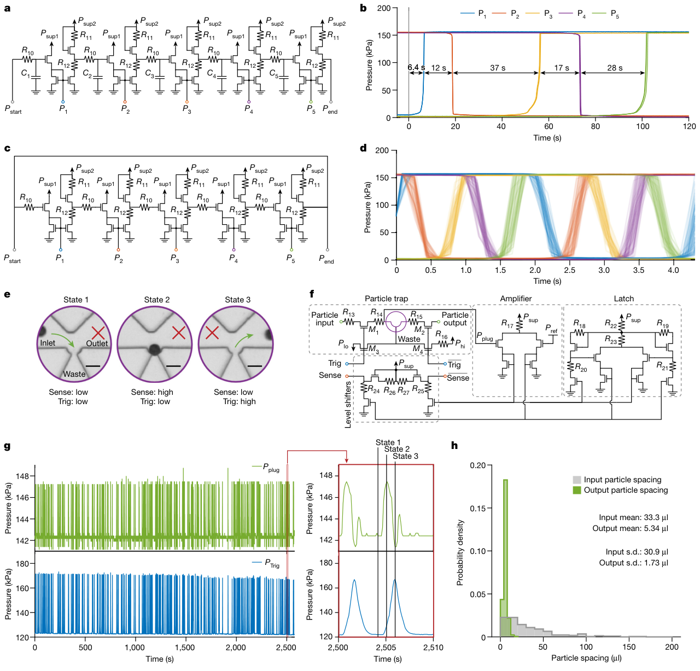

# 微流控晶体管如何定时、分送单颗粒

[大图目录](../README.md) · [混合矢量 PDF · 下载单页图版](figure.pdf) · [来源记录](metadata.json)

**Nature 2023 · Fig. 3 · a–h（8 个标记面板）**

## 这张图怎么读

a、b 的延时器依次开启通路，c、d 以环形振荡器产生重复波形。e、f 让读者看清颗粒停在哪里、谁触发释放，再用 g 的压力尖峰和 h 的进出间距分布检验排序效果。

**版式**　上方两行各用左电路图、右压力曲线。第三行把颗粒阱的三个状态放在左侧，右侧展开整个分配器。末行从一次分配的时序走到粒子间距统计。

## 出处与文件

*A microfluidic transistor for automatic control of liquids*。Kaustav A Gopinathan, Avanish Mishra, Baris R Mutlu, Jon F Edd, Mehmet Toner。

PDF 同时保留矢量路径与嵌入位图。照片、显微图像或热图等位图部分保留原分辨率。部分文字可以选取。 从论文 PDF 提取完整图版，另存为单页 PDF，并等比生成预览。面板沿用原文顺序。

CC BY 4.0。 © The Author(s) 2023

[原图出处](https://www.nature.com/articles/s41586-023-06517-3/figures/3) · [发布方图像或全文](https://www.nature.com/articles/s41586-023-06517-3.pdf) · [许可条款](https://creativecommons.org/licenses/by/4.0/)
