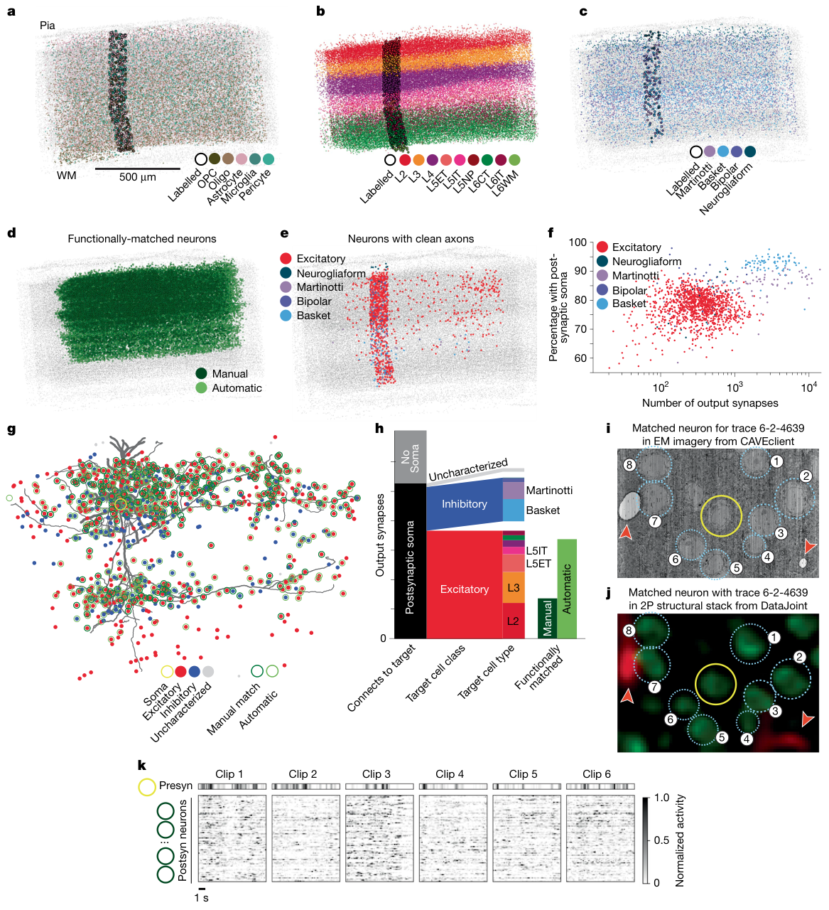

# 从单个锥体细胞追到突触靶点和功能响应

[大图目录](../README.md) · [混合矢量 PDF · 下载单页图版](figure.pdf) · [来源记录](metadata.json)

**Nature 2025 · Fig. 6 · a–k（11 个标记面板）**

## 这张图怎么读

a–e 在同一组织体积分别标出细胞类别、功能配准与校对状态，f 比较校对细胞的输出突触与可归属靶点。g 选出一个锥体细胞，h 汇总它的突触去向，i、j 利用相同细胞及血管标志比对两种成像，k 将它与突触后靶细胞对同一影片片段的反应并排。

**版式**　顶端两行沿同一组织方向重复细胞分布图。中段左侧展开单细胞及靶点，中央汇总连接去向，右侧竖排电镜与双光子图。底部热图回到视觉刺激。

## 出处与文件

*Functional connectomics spanning multiple areas of mouse visual cortex*。The MICrONS Consortium。

PDF 同时保留矢量路径与嵌入位图。照片、显微图像或热图等位图部分保留原分辨率。部分文字可以选取。 从论文 PDF 提取完整图版，另存为单页 PDF，并等比生成预览。面板沿用原文顺序。

CC BY 4.0。已核对论文的版权与许可声明。

[原图出处](https://www.nature.com/articles/s41586-025-08790-w/figures/6) · [发布方图像或全文](https://pmc-oa-opendata.s3.amazonaws.com/PMC11981939.1/PMC11981939.1.pdf) · [许可条款](https://creativecommons.org/licenses/by/4.0/)
