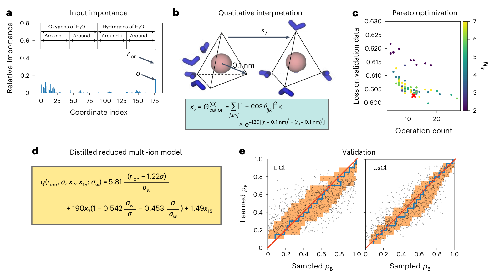

# 离子配对 · 从前沿红叉追到解析式与采样验证

[大图目录](../README.md) · [从模型选择读到输出](../README.md#model-to-output) · [单页 PDF](figure.pdf) · [来源记录](metadata.json)

**Nature Computational Science 2023 · Fig. 2 · a–e**

## 沿一个模型读图

c 红叉 → d 黄框函数（四个输入量）→ b 对 x₇ 的定义 → e 中同一函数对 LiCl 与 CsCl 的预测与采样对照。

先在 c 的运算次数–验证损失图找到红叉，再到 d 的黄框读所选模型。它使用离子距离、离子尺寸以及 x₇、x₁₅ 两个水分子几何量。想知道 x₇ 实际量了什么，可以回看 b 的几何示意及青色框内的计算式。用 d 的反应坐标 q 换算概率 p_B 后，e 用左右两幅图分别比较 LiCl、CsCl 的模型预测和独立分子动力学采样值；红色对角线表示两者相等。

## 出处与文件

*Machine-guided path sampling to discover mechanisms of molecular self-organization*。Hendrik Jung, Roberto Covino, A. Arjun, Christian Leitold, Christoph Dellago, Peter G. Bolhuis, Gerhard Hummer。

从期刊 PDF 第 3 页裁出完整 a–e。坐标、散点、前沿上的红叉与多数文字保留矢量对象；水分子示意含嵌入位图。

CC BY 4.0。

[原图出处](https://www.nature.com/articles/s43588-023-00428-z/figures/2) · [来源 PDF](https://pmc-oa-opendata.s3.amazonaws.com/PMC10766509.1/PMC10766509.1.pdf) · [许可说明](https://creativecommons.org/licenses/by/4.0/) · [图版原始数据](https://pmc-oa-opendata.s3.amazonaws.com/PMC10766509.1/43588_2023_428_MOESM4_ESM.zip)
