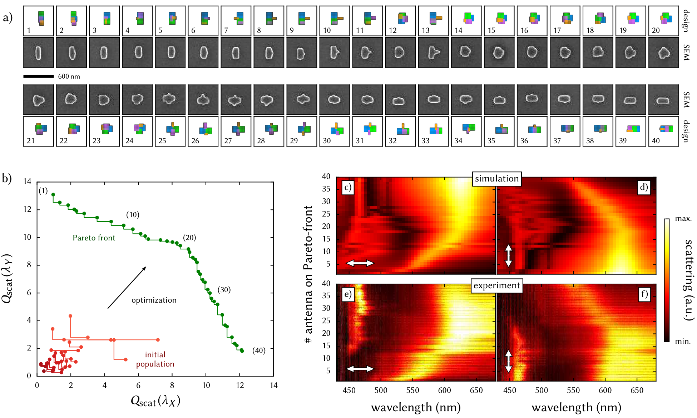

# 硅纳米天线 · 从前沿上的编号追到几何、模拟谱与实测谱

[大图目录](../README.md) · [从模型选择读到输出](../README.md#model-to-output) · [作者独立 PDF](original.pdf) · [来源记录](metadata.json)

**Nature Nanotechnology 2017 · Fig. 3 · a–f**

## 沿一个模型读图

b 的 (1) → a 同编号设计和 SEM → c/d 编号 1 的 X/Y 偏振计算散射谱 → e/f 的同一器件实测散射谱。谱线以热图行呈现，前沿用 630 nm 的计算散射效率构建，实测谱使用任意单位。原图给出光谱响应，不含显式解析函数。

在 b 的绿色前沿找到左上端的 (1)，此处 Y 偏振下的目标散射效率较高。回到 a 的 1 号格，彩色图标给出子块排布，正下方是制成器件的 SEM 图。再沿 c–f 接近底边的第 1 行横向读波长，左列是 X 偏振，右列是 Y 偏振，上排为模拟，下排为实验。在 630 nm 附近，比较 d 与 f 就能检查前沿点对应的 Y 偏振目标在实物上的表现。编号也允许对前沿中间的 (20) 重复这一路径。

## 出处与文件

*Evolutionary multi-objective optimization of colour pixels based on dielectric nanoantennas*。Peter R. Wiecha, Arnaud Arbouet, Christian Girard, Aurélie Lecestre, Guilhem Larrieu, Vincent Paillard。

作者 TeX 源包直接收录的完整独立 PDF。前沿和轴标保留矢量，SEM 显微照片等保留为位图。

arXiv 非独占传播许可；未核实图版的独立开放复用许可。

[原图出处](https://www.nature.com/articles/nnano.2016.224/figures/3) · [作者源包](https://arxiv.org/src/1609.06709v2) · [许可说明](https://arxiv.org/abs/1609.06709v2)
