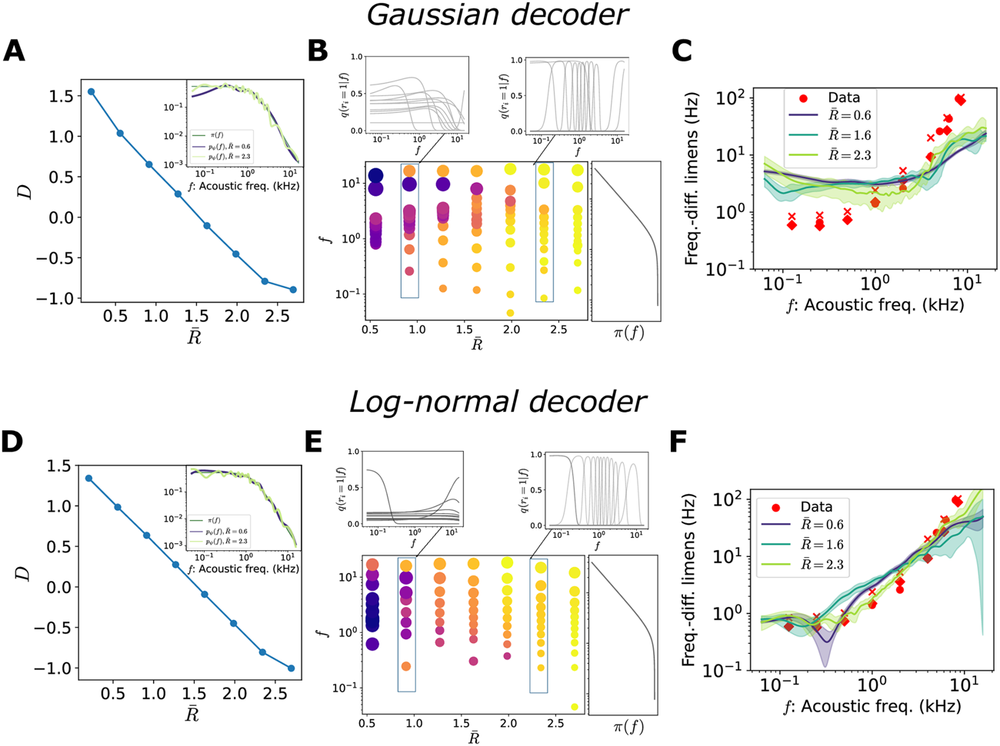

# 听觉编码 · 从一个编码率读到调谐函数和频率辨别阈

[大图目录](../README.md) · [从模型选择读到输出](../README.md#model-to-output) · [原始 TIF](original.tif) · [来源记录](metadata.json)

**PLOS Computational Biology 2024 · Fig. 9 · A–F，上排高斯解码器，下排对数正态解码器**

## 沿一个模型读图

D 的 R̄≈2.3 工作点 → 下排对数正态解码器、12 个神经元 → E 右侧框选列上方的 q(rᵢ=1 | f) 调谐曲线 → F 的 R̄=2.3 浅绿预测线与红色实测点。蓝线来自一组约束优化的数值解，表示该模型的率–失真权衡。

沿下排读对数正态解码器。D 在横轴目标编码率约 2.3 处给出失真，插图也用浅绿标出该设置。E 在同一编码率处用细框挑出一列神经元，沿引线向上看各神经元随频率变化的响应概率。F 按图例找浅绿曲线，与三位受试者的红色实测点比较。模型曲线来自刺激估计的均方根误差，作者拟合一个比例系数，将其换算为频率辨别阈。

## 出处与文件

*Jointly efficient encoding and decoding in neural populations*。Simone Blanco Malerba, Aurora Micheli, Michael Woodford, Rava Azeredo da Silveira。

期刊提供的独立 TIFF 原图（2050 × 1531）。正式论文第 21 页内嵌此图也是位图。预览 PNG 由原件缩小；坐标、文字与曲线均为像素。作者代码库列出了图 9 的复现 notebook 与数据文件。

CC BY 4.0。

[论文](https://journals.plos.org/ploscompbiol/article?id=10.1371/journal.pcbi.1012240) · [原图出处](https://doi.org/10.1371/journal.pcbi.1012240.g009) · [原文件](https://journals.plos.org/ploscompbiol/article/figure/image?size=original&id=10.1371/journal.pcbi.1012240.g009) · [许可说明](https://creativecommons.org/licenses/by/4.0/) · [作者复现代码](https://github.com/simonebmalerba/neural_VAE)
